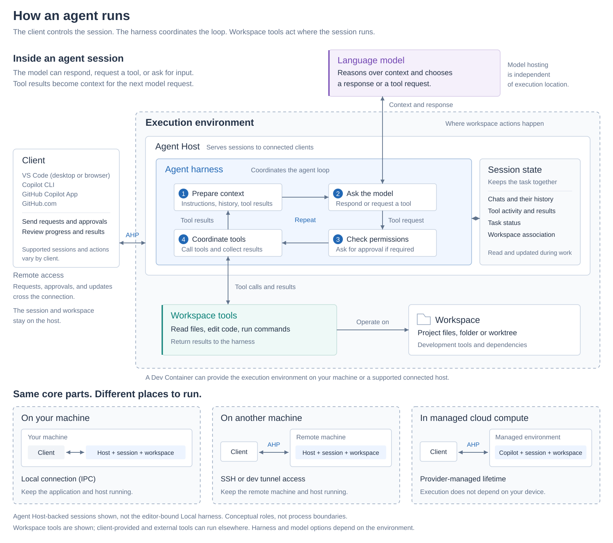

# Understand AI agents

An agent is an AI system that uses a language model and [tools](/docs/agents/concepts/tools.md) to complete a goal on your behalf. A language model generates responses based on the information in a prompt. An agent goes further by gathering context, taking actions in your development environment, evaluating the results, and repeating these steps as needed.

You choose the goal, control which actions require approval, and review the resulting changes. This article explains how the agent loop works and introduces the sessions, planning, subagents, memory, and customizations that support agentic work.

For an overview of AI workflows in  and where to work with agents, see [Build with AI in ](/docs/agents/overview.md).

Complete a short quickstart to create and validate an app with an agent in .

* [Start the agents quickstart](/docs/agents/quickstart.md)

## Start with the essentials

You don't need to configure every agent option before your first task. Read this article to understand the agent loop, then explore these concepts in order:

1. [Language models](/docs/agents/concepts/language-models.md): what a model can do, its limitations, and how tokens and context limits affect your work.
1. [Context](/docs/agents/concepts/context.md): what information the agent uses and what it remembers across conversations.
1. [Tools](/docs/agents/concepts/tools.md): how an agent reads code, makes changes, and checks results.
1. [Sessions and chats](/docs/agents/concepts/sessions.md): how to organize conversations and keep code changes separate.
1. [Trust and safety](/docs/agents/concepts/trust-and-safety.md): how to control actions, review results, and understand data handling.

When you need to adapt the experience, learn about [agent harnesses](/docs/agents/concepts/agent-harnesses.md) and [customization](/docs/agents/concepts/customization.md). These are deeper choices, not prerequisites for the [agents quickstart](/docs/agents/quickstart.md).

## How the concepts fit together

The core concepts work together each time you send a request:

1. **Request:** You describe a goal and provide any requirements or constraints.
1. **Context and reasoning:**  assembles relevant [context](/docs/agents/concepts/context.md), such as files and conversation history. A [language model](/docs/agents/concepts/language-models.md) reasons over that information and determines the next action.
1. **Tool action:** The agent uses [tools](/docs/agents/concepts/tools.md) to gather more information or act on your environment, such as reading a file, editing code, or running a command.
1. **Validation:** The result of the tool call returns to the model as context. The agent evaluates its progress and decides whether to take another action.
1. **Review:** When the task is complete, you review the response, code changes, and validation results.

The repeated reasoning, action, and validation steps form the **agent loop**. A [session](/docs/agents/concepts/sessions.md) keeps the conversation and task state together. An [agent harness](/docs/agents/concepts/agent-harnesses.md) coordinates the loop, while the execution environment determines where tools run and code changes are made.

## Agent loop

The agent loop enables an agent to work through a task instead of producing a single response. At each step, the agent evaluates its progress and chooses the next action. The output of that action informs the next decision.

For example, when you ask an agent to add validation to a form, the loop typically includes these stages:

1. **Understand:** The agent finds the form, reads related code and tests, and identifies the project's existing validation patterns.
1. **Act:** The agent updates the form and adds or modifies tests.
1. **Validate:** The agent runs the relevant tests and checks for errors. If validation fails, it diagnoses the result, makes another change, and validates again.

Simple questions might require only a few file reads. Larger implementation tasks might repeat the loop many times as the agent edits code, runs tests, and fixes problems.

## Choose what the agent should do

An agent doesn't need to change code to be useful. Start by deciding what outcome you want:

| Intent | Example request | What to review |
|--------|-----------------|----------------|
| **Understand** | 'Explain how this form validates an email address.' | The explanation and the source code it references. |
| **Plan** | 'Propose how to add server-side validation. Identify decisions before implementation.' | The approach, assumptions, and verification steps before approving implementation. |
| **Implement** | 'Add server-side validation and tests for invalid email addresses.' | The code changes, test results, and behavior of the app. |

Supported harnesses offer built-in agents such as **Ask**, **Plan**, and **Agent** for these intentions. See [choose a built-in agent](/docs/agents/run/agent-harnesses.md#choose-a-built-in-agent) and [plan work with agents](/docs/agents/run/planning.md) for the available workflows.

Describe your goal, constraints, and how to verify success. A request to 'explain without making changes' guides the model, but doesn't change its available tools or permissions. Use the appropriate agent and [permission controls](/docs/agents/concepts/trust-and-safety.md) when you need to restrict actions.

## Stay in control

An agent can take actions, but you remain responsible for directing the task and deciding which changes to keep. During a session, you can:

* Choose which tools are available and which tool calls require approval.
* Review an approval request before an action runs.
* Send another message to add context or redirect the work.
* Stop the agent if it is taking the wrong approach.
* Review changed files and validation results before you keep the changes.

Learn more about [trust and safety controls](/docs/agents/concepts/trust-and-safety.md).

## Sessions

A session is the unit of work with an agent. It brings together the workspace, code changes, and execution state for a task. Depending on the harness, a session can contain multiple chats, each with its own conversation history.

Sessions can run in parallel. Both the [](/docs/agents/run/chat-view.md) and the [](/docs/agents/run/agents-window.md) support agents, but the harness determines whether you can continue the same session in both interfaces. For example, Local harness sessions are editor-only. Sessions can use the same folder or separate worktrees, so separate conversations don't necessarily isolate code changes. Learn about [session compatibility, execution environments, and handoff](/docs/agents/concepts/sessions.md).

## Agent harnesses and execution environments

An agent harness is the runtime that coordinates the agent loop. It manages the session and connects the language model to tools. Different harnesses offer different tools and workflows, even when they use the same model. See [choose an agent harness](/docs/agents/run/agent-harnesses.md) for available options and organization restrictions.

Where you interact with an agent and where its work happens are separate:

* **Client**: the interface where you send requests, approve actions, and review results, such as the editor, , or a supported browser interface. The client can be on the same machine as the workspace or connect from another device.
* **Execution environment**: where workspace tools run and code changes are made. It can be on your machine, a connected host, inside a Dev Container, or in cloud infrastructure, depending on harness support.
* **Model hosting**: where the language model processes requests. This is independent of the client and execution environment. An agent can edit local files while sending model requests to a hosted provider.

For example, you can use a browser on your laptop to control a supported session on a remote development machine. The browser displays the session, while workspace files and commands stay on the remote machine.

The diagram shows how these parts connect in Agent Host-backed sessions, with local, remote, and managed cloud examples.

Learn more about [agent harnesses and execution environments](/docs/agents/concepts/agent-harnesses.md#relate-execution-environments-and-code-isolation).

## Capabilities that extend agent work

Agents can use additional capabilities for complex tasks and recurring workflows. These capabilities are not required for every request.

### Planning

Every agent decides which action to take next as part of the agent loop. For a complex task, use the built-in Plan agent to research the codebase, clarify requirements, and propose an implementation plan before code changes begin.

The planning workflow separates research and review from implementation. After you approve the approach, continue with implementation using the controls available for your harness. Learn more about [planning with agents](/docs/agents/run/planning.md).

### Subagents

For complex tasks, the main agent can delegate focused work to subagents. A subagent performs a specific task, such as researching a topic or analyzing part of a codebase, and reports the result to the main agent.

Subagents are useful when independent research would add large amounts of intermediate information to the main agent's [context window](/docs/agents/concepts/language-models.md#context-window).

Key characteristics of subagents:

* **Context isolation**: each subagent works in its own context. The harness determines which instructions and conversation history it receives. In the Local harness, subagents receive the delegated task and applicable instructions, not the main conversation history.
* **Parallel execution**: independent subtasks can run in parallel when the harness supports concurrent subagents, such as separate correctness and performance reviews.
* **Focused results**: the main agent uses the subagent's result without adding all of its intermediate work to the main context.

Subagents make their own model requests, so a smaller main context doesn't necessarily mean lower total token usage or [cost](/docs/agents/concepts/language-models.md#ai-credits-and-model-costs).

You don't need to create a custom agent to use subagents. A [custom agent](/docs/agent-customization/custom-agents.md) defines reusable instructions, tools, and model preferences that a subagent can use.

For example, the [Plan agent](#planning) can use subagents to research independent parts of a task before creating a plan.

Learn more about [using subagents](/docs/agents/run/subagents.md).

### Memory

Memory retains selected preferences and codebase knowledge separately from conversation history. It can help an agent reuse a project fact in another conversation without you repeating it. It is not a complete record of everything you discussed, and a saved fact still needs to be retrieved to inform a response.

The harness determines how memory is stored, shared, and retrieved. Compare [context, instructions, and memory](/docs/agents/concepts/context.md#context-knowledge-and-memory), then learn how to [use and manage agent memory](/docs/agents/run/memory.md).

### Customization

You can customize the agent loop for a project or workflow:

* A [**custom agent**](/docs/agent-customization/custom-agents.md) defines instructions, available tools, a language model, and optional handoffs for a specific workflow.
* [**Agent skills**](/docs/agent-customization/agent-skills.md) give an agent instructions and resources for a specialized task.
* [**Hooks**](/docs/agent-customization/hooks.md) run commands at specific points in the agent's workflow, such as before or after a tool runs.

Learn more about [customization concepts](/docs/agents/concepts/customization.md).

## Related resources

* [Tools](/docs/agents/concepts/tools.md)
* [Agent harnesses and execution environments](/docs/agents/concepts/agent-harnesses.md)
* [Trust and safety](/docs/agents/concepts/trust-and-safety.md)
