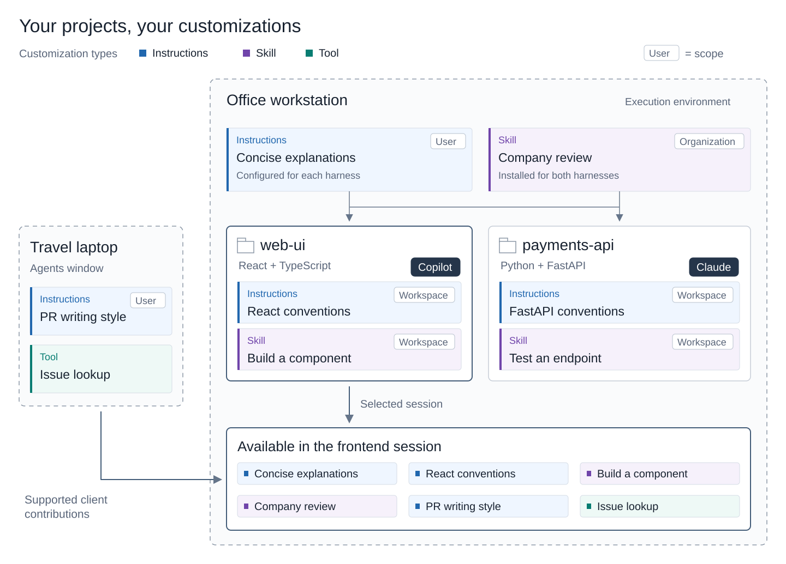

# Understand agent customization

AI models have broad knowledge, but that knowledge isn't a substitute for your project's current requirements or your organization's internal practices. Agent customization adapts an agent to your environment by adding persistent context, repeatable workflows, specialized roles, external tools, and deterministic controls.

Focused customizations reduce repeated prompting and corrective work, which can help reduce [AI credit usage](/docs/agents/guides/optimize-usage.md). Keep guidance relevant because loaded content also consumes space in the model's context window.

This article explains how customization types differ, when they apply, and what they can and can't control. Use it to choose the right building blocks for your workflow. To install, create, and verify a customization, see [Customize agents for your workflow](/docs/agent-customization/overview.md).

Follow a hands-on tutorial to discover the customization options and configure them for your project.

* [Customize AI for your project](/docs/agents/guides/customize-copilot-guide.md)

## Customization building blocks

Each customization type contributes something different to the agent's work:

| Type | What it contributes |
|------|---------------------|
| [Instructions](/docs/agent-customization/custom-instructions.md) | Standing guidance, such as coding conventions, supplied in files like `AGENTS.md`. Instructions can apply broadly or to particular files or tasks. |
| [Skills](/docs/agent-customization/agent-skills.md) | Task-specific workflows with instructions, scripts, and supporting resources. |
| [Custom agents](/docs/agent-customization/custom-agents.md) | Specialized roles with their own instructions and tool configuration. An agent can use skills as part of its work. |
| [Tools and integrations](/docs/agents/run/tools.md) | Capabilities to query systems or take actions. Connect external services through [MCP servers](/docs/agent-customization/mcp-servers.md) or managed [ connectors](/docs/agent-customization/copilot-connectors.md) `feature(copilot-connectors)`. |
| [Hooks](/docs/agent-customization/hooks.md) | Code that the harness runs at configured events, without relying on the model to request it. |
| [Plugins](/docs/agent-customization/agent-plugins.md) | Bundles of related customizations for installation and sharing. [Marketplaces](#marketplaces-and-reusable-customizations) help you discover them. |

Skills can come from project or personal files, marketplaces and plugins, extensions, or MCP servers `feature(mcp-skills)`. Their source doesn't change their role as task-specific guidance. See [Where skills come from](/docs/agent-customization/agent-skills.md#where-skills-come-from) for source and harness requirements.

For saved prompts that you invoke explicitly, [prompt files](/docs/agent-customization/prompt-files.md) are available in Local harness sessions only.

You don't need a customization for a one-time requirement. Add it to the current request instead. When a problem repeats, [choose the smallest useful customization](/docs/agent-customization/overview.md#choose-how-to-customize).

## How customizations combine

Multiple customizations can contribute to the same task. For example, when you ask the agent to add a checkout button:

* **Project instructions** specify which design-system components and TypeScript conventions to use.
* A **component-building skill** provides the workflow and templates for creating the component and its tests.
* A configured **post-edit hook** runs the project's formatter after file edits.

The instructions guide the implementation within the skill's workflow. The hook handles formatting without relying on the agent to remember that step.

Instructions, skills, and custom agents can all contain guidance. Keep shared project conventions in instructions, task-specific steps in skills, and role-specific guidance in custom agents. Avoid repeating the same rules across them, which makes updates harder and can introduce contradictions.

## Model-driven vs. deterministic behavior

**Model-driven behavior** depends on the model interpreting and following guidance. Even when guidance is loaded into context, the model can misunderstand, partially follow, or ignore it. Instructions are not enforcement.

**Deterministic behavior** is triggered or enforced by harness code, rather than relying on the model to comply. The distinction depends on which part of a customization you use:

| Customization | How behavior is controlled |
|---------------|----------------------------|
| **Instructions and skills** | Model-driven guidance. Loading instructions or invoking a skill doesn't guarantee that the model follows every rule, completes every step, or runs a bundled script. |
| **Custom agents** | Mixed. Role instructions are model-driven. Supported tool restrictions are applied by the harness, subject to [harness compatibility](/docs/agents/reference/custom-agent-file-reference.md#harness-compatibility). |
| **Tools and integrations** | Model-driven invocation. The model chooses whether to call a tool and supplies its arguments. If permitted, the tool executes its implementation. |
| **Hooks** | Deterministic triggering. The harness runs the hook when its configured event occurs and its execution conditions are met, without the model requesting it. |
| **Plugins** | Each bundled component keeps its own behavior. Packaging guidance in a plugin doesn't make it enforced. |

For example, an instruction to 'run the formatter after editing' can be ignored. A configured post-edit hook triggers the formatter without relying on the model to remember that instruction.

Deterministic triggering doesn't guarantee success or identical results. Hook execution still depends on discovery, enablement, trust, filters, timeouts, and error handling. Review actual tool and hook activity rather than relying only on the model's response.

Neither instructions nor hooks alone establish a security boundary.

## Customization scope

Customization scope describes where a customization is defined or installed and how it is shared. A session can combine personal preferences, project-specific guidance, and organization-wide workflows. Scope alone doesn't determine whether a customization reaches the session or is used for a particular request.

### Personal and shared customizations

The same customization type can exist at different scopes, depending on harness support:

* **User**: defined in a user's configuration and available across workspaces that use it.

* **Workspace or repository**: stored with the project and shared with contributors through source control.

* **Organization**: managed centrally and made available across repositories, where supported.

Applicable customizations are additive: personal, project, and organization guidance can apply together. They can also conflict, for example if they require different test frameworks. There is no universal override order across harnesses and customization types.

Repository customizations can be shared and versioned with the project. Personal customizations are stored separately from that project.

Company-shared plugins and file-based skills still need to be installed or placed in a supported location for the selected harness.

Through managed policies, an organization can enforce limits on tools, MCP servers, and approvals. Customizations can't override those limits. See [enterprise AI controls](/docs/enterprise/manage-ai-settings.md).

### Which customizations reach a session

The harness determines which customization types, formats, and locations it supports. The workspace supplies project customizations, while personal configuration can differ across harnesses and machines. A customization available in one session isn't necessarily available in another.

Start with the [Agent Customizations editor](/docs/agent-customization/overview.md#agent-customizations-editor) for the **selected session**. It shows discovered customizations, including disabled items. Switching sessions can change what appears. See [reuse customizations across harnesses](/docs/agent-customization/overview.md#reuse-customizations-across-harnesses) before adapting an existing setup.

For remote and multi-device workflows, the machine running the harness supplies its native configuration, and a connected client can contribute additional supported customizations. Reconnecting from another device doesn't replace the host's configuration, but client contributions can differ.

The diagram shows how user, workspace, organization-shared, and client-supplied customizations contribute to a session.

For setup, see [manage customizations for remote sessions](/docs/agent-customization/overview.md#manage-customizations-for-remote-sessions).

### When available customizations are used

Enablement controls whether a customization is turned on globally, for a workspace, for a harness, or for a session, where those choices are supported. It doesn't change where the customization is stored.

Even when enabled, a customization isn't necessarily used for every request. Always-on instructions are included in each request, while conditional instructions depend on matching files or tasks. A skill is loaded when invoked or selected, and a tool is called when needed.

Editing a shared definition can affect other sessions that read it, even when the edit starts from one session's customization editor. See [what a change affects](/docs/agent-customization/overview.md#understand-what-a-change-affects).

## Marketplaces and reusable customizations

You don't need to author every customization yourself. Marketplaces help you discover existing workflows and integrations from community publishers or your organization.

Plugin marketplaces are catalogs of plugins. Adding a marketplace makes its plugins available to browse. Installing a plugin makes its supported customizations available to your harness.

A marketplace is a discovery and distribution mechanism, not another customization type. Installed components keep their own activation rules. Review the publisher, included files, and setup requirements before installation, then test the result in your workflow.

The Agent Customizations editor provides a unified marketplace experience (Preview). Available sources depend on the harness and organization policy. See [discover and install existing customizations](/docs/agent-customization/overview.md#discover-and-install-existing-customizations-preview).

## Related resources

* [Customize agents for your workflow](/docs/agent-customization/overview.md)
* [Configure AI for your codebase](/docs/agents/guides/customize-copilot-guide.md)
