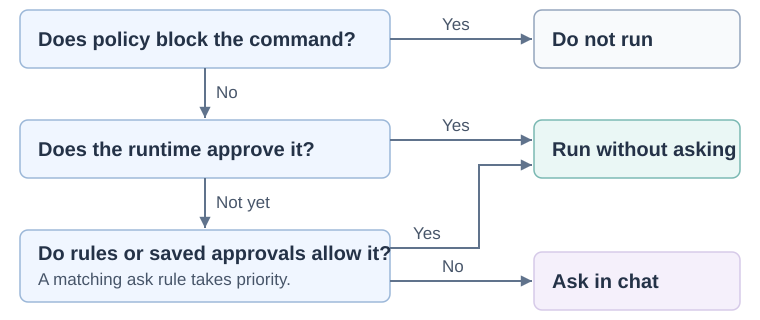

# Manage approvals and permissions

In , agent permissions control which actions an agent can take without asking you, such as editing files or running terminal commands. When a prompt appears, you can approve or decline the requested action. Depending on the harness, you can also save an approval for matching requests in the current session or across sessions.

## How approvals work

Approving a command lets it run but doesn't expand its access. Sandboxing limits which files and network destinations the command can access, even after you approve it.

The available controls depend on the [agent harness](/docs/agents/run/agent-harnesses.md) selected for your session, not the model. For example, a  session that uses a  model still follows  approval rules.

* [ approvals](#copilot-approvals): choose a permission level, configure terminal command rules, or withdraw a saved approval.
* [ permission modes](#claude-permission-modes): choose when to review edits and other tool calls.
* [ approval presets](#codex-approval-presets): choose what the agent can access and who reviews approval requests.
* [Local harness (deprecated)](#local-harness-deprecated): check compatibility differences for existing Local workflows.

Your organization can restrict which harnesses and permission levels are available. For example, when [ enterprise-managed settings apply](/docs/enterprise/manage-ai-settings.md#claude-and-codex-availability),  and  aren't available unless your administrator permits them.

<div class="docs-action" data-show-in-doc="false" data-show-in-sidebar="true" title="Trust and safety concepts">
Learn how approvals and sandboxing protect your development environment.

* [Read about trust and safety](/docs/agents/concepts/trust-and-safety.md)

</div>

##  approvals

A [tool approval](#tool-approval) gives  permission to take a specific action, such as running a terminal command. When  asks, you can approve or decline that action without changing the session's permission level.

The [permission level](#permission-levels) is a session-wide preset that determines when  asks for your approval. With **Manual permissions**, you review actions that aren't already approved. **Assisted permissions** uses a model to decide which actions need your review. **Allow all** skips ordinary tool confirmations. None of these levels overrides organization policy or expands sandbox access.

### Tool approval

When a prompt appears, check the tool name, its inputs, and the command, path, or destination it will act on. Choose **Allow Once** if only this call should run, or **Skip** to decline it. If the command or its target is wrong, don't approve it. Tell the agent what to change.


To approve similar calls without being asked each time, see [Scope approvals in Copilot sessions](#scope-approvals-in-copilot-sessions).

### Permission levels

In the chat input, open the permissions picker and choose how much review you want for the current  session.


| Permission level | When to choose it |
|---|---|
| **Manual permissions** (default) | You want to review actions that the runtime hasn't approved and that no rule or saved approval covers. Manual doesn't mean that every command prompts. |
| **Assisted permissions** | You want a model to assess proposed actions and ask you about those that need review. The reviewer can make mistakes. You can [give the reviewer instructions](#customize-assisted-permissions). |
| **Allow all** | You trust the workspace and want to skip ordinary tool confirmations, including for destructive actions. This doesn't override organization policy or grant access outside an enabled sandbox. |

To start new  sessions with a particular permission level, set `approvals` in `setting(chat.defaultConfiguration)`. For example, to start with **Assisted permissions**, add this to your settings:

```json
{
  "chat.defaultConfiguration": {
    "approvals": "assisted"
  }
}
```

You can change the level during a session. The session remembers your choice when you resume it. Your organization can [set a managed default or restrict which levels you can select](/docs/enterprise/manage-ai-settings.md#manage-permission-levels).

[Autopilot](#autopilot-mode) is a mode, not a fourth permission level. It tells the agent to keep working, not which actions you've approved.

### Scope approvals in Copilot sessions

A scoped approval lets you approve matching requests, such as fetches from the same host, without approving every use of the tool.

With **Manual permissions**, check **what** each option in the approval dropdown covers:

| Action | What you're approving |
|---|---|
| Terminal command | The exact command or a suggested prefix. For example, approving the prefix `npm run build` covers other arguments to that script, but not `npm run deploy`. |
| Web fetch | The displayed host. Approving `https://example.com` doesn't cover `http://example.com` or `https://sub.example.com`. |
| File read or edit | The selected file or, when offered, a folder. A folder approval covers the nearest parent Git repository, or the file's parent folder if there is no repository. Approval to read doesn't imply approval to edit. |

Then choose whether to approve this request once or save the approval for matching requests:

* **Allow Once** saves nothing. Choose it if you haven't decided whether similar calls should run automatically.
* **In this Session** applies when you continue or resume this session. A new session doesn't inherit the saved approval.
* **Always Allow** saves the approval for future sessions on the same Agent Host, including after a restart. Terminal approvals saved on a remote host stay there. You can't remove them from the local approval picker. Prefer one-time or session approval if you don't need it to persist.

These are tool approvals. A prompt to [grant sandbox path access](/docs/agents/run/agent-sandboxing.md#choose-the-scope-of-a-path-approval) asks a different question and has different scopes.

### Automatically approve terminal commands

A **terminal approval rule** matches a [shell command](/docs/agents/run/tools.md#run-terminal-commands) or command pattern and specifies whether to run it without asking or request your confirmation. In a  session with **Manual permissions**, not every command reaches these rules.

* **Runtime approval:** The runtime can approve a read-only or sandboxed command without checking terminal rules. A rule can't force a prompt for that command, and approval in chat can't override a policy block.
* **Terminal rules:** If the command still needs a decision, the Agent Host checks terminal rules and saved approvals together. An explicit ask rule wins over a matching allow rule or saved approval. If neither an explicit rule nor a saved approval matches, built-in rules allow some commands to run automatically and require confirmation for others.



If the command still needs confirmation, review it in chat. You might see only **Allow Once** and **Skip**, for example if an explicit rule calls for confirmation, rule-based approval is off, or the shell command can't be analyzed safely.

#### Configure terminal approval rules

For  sessions on your machine, add your rules to `setting(chat.tools.terminal.autoApprove)` in User settings, not Workspace settings. To view these settings, select the **User** tab in the [Settings editor](/docs/configure/settings.md#settings-editor). If you [connect to a remote agent session](/docs/agents/run/remote-agent-sessions.md#continue-an-existing-remote-session), your local terminal approval rules don't apply to that session.

Each entry pairs a command pattern with a decision: `true` lets a matching command run without asking, and `false` asks for confirmation rather than blocking it. For example:

```json
{
  "chat.tools.terminal.autoApprove": {
    "npm run lint": true,
    "npm run build": false
  }
}
```

When a command reaches the [rule check](#automatically-approve-terminal-commands), `npm run lint` can run without asking. `npm run build` prompts, even if you previously approved it for the session. Running `npm run lint && npm run build` also prompts because the build requires confirmation.

**Choose what to match.** Use a plain command prefix such as `"npm run lint"` to include calls with additional arguments. To match only `npm run lint` without arguments, use an anchored regular expression as the key: `"/^npm run lint$/"`.

By default, rules match each subcommand separately. To check the entire command line instead, use `matchCommandLine: true`. For example, this rule asks for confirmation when the command line contains the `--fix` flag:

```json
{
  "chat.tools.terminal.autoApprove": {
    "/--fix\\b/": { "approve": false, "matchCommandLine": true }
  }
}
```

**Change how rules are applied (optional).** You don't need to change these settings to add a rule:

* To stop using both command rules and saved command approvals, turn off `setting(chat.tools.terminal.enableAutoApprove)`. This also removes the option to save a new command approval at the prompt. It doesn't change your permission level or force a prompt for commands the runtime already approves, including sandboxed commands.
* To review the built-in rules, run **Preferences: Open Default Settings (JSON)** from the Command Palette and search for `chat.tools.terminal.autoApprove` in the read-only file. To ignore those defaults on the local Agent Host but keep your rules and saved approvals, leave rule-based approval on and turn on `setting(chat.tools.terminal.ignoreDefaultAutoApproveRules)` (Experimental).

Command matching is best effort. To restrict file or network access, use [sandboxing](#sandbox-agent-commands). For settings specific to the integrated terminal tool, see the [AI settings reference](/docs/agents/reference/ai-settings.md#approvals-and-permissions).

### Manage tool approvals

To review a terminal approval saved with **Always Allow** on your machine:

1. Focus a session on the local Agent Host. Run **Chat: Manage Tool Approval** from the Command Palette (`kb(workbench.action.showCommands)`).

1. Find the terminal command rule. Clear its checkbox to change it to an explicit ask, or select **Delete** to remove the rule from your User settings.

Deleting the rule withdraws that saved approval. The command might still run without asking because of another saved approval, a built-in default, or an earlier runtime decision. You can also edit `setting(chat.tools.terminal.autoApprove)` directly in User settings.

For an approval saved with **In this Session**, start a new session to work without it. The original session keeps the approval. If you chose **Always Allow** on a remote host, neither starting a new session on that host nor editing local User settings withdraws the approval.

The same command lists supported tool approvals for the active Agent Host, including approvals for an MCP server or its individual tools. In the client-managed tool picker, **without approval** lets a tool run without asking, while **without reviewing result** lets its result enter the chat context without review. Don't treat approving execution as trusting external content.

#### Reset tool confirmations

**Chat: Reset Tool Confirmations** clears client-managed tool confirmation preferences. It doesn't delete terminal rules from User settings, remove approvals saved on the Agent Host, or reset approvals on another host.

### URL approval

URL approval controls whether  can contact a website to retrieve information, such as API documentation. Approving the request doesn't mean you trust the content the site returns.

Review the destination in the web fetch prompt. In a session on your machine, **Always Allow Fetching** saves approval for requests to the displayed website in `setting(chat.tools.urls.autoApprove)`. Remote agent sessions keep their own saved approvals. See [scope approvals](#scope-approvals-in-copilot-sessions) to approve one fetch or limit approval to the current session instead.

### Sandbox agent commands

Sandboxing limits which files a terminal command can read or change and which network destinations it can reach. These limits apply on the machine where the command runs, including to programs the command starts.

Your permission level determines when  asks to run a command. Approving the command doesn't change its sandbox limits. For example, even with **Allow all**, a command can't write to a folder the sandbox marks read-only. With **Manual permissions**, a sandboxed command can run without a prompt and still face the same restriction.

If a command needs more file access, prefer [allowing access to the specific path](/docs/agents/run/agent-sandboxing.md#choose-the-scope-of-a-path-approval) when offered. The command retries inside the sandbox. **Allow Outside Sandbox** is a different approval: it lets the command run without the sandbox's file and network restrictions.

To turn sandboxing on or off for the current session, select **Sandboxing for terminal** in the permissions picker. Your organization can require sandboxing. See [agent sandboxing](/docs/agents/run/agent-sandboxing.md) for platform support and configuration.

### Advanced approval options

#### Customize Assisted permissions

With **Assisted permissions**, a model reviews proposed tool calls to decide whether they can run automatically or need your confirmation. Use `setting(chat.permissions.assisted.instructions)` to specify which actions it should ask you to approve and which it can approve automatically. For example, ask before installing packages or pushing changes, but approve test runs:

```json
{
  "chat.permissions.assisted.instructions": "Ask before installing packages or pushing to a remote. Running tests doesn't need my approval."
}
```

These instructions guide approval decisions, not the tasks the agent performs. Changes apply to open sessions using **Assisted permissions**. Your instructions take precedence over the reviewer's default guidance, but can't override permission rules, organization policy, or sandbox restrictions. They are model guidance, not guaranteed checks.

The reviewer also considers your answers to questions and plan reviews, including when you decline an action. It doesn't treat requests from automations or other agents as requests you made yourself.

#### Autopilot mode

In **Autopilot** mode,  continues working across turns without waiting for you to send another prompt, until it determines that your request is complete. Select **Autopilot** from the mode picker in the chat input.

Autopilot doesn't replace the session's [permission level](#permission-levels). With **Assisted permissions**, tool calls still undergo model-based review rather than receiving unrestricted approval. Sandbox restrictions also remain in effect. If an unattended Assisted permissions session needs a person to approve running outside the sandbox, that command can't proceed outside it.

By default, Autopilot relies on the agent to signal that the task is complete. Turn on the experimental `setting(chat.autopilot.advanced.enabled)` setting to have a separate model check progress against your original request after each turn. If it finds unfinished work, its feedback guides the agent's next turn.

#### Allow all tools globally

To skip ordinary tool confirmations across workspaces, turn on `setting(chat.tools.global.autoApprove)` in User settings. Unlike selecting **Allow all** for one session, this setting affects work in other workspaces too. Prefer the session's **Allow all** level when you only need automatic approval for one task.

> [!CAUTION]
> Global auto-approval lets agents edit files, run commands, and call external tools without asking. Prompt injection in files or tool results, or an agent mistake, can cause unintended changes or actions on external services. Organization policies and sandbox restrictions still apply, but they don't eliminate these risks. Review the [security implications](/docs/agents/run/security.md) before turning it on.

#### Tool auto-approval restrictions

Your organization can use a policy for `setting(chat.tools.eligibleForAutoApproval)` to mark specific tools as ineligible for automatic approval. In  sessions, this removes **Allow all** from the permissions picker for the entire session, not just for the listed tools.

This restriction doesn't require you to approve every call to those tools. **Assisted permissions** or saved approvals can still let them run automatically. The same policy behaves differently in the deprecated Local harness `feature(local-harness)`. See [tool approval policy by harness](/docs/enterprise/manage-ai-settings.md#limit-automatic-approval-for-specific-tools) for details.

##  permission modes

In a [ harness session](/docs/agents/run/agent-harnesses.md#claude), the permission mode controls when the agent asks before editing files or using other tools. These modes are specific to the  harness, rather than the  permission levels described above.

Open **Approvals** in the chat input to choose a mode. You can change it during the session as your task or review needs change.

| Mode | Approval behavior |
|---|---|
| **Ask Before Edits** (default) |  asks before editing files. |
| **Edit Automatically** | File edits proceed without confirmation.  asks before using other tools. |
| **Plan Mode** |  outlines the work before making changes. |
| **Auto Mode** |  decides which tool operations need your confirmation. |
| **Bypass Permissions** | File edits, terminal commands, and other tool calls run without asking. |

Choose **Edit Automatically** if you want to skip prompts for file edits but still review other tool actions. Choose **Auto Mode** if you want  to decide which actions need review. Auto Mode can still ask for confirmation, and its assessment can make mistakes.

> [!CAUTION]
> **Bypass Permissions** removes the opportunity to review tool calls before they run. An agent mistake or prompt injection can cause unintended file changes, command execution, or actions on external services. Use this mode only in an isolated environment where you understand these risks.

##  approval presets

In a  harness session, an approval preset determines both what the agent can access and who reviews requests for additional access. Changing the preset can therefore change the sandbox restrictions, not just whether you see approval prompts.

Use the permissions picker in the chat input to choose a preset. The following options apply to the experimental [direct  integration](/docs/agents/run/agent-harnesses.md#codex). If you installed the OpenAI  extension instead, use that extension's permission controls.

| Preset | What the agent can access | Who reviews requests |
|---|---|---|
| **Default Permissions** | Read and edit workspace files and run routine commands within the sandbox. | You review requests for additional access, such as using the network. |
| **Auto-Review** | The same workspace sandbox as **Default Permissions**. | An automatic reviewer assesses requests instead of prompting you. |
| **Full Access** | Disk and network access without the  sandbox restrictions. | No approval prompt. |

Keep **Default Permissions** to review requests for access beyond the sandbox yourself. Choose **Auto-Review** to delegate those decisions to an automatic reviewer while keeping the same initial sandbox restrictions. The reviewer can make mistakes; Auto-Review isn't a guarantee that every approved action is safe.

If you switch to or from **Full Access** while a turn is running, select **Apply Now** in the confirmation dialog to stop that turn and continue with the new preset. Otherwise, the change applies with your next message after the turn finishes.

> [!CAUTION]
> **Full Access** turns off the  sandbox and skips approval prompts. An agent mistake or prompt injection can cause unintended changes outside your workspace or actions on external services. Operating system permissions still apply, but they don't provide the same isolation as the sandbox.

## Local harness (deprecated)

The deprecated Local harness `feature(local-harness)` uses the editor's tool approval controls and integrated terminal. Its permission levels and saved approvals differ from  sessions. Use the guidance below for existing Local workflows. For new work, see [Move to ](/docs/agents/run/move-to-copilot.md).

### Local permission levels

In a Local session, open the permissions picker in the chat input:

| Permission level | What happens |
|---|---|
| **Default permissions** (default) | Uses your configured approval settings and asks when they don't approve an action. |
| **Allow all** | Automatically approves tool calls without asking. |
| **Autopilot (Preview)** | Automatically approves tool calls and continues working until the agent determines the task is complete. |

Unlike the  harness, Local treats **Autopilot** as a permission level, not a separate mode. **Assisted permissions** isn't available. Use `setting(chat.permissions.default)` to set the starting level for new Local chats, rather than `setting(chat.defaultConfiguration)`.

> [!CAUTION]
> **Allow all** and **Autopilot** skip ordinary tool confirmations. Agent mistakes or prompt injection can cause unintended changes. Use **Default permissions** when you want to review actions that aren't already approved.

### Local tool and terminal approvals

When a tool asks for approval, review its inputs before allowing it to run. Where supported, you can approve only the current call or save approval for the session, workspace, or user profile. Run **Chat: Manage Tool Approval** to review client-managed tool approvals.

For terminal commands, configure `setting(chat.tools.terminal.autoApprove)` in User or Workspace settings. Unlike the  shell, the Local integrated terminal applies Workspace rules. The terminal prompt can also offer session-only rules or save a rule to User or Workspace settings.

Set a tool to `false` in `setting(chat.tools.eligibleForAutoApproval)` to require manual approval for that tool and remove its auto-approval option. Local also has [different sandbox behavior](/docs/agents/run/agent-sandboxing.md#local-harness-sessions-and-custom-terminal-tools). Turning off rule-based terminal approval doesn't force a prompt for commands already approved through sandboxing or the session's permission level.

### Local URL approvals

Local tools such as `#web/fetch` can ask for two separate approvals:

* **Request approval:** contact the URL or domain.
* **Response approval:** add the returned content to the chat context, where the model can use it.

Approving the request doesn't approve the response. A domain in [Trusted Domains](/docs/editing/editingevolved.md#outgoing-link-protection) doesn't need request approval, but its response can still need review.

In `setting(chat.tools.urls.autoApprove)`, use `approveRequest` and `approveResponse` to configure those decisions separately for a URL pattern. For example, `approveRequest: true` and `approveResponse: false` permit the request but retain review of its response. A boolean value sets both decisions.


## Related resources

* [Choose tools for an agent session](/docs/agents/run/tools.md)
* [Require approval for edits to sensitive files](/docs/agents/run/review-code-edits.md#require-approval-before-sensitive-edits)
* [Secure your development environment](/docs/agents/run/security.md)
