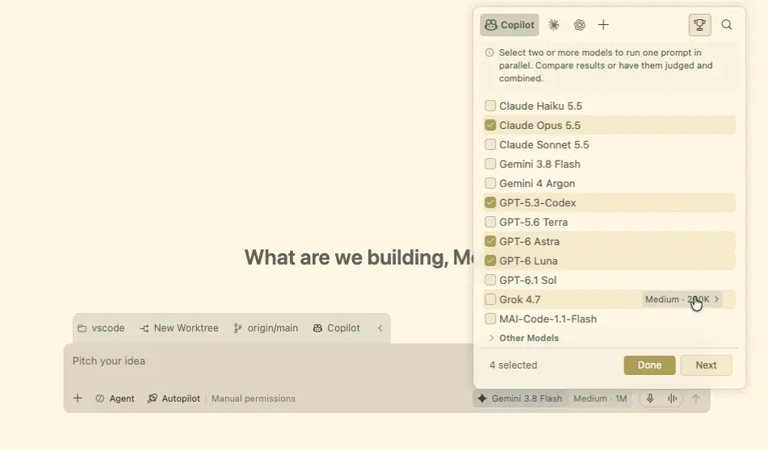
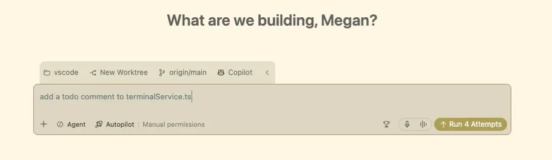

# Compare model results (Preview)

Run the same prompt with multiple models or agent harnesses in the , then compare their responses or implementations side by side. Use a folderless chat to compare ideas and plans, or a Git repository to compare code changes in isolated worktrees. For repository comparisons, you can choose the strongest attempt or synthesize a new implementation from the best parts of several attempts.

Model comparison is available in Preview and only in the . It isn't available in the editor .

## Prerequisites

Before you start, make sure you have:

* Met the [ prerequisites](/docs/agents/run/agents-window.md#prerequisites).
* Access to an eligible Agent Host harness.

For a folderless comparison, use a harness that supports [quick chats](/docs/agents/run/agents-window.md#start-a-quick-chat). Folderless comparisons run independent chats without worktrees, a judge, or a synthesizer.

The models and harnesses available for comparison depend on your setup, credentials, and enterprise policies. Learn how to [configure and choose an agent harness](/docs/agents/run/agent-harnesses.md).

## Configure a comparison

Model comparison is on by default. If **Compare Models** isn't shown for an eligible new session, check that `setting(sessions.chat.compareAgents.enabled)` is enabled in **Settings**.

1. In the , select **New**, and then select the Git repository for the task. To compare responses without a repository, [start a quick chat](/docs/agents/run/agents-window.md#start-a-quick-chat) instead.

1. Open the model picker and select **Compare Models**.

    If the optional **Send Query to Multiple Models** hint appears at the bottom of the picker, you can also select it to open comparison setup. The hint stops appearing after you first open comparison setup.

1. Add between two and 10 attempts.

    Choose from the models available to your agent harnesses. When available, you can mix , , and  attempts. **Auto** and other routing choices aren't available for comparisons.

    For models that support thinking effort, add the same model more than once and select a different effort for each attempt.

1. For repository comparisons, optionally select **Configure Judge**, and then choose a judge model to evaluate the attempts automatically.

1. To create a combined implementation later, select **Configure Synthesis** and choose a synthesizer model.

    Configure the judge and synthesizer before you run the comparison. Without a judge, compare the attempts manually. Synthesis requires both a judge and a synthesizer. These steps aren't available for folderless comparisons.

1. Select **Done**. To compare attempts without a judge or synthesizer, select **Done** directly after choosing the attempts.

<!-- TODO: Update the model picker screenshot to show the current Compare Models icon and Configure Judge button. -->


## Run the same task across attempts

Enter one bounded prompt that gives every attempt the same goal and success criteria. For a repository comparison, use a coding task such as:

```prompt
Add validation to the profile form so the display name is required and no longer
than 50 characters. Show an inline error, preserve the existing form styles, and
add focused tests for valid, empty, and overlong names. Don't change other forms.
```

For a folderless comparison, ask a question or request a plan, such as outlining the trade-offs between two API designs.



Select **Run N Attempts**, where `N` is the number of attempts you configured. All attempts start concurrently as independent sessions. The results appear in a tiled grid by default, where you can monitor each attempt and open its session.


For repository comparisons, each attempt works in its own Git worktree based on the repository's committed state. It doesn't include changes that are uncommitted in your original working tree. Git-ignored files and dependencies might also be absent. For worktree requirements, ignored files, and **Allow all** permission behavior, see [Choose where an agent makes changes](/docs/agents/run/agents-window.md#choose-where-an-agent-makes-changes).

> [!CAUTION]
> Repository comparisons use worktree sessions with **Allow all**, which skips tool approval prompts. Worktrees separate edits, not the agent's access to your machine or network. Review [approvals and permissions](/docs/agents/run/approvals.md) and [agent sandboxing](/docs/agents/run/agent-sandboxing.md) before you run a comparison.

## Compare the results

After the attempts finish, compare them manually or, for repository comparisons, use the judge scorecard:

* Review the responses and, for repository comparisons, changed files for each attempt.
* Check whether each result meets the prompt's constraints. For code changes, also check that the implementation follows the repository's conventions.
* For code changes, run the relevant tests and checks in promising attempts.

If you configured a judge, evaluation starts automatically after the attempts finish. The scorecard includes a recommendation, time and token usage for each attempt, and expandable rationale with validation evidence. Select **Open Attempt N** to inspect an attempt's full session and changes.

Token values can be lower bounds rather than complete totals. The scorecard doesn't measure credit or currency costs.


> [!IMPORTANT]
> A judge's assessment isn't proof that an implementation is correct. Review the code, verify the evidence, and run the project's tests before you integrate a result.

## Synthesize a new implementation

For repository comparisons, if you configured both a judge and a synthesizer, select **Synthesize** after reviewing the verdict. Add optional instructions to focus the synthesis on specific strengths, constraints, or corrections.

The synthesizer creates a new grouped session in another isolated worktree. It uses the judge verdict and strengths from the attempts as context for a new implementation. It doesn't modify the recommended attempt or your original working tree.

Synthesis doesn't automatically merge changes from the attempts or the synthesized result. Review and validate the new implementation as a separate result.

## Continue with a result

Open the attempt or synthesized session that you want to continue. For a folderless comparison, continue the conversation in the chat you choose. For code changes, review all changed and untracked files, run the relevant tests, and make any needed revisions.

When a repository result is ready, follow the [agent change review and worktree integration workflow](/docs/agents/run/review-code-edits.md). Comparison doesn't automatically merge, push, or create a pull request for the selected result.

Each attempt, judge evaluation, and synthesis is separate model work. Consider the additional model usage when you choose the number of attempts and whether to enable evaluation or synthesis.

## Related resources

* [Manage agent sessions](/docs/agents/run/sessions/manage-sessions.md)
* [Use Git branches and worktrees](/docs/sourcecontrol/branches-worktrees.md)
