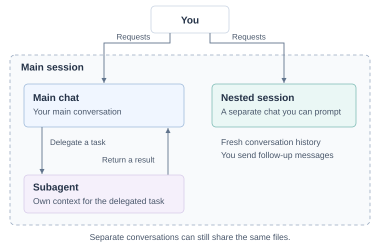

# Use subagents in 

A subagent performs a focused task in its own context and returns a result to the main agent. This keeps intermediate research or review out of your main conversation while letting the main agent use the findings to continue its work.

You don't need to create a custom agent file to use a subagent. For a one-off task, [request delegation in your prompt](#delegate-a-task). For a recurring specialist with particular instructions and tools, [create a custom agent and use it as a subagent](#run-a-custom-agent-as-a-subagent).

The main workflow below uses the  harness. See [harness differences](#subagents-by-harness) before reusing configuration with another harness.

## When to use subagents

Delegate work with a clear scope and a result the main agent can use. The following scenarios are common use cases for subagents:

* **Research before implementation:** find relevant files, existing patterns, or library options and return a recommendation.
* **Compare approaches:** investigate independent solutions and combine the findings.
* **Review changes:** check a substantial change for correctness or missing tests without mixing the review's intermediate work into the main conversation.

For a quick lookup or a small edit, a direct request is usually enough. Subagents make their own model requests, so a smaller main context doesn't necessarily mean lower total usage or cost. Delegate independent work in parallel only when the tasks don't depend on each other's results.

### Should I use a subagent or a nested chat?

The difference is who directs the work, not who creates the conversation:

| Choose | When to use it |
|---|---|
| **Subagent** | You want the main agent to delegate a focused task and use the returned result to continue its work. |
| **Nested chat** | You want a separate, interactive conversation for related work, with your own questions and follow-up instructions. The UI calls this a **nested session**. |



Nested sessions can be created by you or an agent. The arrows show how requests and results flow, not who creates each conversation.

For example, ask a subagent to investigate authentication before the main agent changes it. Start a nested chat if you want to discuss authentication design choices yourself while keeping that discussion separate from implementation.

A new nested chat starts without the other chats' history. A subagent receives the task and context supplied through delegation, with details determined by its harness. Include the requirements and constraints needed for the work rather than assuming another conversation knows them.

**Separate contexts don't guarantee separate files.** Conversations using the same folder or worktree can affect the same code. For independently directed work whose edits must stay separate, [create a nested session with a separate worktree](/docs/agents/run/sessions/manage-sessions.md#run-multiple-chats-in-a-session), where supported.

## Delegate a task

1. Open your project and [select the  harness](/docs/agents/run/agent-harnesses.md#select-a-harness).

1. Ask the main agent to delegate a bounded task. Include the goal, relevant files or context, whether edits are allowed, and the result to return. For example:

    ```prompt
    Use a subagent to investigate authentication in this project.
    Trace how a request is authenticated, without changing files.
    Return the relevant file paths, the authentication flow, and any
    unanswered questions. Use those findings to propose an implementation
    plan in the main chat, but wait for my review before making changes.
    ```

1. [Follow the delegated work](#what-you-see-in-chat). Check that the agent actually invoked a subagent rather than only describing what one would do.

1. Review the returned findings and the main agent's proposed next step. Check file references and assumptions before continuing with implementation.

The main agent can also choose to delegate without an explicit request. You describe the work in natural language; you don't need to construct a `task` tool call yourself.

For a one-off review from different perspectives, ask for separate, bounded investigations:

```prompt
Use two subagents to review the current changes without editing files.
Ask one to check correctness and the other to check test coverage.
Combine their findings, remove duplicates, and prioritize actionable issues.
```

## What you see in chat

Follow subagent activity from the main conversation, then review the result returned to it. If an [approval prompt](/docs/agents/run/approvals.md) appears, inspect the proposed action before approving it.

The controls differ between the editor's  and the :


{% tab label="" %}

### Chat view

Use the subagent indicator in the main conversation to inspect its activity. Select **Open Subagent**, when available, to open the delegated conversation.

The editor's **Sessions** view lists nested sessions but doesn't list subagent chats in that hierarchy. Follow the subagent from the conversation where the delegation occurred.


{% tab label="" %}

### Agents window

Select the subagent indicator in the parent chat or **Open Subagent** to inspect the delegated conversation. You can also find subagent chats in the **Chats** dropdown. They are hidden from the tab strip by default and persist across window reloads.

<details>
<summary>View the parent and subagent side by side</summary>

Hold `kbstyle(Alt)` while selecting a subagent in the chat response or **Chats** dropdown. You can also focus the subagent indicator in the response and press `kbstyle(Alt+Enter)`, or drag it to the center or edge of a chat group.

The background-activities indicator above the chat input opens a picker for running activities. It isn't the draggable subagent indicator in the response.

</details>




Subagent chats are read-only views: you inspect the work but don't type requests directly into them. Send follow-up instructions to the main conversation. **Read-only describes the viewer, not the subagent's capabilities.** If the task permits edits, review the actual file changes and validation results as well as the summary.

To display AI credit usage in subagent indicators and hover details, turn on `setting(chat.subagents.showCreditUsage)`. It is off by default. See [model usage and costs](/docs/agents/concepts/language-models.md#ai-credits-and-model-costs) when deciding whether delegation is worthwhile.

## Run a custom agent as a subagent

A custom agent defines reusable instructions, tools, and optional model preferences. Running it as a subagent delegates its role without switching the agent in your main conversation. Create one when you repeatedly need the same kind of investigation or review.

The following example creates a **Codebase Researcher** for  sessions. For general creation, locations, and sharing, see [Create a custom agent](/docs/agent-customization/custom-agents.md#create-a-custom-agent).

1. Select the  harness and the workspace where you want to use the helper.
1. Run **Chat: Open Customizations** from the Command Palette (`kb(workbench.action.showCommands)`), then select **Agents**.
1. Select **New Agent** (plus icon) next to **Workspace**, choose the workspace location, and enter `codebase-researcher` as the file name.
1. Replace the generated contents with this definition:

    ```markdown
    ---
    name: Codebase Researcher
    description: Find relevant code and explain existing patterns without modifying files
    user-invocable: false
    tools: ['read', 'search']
    ---
    Investigate the delegated question in the workspace.
    Return relevant file paths, an explanation of the existing behavior,
    and any unanswered questions.
    Do not edit files or run terminal commands.
    Stop after returning the findings. Leave implementation to the main agent.
    ```

1. Save the file and confirm that **Codebase Researcher** appears in the customization editor without file errors.

The `description` helps the main agent choose the helper. The `tools` list selects reading and search capabilities. `user-invocable: false` hides the helper from the main agent picker, not from delegation. Leave `disable-model-invocation` unset or `false` so other agents can invoke it.

If you prefer to create the file directly, save it as `.github/agents/codebase-researcher.agent.md`. Don't copy a Local coordinator's `agents` allowlist into a  agent: that field is Local-only. See [harness compatibility](/docs/agents/reference/custom-agent-file-reference.md#harness-compatibility) for supported fields and tool names.

### Invoke and verify the helper

Start a new chat in the same workspace with the  harness. Keep a general-purpose agent selected and request the helper by name:

```prompt
Use the Codebase Researcher subagent to explain how authentication works
in this project. Report its findings in the main chat without implementing
any changes.
```

Check the delegated call and result:

* The main agent used the intended helper.
* Its tool activity is limited to reading and searching, without edits or terminal commands.
* Its response identifies relevant files, explains behavior, and states what it couldn't verify.

If the result isn't useful, refine the helper's instructions and repeat the task. Instructions alone don't enforce a read-only boundary. Keep the tool selection appropriate to the role and check the actual activity.

For a model preference, use completions in the agent file's `model` field to select a supported model. See [model configuration and harness differences](/docs/agents/reference/custom-agent-file-reference.md#model-preferences), rather than applying the Local model-selection rules to every harness.

## Subagents by harness

The selected harness determines the delegation tools, custom-agent format, and model behavior. Don't assume that a working definition or setting in one harness has the same effect in another.


{% tab label="" %}

<a id="copilot"></a>

Use the [delegation](#delegate-a-task) and [custom helper](#run-a-custom-agent-as-a-subagent) workflows above.  uses its native `task` tool rather than Local's `runSubagent`. If an existing coordinator names a tool explicitly, review both its instructions and tool list when migrating. See the [subagent migration FAQ](/docs/agent-customization/migrate-customizations.md#why-does-my-coordinators-subagent-invocation-stop-working).

For provider-specific behavior, see [ built-in and custom agents](https://docs.github.com/en/copilot/concepts/agents/copilot-cli/about-custom-agents).


{% tab label="" %}

<a id="claude"></a>

Ask  to delegate a focused task, or let it choose a subagent. For reusable specialists, use the [Claude agent format](/docs/agents/reference/custom-agent-file-reference.md#claude-agent-format), rather than assuming the  example is portable.

See [Claude subagents](https://code.claude.com/docs/en/sub-agents) for native configuration and behavior, and [the harness setup guide](/docs/agents/run/agent-harnesses.md#claude) for the integration in .


{% tab label="" %}

<a id="codex"></a>

Ask  to delegate independent tasks and collect their results. It uses provider-native subagents and configuration. See [Codex subagents](https://developers.openai.com/codex/multi-agent) and the [experimental direct integration](/docs/agents/run/agent-harnesses.md#codex) for availability and setup.




Provider documentation also covers CLI workflows. Commands and configuration options can differ in .  and  are unavailable when [ enterprise-managed settings apply](/docs/enterprise/manage-ai-settings.md#claude-and-codex-availability), unless your administrator permits them.

## Troubleshoot delegation

| What you observe | What to check |
|---|---|
| The main agent does the task itself. | Explicitly request a subagent with a bounded task and expected result. Check tool activity to distinguish actual delegation from a response that only describes it. |
| A custom helper isn't available for delegation. | Check the selected harness, workspace, file errors, and `disable-model-invocation`. `user-invocable: false` only hides it from the picker. See [custom-agent troubleshooting](/docs/agent-customization/custom-agents.md#troubleshoot-custom-agents). |
| The helper has unexpected tools. | Check the tool names supported by that harness and inspect the helper's actual calls. A 'do not edit' instruction isn't a substitute for tool restrictions. |
| A requested model doesn't run. | Check that the model is available for the selected harness and use the error details to choose an alternative. Local has additional [model-selection constraints](#select-the-model-for-a-subagent). |
| The result is too broad or misses relevant context. | Narrow the task, supply the relevant files and constraints, and specify the output. Send the follow-up through the main chat. |

<a id="local"></a>

## Local harness compatibility

The Local harness is deprecated `feature(local-harness)`. Its editor-based `runSubagent` tool differs from the native delegation tools described above.

### Invoke a Local subagent

In the , select the **Local** harness and **Agent** role. Open **Configure Tools** and select **Run Subagent** (`agent/runSubagent`). Then request a focused task in your prompt. See [Local tool selection](/docs/agents/run/tools.md#select-tools-for-a-local-request).

Local subagents receive the delegated task and applicable instructions, not the main conversation history. Each invocation is stateless: follow-up work requires a new invocation with the relevant context.

For a reusable Local prompt file or coordinator, include the `agent` tool set in `tools`. Local's `agents` frontmatter can restrict the coordinator to named workers. Names are case-sensitive, and an explicit allowlist can permit a worker even when it sets `disable-model-invocation: true`. See the [Local subagent configuration reference](/docs/agents/reference/custom-agent-file-reference.md#subagent-configuration).

### Select the model for a subagent

In Local, an explicit model passed to `runSubagent` takes precedence over the custom agent's `model` preference. Otherwise, the subagent uses its custom-agent preference or the calling conversation's model. An unnamed nested invocation can inherit its caller's subagent configuration.

To request a model, include a name available in your session:

```prompt
Use a subagent with <model name> to review the error handling in this module.
```

Selections are checked against the main model's cost tier. If the requested model exceeds that tier or isn't available, use the error's model suggestions rather than assuming an automatic fallback.

### Nested subagents

This means a subagent invoking another subagent, not a [nested chat](#should-i-use-a-subagent-or-a-nested-chat). Local disables this by default. Turn on `setting(chat.subagents.allowInvocationsFromSubagents)` to permit it, up to a maximum depth of five, and ensure the worker's tools include `agent`.

Keep recursive work bounded and include a stopping condition. This Local setting doesn't configure nesting in other harnesses.

## Related resources

* [Create and manage custom agents](/docs/agent-customization/custom-agents.md)
* [Optimize AI credit usage](/docs/agents/guides/optimize-usage.md)
* [Manage agent sessions](/docs/agents/run/sessions/manage-sessions.md)
