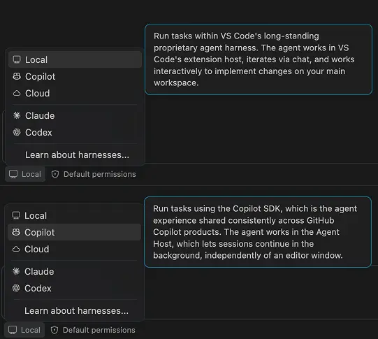
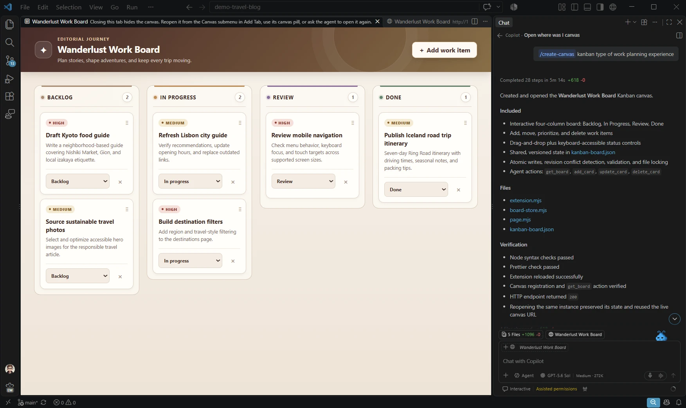
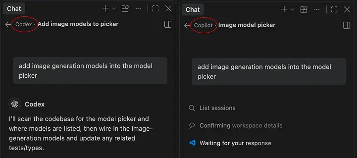
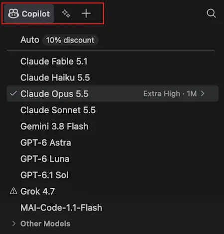
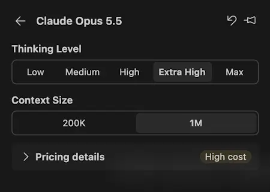
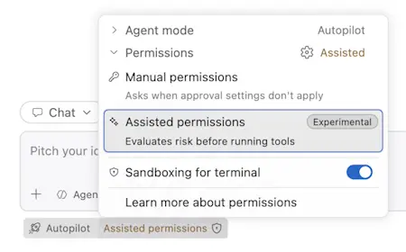
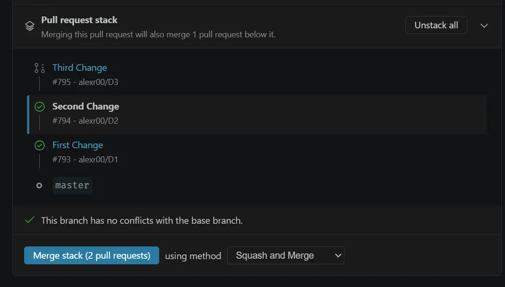

# Visual Studio Code 1.142

<!-- %IF IN_PRODUCT %
Follow us on [LinkedIn](https://www.linkedin.com/showcase/vs-code), [X](https://go.microsoft.com/fwlink/?LinkID=533687), [Bluesky](https://bsky.app/profile/vscode.dev), [Instagram](https://www.instagram.com/vscode.ig) | [View online](https://code.visualstudio.com/updates)
%ENDIF % -->
<!-- %IF IN_WEB %
<p class="release-metadata"><span>Released October 14, 2026</span> <span class="release-channel">Stable</span></p>
%ENDIF % -->
<!-- %IF IN_PRODUCT %
_Release date: October 14, 2026_
%ENDIF % -->

<!-- DOWNLOAD_LINKS_PLACEHOLDER -->

<!-- %IF STABLE %
<p class="release-update-guidance">Already installed? Use <strong>Check for Updates</strong> in VS Code. For upcoming features, use the <a href="https://code.visualstudio.com/insiders">Insiders build</a>.</p>
%ENDIF % -->

<!-- RELEASE_HIGHLIGHTS_START -->
## Release highlights

This release adds shared canvases for agent workflows, lets you move chats without losing context, expands the Markdown editor, and gives administrators more control over agent permissions.

* [Canvases (Preview)](#canvases-preview): Collaborate with agents beyond chat using visual and interactive canvases.

* [Move chats](#move-chats-between-folders-and-worktrees): Continue a chat in another folder or a new Git worktree without losing conversation history.

* [Markdown editor](#markdown-editor): Work on Markdown files more efficiently with features like pasting images, renaming file links, or breadcrumb navigation.

* [Enterprise management](#enterprise): Enforce agent sandboxing and permission policies while controlling which permission modes developers can use.

* [Redesigned model picker](#redesigned-model-picker): Quickly switch between Copilot and BYOK contributed models, and manage effort levels and context windows more intuitively.

<!-- RELEASE_HIGHLIGHTS_END -->

<!-- %IF IN_PRODUCT %
Happy Coding!

---
%ENDIF % -->

<!-- TOC
<div class="toc-nav-layout">
  <nav id="toc-nav">
    <div>In this update</div>
    <ul>
      <li><a href="#release-highlights">Release highlights</a></li>
      <li><a href="#agents">Agents</a></li>
      <li><a href="#chat">Chat</a></li>
      <li><a href="#markdown-editor">Markdown editor</a></li>
      <li><a href="#editor-experience">Editor experience</a></li>
      <li><a href="#languages">Languages</a></li>
      <li><a href="#enterprise">Enterprise</a></li>
      <li><a href="#contributions-to-extensions">Contributions to extensions</a></li>
      <li><a href="#deprecated-features-and-settings">Deprecated features and settings</a></li>
      <li><a href="#thank-you">Thank you</a></li>
    </ul>
  </nav>
  <div class="notes-main">
Navigation End -->

## Agents

### Copilot harness

The Copilot harness is powered by the Copilot SDK, a shared foundation that helps align behavior, capabilities, and improvements across Copilot products. In VS Code, the Copilot harness runs sessions through the [Agent Host](https://code.visualstudio.com/docs/agents/concepts/agent-host), which lets sessions continue in the background and be accessed from both the VS Code editor window and the Agents window.

The Copilot harness has been available from the harness picker in the chat input. Based on overwhelmingly positive and valuable feedback, we're progressively rolling it out as the default harness for new sessions in VS Code. When you start a new session, **Copilot** in the harness picker indicates that the session will use the Copilot harness.



Thank you to everyone who has shared feedback. We're actively using it to shape the experience. One example is reintroducing **Ask** as a built-in agent in the Copilot harness. Your feedback showed that a dedicated read-only experience remains valuable. Select **Ask** from the agent picker to use it.

Learn how to [work with the Copilot harness](https://code.visualstudio.com/docs/agents/run/agent-harnesses#use-the-copilot-harness), or explore the architecture and workflows in the [agent host blog post](https://code.visualstudio.com/blogs/2026/08/26/agent-host-architecture). If you have feedback or requests, [please file an issue](https://github.com/microsoft/vscode/issues).

### Canvases (Preview)

**Setting**: `setting(chat.canvases.enabled)`

Canvases are interactive interfaces to collaborate with an agent. A canvas opens beside the chat, where you and the agent can inspect and update the same artifact instead of coordinating solely through prompts.

For example, use a Kanban canvas to plan and track implementation work. You can create and move cards directly, while the agent can break a feature into tasks, update their status, or add newly discovered work. Canvases work in both the VS Code editor window and the Agents window, and canvas extensions are also supported in the [GitHub Copilot app](https://docs.github.com/en/copilot/how-tos/github-copilot-app/working-with-canvas-extensions).



Canvases are available in Preview in the VS Code desktop app for local sessions that use the Copilot harness. Enable `setting(chat.canvases.enabled)`, and then start a new session with the Copilot harness.

Every canvas is provided by a canvas extension. To get started, you have two options:

* **Create a canvas extension**: Enter `/create-canvas` in the chat input and describe the user interface you want for your project. The skill then creates a canvas extension in your workspace and opens its canvas.

* **Install a chat plugin**: For now, install a [chat plugin that includes a canvas extension](https://docs.github.com/en/copilot/how-tos/github-copilot-app/working-with-canvas-extensions) through the GitHub Copilot app. Then switch to VS Code and ask the agent to list the available canvases and have it open one.

After you install a canvas extension, you can also open an available canvas in the Agents window from **Add Tab (+)** > **Canvas**.

Explore and install [sample canvas extensions from the community](https://awesome-copilot.github.com/extensions/).

Learn more about [canvas support](https://code.visualstudio.com/docs/agents/run/agent-harnesses#_use-canvases-with-the-copilot-harness) in the VS Code documentation.

<video src="images/1_142/canvases.mp4" title="Video showing a canvas being used in VS Code." autoplay loop controls muted></video>

### Move chats between folders and worktrees

Previously, if you started investigating a task in one folder and then wanted to implement it in a Git worktree, or continue in a different repository, you had to start a new chat and rebuild the context.

In the [Agents window](https://code.visualstudio.com/docs/agents/run/agents-window), you can now ask the agent to move the current chat to another folder or into a new Git worktree, and it keeps the conversation history intact. Changing the workspace also works for chats that already have a workspace, and the agent can isolate work in a new worktree.

Ask the agent with a natural-language prompt, for example:

```prompt
Continue this task in a new Git worktree of the current repository before implementing it.
```

The agent finishes the current turn, moves the chat, and shows a notice when the workspace changes. Then it continues the task automatically in the new location. Edits and commands run in the new location while your original checkout stays unchanged.

<video src="images/1_142/move-chat-worktree.mp4" title="Video showing a chat started in the VS Code repository moving to a new Git worktree, continuing with edits, and showing the worktree in the Files explorer." autoplay loop controls muted></video>

The move is available for agent sessions that use the Codex harness or Codex in Interactive mode, and that contain one chat and one local folder. For prerequisites and details about which files are available in the new location, see [Move a chat to another folder or worktree](https://code.visualstudio.com/docs/agents/run/sessions/manage-sessions#move-a-chat-to-another-folder-or-worktree).

### Session-scoped layout in the Agents window (Experimental)

**Setting**: `setting(sessions.experimental.layoutScope)` (Agents window only)

Previously, when you switched between sessions in the Agents window, VS Code shared layout settings such as editor visibility, details, and panel visibility across sessions. If you're used to VS Code remembering the layout for each workspace, sharing the layout across sessions can be disruptive.

With the new experimental `setting(sessions.experimental.layoutScope)` setting, you can choose how much of the layout each session remembers. Reload the window after you change the setting. It supports the following values:

* `session-shared` (default): The current behavior. A session and its nested sessions share the same editors and selected panel views. Editor, details, and bottom panel visibility are shared across existing workspace sessions.

* `chat-shared`: A session and each of its nested sessions keep their own editors and selected panel views, while editor, details, and bottom panel visibility stay shared across existing workspace sessions.

* `chat`: A session and each of its nested sessions also keep their own editor and details composition and bottom panel visibility.

Window geometry, pane sizes, and the sidebar currently remain shared across the window.

### Customize the Agents window panel layout

You can now choose how the bottom panel is aligned in the Agents window. Right-click a panel tab, select **Align Panel**, and choose one of the following layouts:

* `Center` aligns the panel beneath the chat area, leaving more room for the side pane.

* `Justify` extends the panel across the full width of the window.

Your selection is saved per profile and preserved when maximizing or restoring the panel.

<video src="images/1_142/agents-window-bottom-panel-layout.mp4" title="Video showing the bottom panel alignment options in the Agents window." autoplay loop controls muted></video>

## Chat

### Quickly identify the active harness

Chat titles show the active harness name, such as **Copilot** or **Codex**, so you can identify it without opening the harness picker or hovering over the session list.



### Stop background shells

In [Copilot harness](#copilot-harness) sessions, the [background shells pill](https://code.visualstudio.com/updates/v1_141#_keep-track-of-background-shells) above the chat input lists the commands that the agent is still running in the background. When one of those commands is no longer useful, for example a test run that you want to restart or a command that runs longer than expected, you can stop it instead of waiting for it to finish.

Select the **Background Shells** pill, select a shell to open its details, and then select **Stop Shell** next to its command. Only that command ends, and the shell leaves the list. You can reach **Stop Shell** with the keyboard, and screen readers announce when the shell stops.

<video src="images/1_142/background-shell-stop.mp4" title="Video showing a background shell's output streaming in its details, then selecting Stop Shell, which removes the shell from the Background Shells list." autoplay loop controls muted></video>

Stopping a shell is only available for **attached shells**, which the agent runs as part of its current request. Detached shells run independently of the agent and can't be stopped from this interface.

Shell details also show each shell's full description above its command, even when the list truncates it. Long output is no longer cut off, and you can scroll back through earlier output, both in the shell's details and in the terminal output in the chat response.

### Stateful responses for BYOK custom endpoints

If your bring-your-own-key (BYOK) model uses a stateless Responses API, set `"statefulResponses": false` on its model entry in `chatLanguageModels.json` to send full conversation history with each request.

See [Custom Endpoint configuration](https://code.visualstudio.com/docs/agent-customization/language-models#stateful-responses-api-endpoints) for details.

### Windows sandboxing for Local harness is no longer supported

Windows sandboxing for terminal commands in Local agent sessions has been deprecated. For sandboxed command execution on Windows, use an Agent Host session. See the [Agent Host sandboxing documentation](https://code.visualstudio.com/docs/agents/run/agent-sandboxing) for details.

### Redesigned model picker

Copilot and bring-your-own-key (BYOK) providers offer many models, each with strengths for different tasks. The redesigned model picker makes it easier to choose and switch models as your work changes.

The model picker uses a tabbed interface to separate Copilot and BYOK models.



When you hover over a model in the list, you can further configure its thinking level and context window size.



## Markdown editor

### Editing mode closer to the Markdown source

When you edit Markdown, each source line appears on a separate visual line, making the document structure easier to follow. Read-only mode continues to render Markdown as before.

### Paste images

To add an image, for example a screenshot, to your Markdown document, simply paste it directly into the Markdown editor, like you could already do in the text editor. This makes it easier to include visual content without having to save and insert files manually.

<video src="images/1_142/markdown-pasting-images.mp4" title="Video showing an image pasted from the clipboard into the Markdown editor." autoplay loop controls muted></video>

### Rename file links

The Markdown editor now supports **Rename Symbol** (`kb(editor.action.rename)`), so you can rename file links in place and have the changes reflected throughout your document.

<video src="images/1_142/markdown-rename.mp4" title="Video showing a file link renamed in the Markdown editor." autoplay loop controls muted></video>

### Outline and breadcrumbs

The Markdown editor integrates with the Outline view and breadcrumbs, making it easier to inspect the heading structure and jump to a section.

<video src="images/1_142/markdown-outline-breadcrumbs.mp4" title="Video showing navigation through a Markdown document with the Outline view and breadcrumbs." autoplay loop controls muted></video>

### Copy code blocks

Like the Markdown preview, code blocks in the Markdown editor display a copy button on hover. This makes it easy to copy multiline code fragments without accidentally editing the content.

<video src="images/1_142/markdown-copy.mp4" title="Video showing the Copy button copying code from a Markdown code block." autoplay loop controls muted></video>

## Editor experience

### Merging document highlights from different providers

**Setting**: `setting(editor.occurrencesHighlightFromAllProviders)`

Enable `setting(editor.occurrencesHighlightFromAllProviders)` to merge document highlights from all providers. By default, VS Code uses highlights only from the highest-priority provider.

## Languages

### Python

This release includes fixes for environment discovery, interpreter selection, and terminal activation in the Python Environments Extension.

* **Environment discovery:** Python installations managed by `uv` now appear under **Global**. Selecting an interpreter by path adds its virtual environment to the environment list, and deleting a virtual environment outside VS Code updates the selection.

* **Project-specific environments:** Automatic selection now prefers a project's own virtual environment over nested environments. Conda environment selection and Poetry package operations respect project scope, and background refreshes no longer overwrite newer interpreter selections.

* **Interpreter configuration:** Fixed resolution of `${workspaceFolder}`, relative paths, and commands such as `python3` in `python.defaultInterpreterPath`. The project-view environment selector now includes **Enter Interpreter Path**.

* **Terminal activation:** Shell-startup activation now updates when the global interpreter changes and is preserved when environment files change. Environment-file notifications include **Enable for Workspace** or **Enable for Folder** actions.

* **Python installation:** When `uv` is required but missing, setup offers to install it and continues to Python version selection without requiring a PATH refresh.

## Enterprise

### Automatically move policy-managed chats to Copilot Agent Host

Enterprise managed settings let administrators govern agent permissions and sandboxing. When your organization configures a nonempty `permissions` object or sets `sandbox.enabled` to `true`, VS Code now requires the [Copilot harness](https://code.visualstudio.com/docs/agents/run/agent-harnesses) in Agent Host for full chat sessions, to be able to enforce these policies.

Opening an existing, unarchived **Local** chat automatically moves it to **Copilot**, preserving the transcript and unsent draft, including attachments. Nothing is sent automatically. The new chat uses its normal model and permission defaults under current organization policy.

VS Code archives the original chat only after the new chat opens successfully. If you switch away while the move is in progress, the original stays unchanged and the unopened destination is removed.

While these policies apply, Claude, Codex, and terminal chat are unavailable. Editor inline chat remains available for limited read and edit tasks. An empty `permissions` object or legacy policy alone does not trigger this migration. Administrators can [temporarily opt out of automatic migration](#temporarily-keep-the-local-harness).

### Temporarily keep the Local harness

Administrators who need more time to transition to Copilot Agent Host can set `vscode.temporaryDefaultToLocalHarness` to `true` in their [unified managed settings](https://docs.github.com/en/copilot/how-tos/administer-copilot/manage-for-enterprise/use-managed-settings/get-started):

```json
{
    "vscode": {
        "temporaryDefaultToLocalHarness": true
    }
}
```

This keeps the **Local** harness available and stops automatic switching to **Copilot**, while preserving explicit, remembered, and current harness choices. Set the managed value to `false` or remove it to restore normal routing.

> **Note:** This temporary opt-out also overrides routing required by managed sandbox and permission settings. Local does not enforce those runtime-only rules. Enforcement in Copilot Agent Host sessions is unchanged.

### Manage Copilot permission modes independently

Administrators can permit **Assisted** while blocking **Allow All**, giving developers assisted approvals without bypassing permission checks. The Copilot permission picker reflects the modes permitted by your organization's managed settings.

For example, merge this configuration into your [unified managed settings](https://docs.github.com/en/copilot/how-tos/administer-copilot/manage-for-enterprise/use-managed-settings/get-started):

```json
{
    "permissions": {
        "disableBypassPermissionsMode": "disable",
        "disableAssistedPermissionsMode": false
    }
}
```



Use `permissions.disableAssistedPermissionsMode` to restrict **Assisted** independently. `permissions.defaultMode` supplies a starting default, not a restriction on the modes users can select.

The legacy `ChatToolsAutoApprove: false` policy still blocks both **Allow All** and **Assisted** unless you configure explicit managed mode restrictions. Setting only `permissions.defaultMode` does not replace that legacy restriction.

> **Note:** Assisted Permissions is not currently compatible with `permissions.{allow,ask,deny}`.
> If you are using any of `permissions.allow`, `permissions.ask`, `permissions.deny`, please set `"disableAssistedPermissionsMode": true`.
> In the next release, both will be supported alongside one another.

### Windows numeric policies support DWORD values

On Windows, policies that accept numeric values support DWORDs and QWORDs.

## Contributions to extensions

### GitHub Pull Requests

There has been more progress on the [GitHub Pull Requests](https://marketplace.visualstudio.com/items?itemName=GitHub.vscode-pull-request-github) extension, which enables you to work on, create, and manage pull requests and issues. New features include:

* Stacked pull request support is enabled by default.

    

* Conflict-free, locally checked-out pull requests can be updated.

Review the [changelog for the 0.170.0](https://github.com/microsoft/vscode-pull-request-github/blob/main/CHANGELOG.md#01700) release of the extension to learn about everything in the release.


## Deprecated features and settings

### New deprecations in this release

* [Windows sandboxing for Local harness is no longer supported](#windows-sandboxing-for-local-harness-is-no-longer-supported)


<!-- RELEASE_THANK_YOU_START -->
## Thank you

Contributions to `vscode`:

* [@bluerose73 (Shengjie Ma)](https://github.com/bluerose73): Copilot NES: add ExP toggle to omit max_tokens [PR #340327](https://github.com/microsoft/vscode/pull/340327)
* [@codelovingcat (Ürem Sancaktutan)](https://github.com/codelovingcat): Fix/issue 337524 multidiff order [PR #337565](https://github.com/microsoft/vscode/pull/337565)
* [@denizguney (Deniz Güney Yıldırım)](https://github.com/denizguney): Fix duration calculation for agent stop command [PR #338278](https://github.com/microsoft/vscode/pull/338278)
* [@na2co3-ftw (na2co3)](https://github.com/na2co3-ftw): Modern UI: Prevent vertical scrolling when dragging connected tabs (revised) [PR #338180](https://github.com/microsoft/vscode/pull/338180)
* [@rksharma-owg (RKS)](https://github.com/rksharma-owg): Preserve newer debugger stop details during continued cleanup [PR #339530](https://github.com/microsoft/vscode/pull/339530)
* [@sgent-epic](https://github.com/sgent-epic): agentHost: preserve BYOK state through tool continuations [PR #331749](https://github.com/microsoft/vscode/pull/331749)
* [@SimonSiefke (Simon Siefke)](https://github.com/SimonSiefke)
  * fix: memory leak in document paste edits [PR #338233](https://github.com/microsoft/vscode/pull/338233)
  * fix: memory leak in native context menu dismissal [PR #338214](https://github.com/microsoft/vscode/pull/338214)
  * fix: memory leak in output channel disposal listeners [PR #338240](https://github.com/microsoft/vscode/pull/338240)
  * fix: memory leak in debug adapter descriptor factory [PR #334103](https://github.com/microsoft/vscode/pull/334103)
  * fix: release terminal command history when clearing the normal buffer [PR #326931](https://github.com/microsoft/vscode/pull/326931)
  * perf: reduce number of strings by 1200 [PR #327689](https://github.com/microsoft/vscode/pull/327689)
  * fix: memory leak in MainThreadDebugService [PR #334102](https://github.com/microsoft/vscode/pull/334102)
  * fix: memory leak in extHostTimeline [PR #334098](https://github.com/microsoft/vscode/pull/334098)
  * fix: memory leak in debug visualization registrations [PR #340046](https://github.com/microsoft/vscode/pull/340046)
  * fix: memory leak in hidden status bar command arguments [PR #338238](https://github.com/microsoft/vscode/pull/338238)
  * fix: memory leak in extension host language model providers [PR #340579](https://github.com/microsoft/vscode/pull/340579)
  * fix: memory leak in terminal disposal subscriptions [PR #340037](https://github.com/microsoft/vscode/pull/340037)
* [@Tabisharaza (TABISH AYUB RAZA)](https://github.com/Tabisharaza): mcp: read migrated local servers from workspace configuration [PR #340034](https://github.com/microsoft/vscode/pull/340034)
* [@tuanvtdeptre199](https://github.com/tuanvtdeptre199): Disable Step Out action when the active thread has only one stack frame [PR #336125](https://github.com/microsoft/vscode/pull/336125)
* [@tyrielv (Tyrie Vella)](https://github.com/tyrielv): Avoid unnecessary --numstat diff for incoming changes decorations [PR #339008](https://github.com/microsoft/vscode/pull/339008)
* [@yuezhang030](https://github.com/yuezhang030): Update VSC model F prompt [PR #340187](https://github.com/microsoft/vscode/pull/340187)

Contributions to `vscode-pull-request-github`:

* [@L4XB (Lukas )](https://github.com/L4XB): Don't open two browser tabs when clicking the pull request number [PR #8962](https://github.com/microsoft/vscode-pull-request-github/pull/8962)
* [@strawberry-little-bear](https://github.com/strawberry-little-bear): Fix malformed issue links in overview HTML [PR #9025](https://github.com/microsoft/vscode-pull-request-github/pull/9025)
* [@vsharha (Viktor Sharha)](https://github.com/vsharha): Fix mergeability polling in pull request overview [PR #8954](https://github.com/microsoft/vscode-pull-request-github/pull/8954)

### Issue tracking

Contributions to our issue tracking:

* [@gjsjohnmurray (John Murray)](https://github.com/gjsjohnmurray)
* [@RedCMD (RedCMD)](https://github.com/RedCMD)
* [@IllusionMH (Andrii Dieiev)](https://github.com/IllusionMH)
* [@albertosantini (Alberto Santini)](https://github.com/albertosantini)

<!-- RELEASE_THANK_YOU_END -->
---

We really appreciate people trying our new features as soon as they are ready, so check back here often and learn what's new.

> If you'd like to read release notes for previous VS Code versions, go to [Updates](https://code.visualstudio.com/updates) on [code.visualstudio.com](https://code.visualstudio.com).

<a id="scroll-to-top" role="button" title="Scroll to top" aria-label="scroll to top" href="#"><span class="icon"></span></a>
<link rel="stylesheet" type="text/css" href="css/inproduct_releasenotes.css"/>
