# Visual Studio Code 1.143

Follow us on [LinkedIn](https://www.linkedin.com/showcase/vs-code), [X](https://go.microsoft.com/fwlink/?LinkID=533687), [Bluesky](https://bsky.app/profile/vscode.dev), [Instagram](https://www.instagram.com/vscode.ig) <!-- %IF INSIDERS % | Follow Insiders Changelog on [X](https://x.com/VSCodeChangelog) or [Bluesky](https://bsky.app/profile/vscodechangelog.bsky.social) %ENDIF % --> <!-- %IF IN_PRODUCT % | [View online](https://code.visualstudio.com/updates)%ENDIF % -->

---

_Last updated: October 19, 2026_

Welcome to the 1.143 <!-- %IF INSIDERS % Insiders %ENDIF % --> release of Visual Studio Code.

<!-- %IF INSIDERS %
These release notes cover the Insiders build of VS Code and continue to evolve as new features are added.

You can still track our progress in the [Commit log](https://github.com/Microsoft/vscode/commits/main) and our list of [Closed issues](https://github.com/Microsoft/vscode/issues?q=is%3Aissue%20is%3Aclosed%20milestone%3A1.143.0).
%ENDIF % -->

<!-- DOWNLOAD_LINKS_PLACEHOLDER -->

<!-- %IF STABLE %
<p class="release-update-guidance">Already installed? Use <strong>Check for Updates</strong> in VS Code. For upcoming features, use the <a href="https://code.visualstudio.com/insiders">Insiders build</a>.</p>
%ENDIF % -->

<!-- RELEASE_HIGHLIGHTS_START -->
## Release highlights

This release makes the Copilot harness the default for new sessions and adds tools to compare models, reclaim storage, run models locally, and navigate file changes.

* [Copilot harness by default](#copilot-harness-as-the-default): The default for new sessions, built on the Copilot SDK, lets you switch between editor and Agents window.

* [Compare models (Preview)](#compare-model-results-preview): Run the same task with multiple models in the Agents window, then compare and combine their solutions.

* [Reclaim worktree storage (Experimental)](#reclaim-storage-from-inactive-worktrees-experimental): Free disk space by reviewing and removing inactive agent session worktrees.

* [On-device models (Experimental)](#run-copilot-models-on-your-device-experimental): Run MAI Code 1.1 Flash locally on your device for your agent tasks.

* [Multi-diff file list (Experimental)](#multi-file-diff-editor-file-list-experimental): Keep an overview of and jump between changed files in the multi-file diff editor.
<!-- RELEASE_HIGHLIGHTS_END -->

<!-- %IF IN_PRODUCT %
Happy Coding!

---
%ENDIF % -->

<!-- TOC
<div class="toc-nav-layout">
  <nav id="toc-nav">
    <div>In this update</div>
    <ul>
      <li><a href="#release-highlights">Release highlights</a></li>
      <li><a href="#agents">Agents</a></li>
      <li><a href="#models">Models</a></li>
      <li><a href="#sandboxing">Sandboxing</a></li>
      <li><a href="#chat">Chat</a></li>
      <li><a href="#editor-experience">Editor Experience</a></li>
      <li><a href="#source-control">Source Control</a></li>
      <li><a href="#enterprise">Enterprise</a></li>
      <li><a href="#vs-code-setup">VS Code setup</a></li>
      <li><a href="#deprecated-features-and-settings">Deprecated features and settings</a></li>
      <li><a href="#thank-you">Thank you</a></li>
    </ul>
  </nav>
  <div class="notes-main">
Navigation End -->

## Agents

### Copilot harness as the default

**The Copilot harness is now the default for new sessions in VS Code.** It's our latest harness, built on the Copilot SDK, a shared foundation that helps align behavior, capabilities, and improvements across Copilot products.

When you start a new session, **Copilot** in the harness picker indicates that the session uses the Copilot harness:


In VS Code, you can keep Copilot harness sessions running in the background and access them from both the VS Code editor window and the Agents window. These sessions run through the [Agent Host](https://code.visualstudio.com/docs/agents/concepts/agent-host).

Thank you so much to everyone who has shared valuable feedback. This release includes more improvements shaped directly by your feedback.

We're continuing to improve performance and reduce latency based on the scenarios and setups you share. For example, [reports of long waits before chat responses](https://github.com/microsoft/vscode/issues/341543#issuecomment-6202370962) helped us reduce delays caused by MCP servers that don't finish loading their tools.

We're also continuing to make our documentation clearer based on the feedback and questions you've shared. Learn how to [work with the Copilot harness](https://code.visualstudio.com/docs/agents/run/agent-harnesses), or explore the architecture and workflows in the [agent host blog post](https://code.visualstudio.com/blogs/2026/08/26/agent-host-architecture).

Please continue [filing issues](https://github.com/microsoft/vscode/issues) to let us know how the Copilot harness is working for you. Your feedback is a huge help and directly shapes the harness experience.

#### Initial file-level working set support (Experimental)

**Setting:** `setting(chat.editor.workingSet.enabled)`

You gave us feedback that when using the Copilot harness, approving or rejecting agent edits in the editor was challenging. As of this release, we are introducing _initial_ file-level working set support to help you manage and review changes more effectively.

Copilot harness sessions in the editor window now support file-level **Keep** in the experimental working set above the chat input. Enable `setting(chat.editor.workingSet.enabled)` to try it.

Select **Keep** on a file, or in the heading for all files, to mark changes as reviewed and remove them from the working set. The edits stay on disk, and files return if the agent changes them again.

<video src="images/1_143/file-level-keep.mp4" title="Video showing file-level and bulk Keep actions in the working set above the chat input." autoplay loop controls muted></video>

**What's next:** We plan to add file-level **Undo** to the working set and bring **Keep** and **Undo** back into the editor for individual changes. These are planned for later releases, landing in [Insiders](https://code.visualstudio.com/insiders/) first, then Stable.

### Discard changes from more changesets in the Agents window

The **Changes** view in the Agents window lets you see all the modifications made by the agent. Until now, discarding pending changes was only available in the **Uncommitted Changes** changeset.

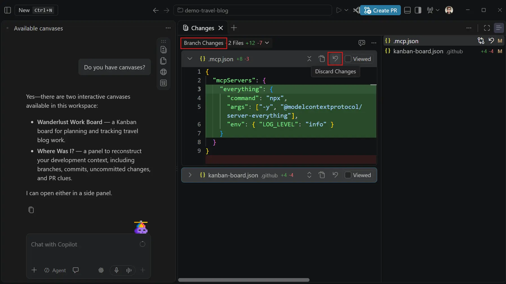

In this release, the **Branch Changes**, **Session Changes**, and **Last Turn Changes** changesets also offer the possibility to discard changes. Select **Discard Changes** on a file in the **Changes** view or in the multi-file diff editor. What VS Code discards depends on the changeset:

* **Branch Changes**: restores the file to its version where the branch diverged from its base branch, and deletes files that the branch added.
* **Session Changes**: reverts the session's edits to the file and keeps changes made outside the session, such as your own edits.
* **Last Turn Changes**: reverts only the latest turn's edits to the file and keeps all other changes to it.

### Compare model results (Preview)

**Setting**: `setting(sessions.chat.compareAgents.enabled)` (Agents window only)

Compare how different models and harnesses approach the same coding task. Run attempts in parallel, review their results, and combine ideas into one solution.

<video src="images/1_143/bake-off.mp4" title="Video showing the Agent bake off model comparison workflow." autoplay loop controls muted></video>

To get started, enable `setting(sessions.chat.compareAgents.enabled)` in the Agents window, then select **Compare Models** in the model picker.

* **Choose the approaches to compare:** Select two or more models to attempt your task independently. You can mix Copilot, Claude, and Codex harnesses and configure different reasoning levels.

    

* **Run the attempts:** Enter one prompt and start all selected attempts together.

    

* **Follow progress side by side:** Each attempt runs in its own session, so you can compare its approach and open the worktree or changes at any time.

    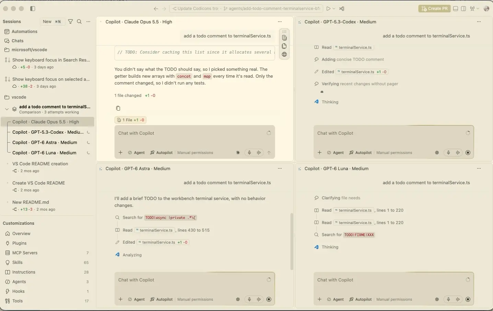

* **Evaluate and combine the results:** Optionally select a Judge model to evaluate the attempts and recommend a solution. Its scorecard shows time and token usage, with expandable rationale, validation evidence, and links to each attempt. You can then select **Synthesize** to build on the recommended attempt with ideas from the others. Synthesis starts only when you request it.

    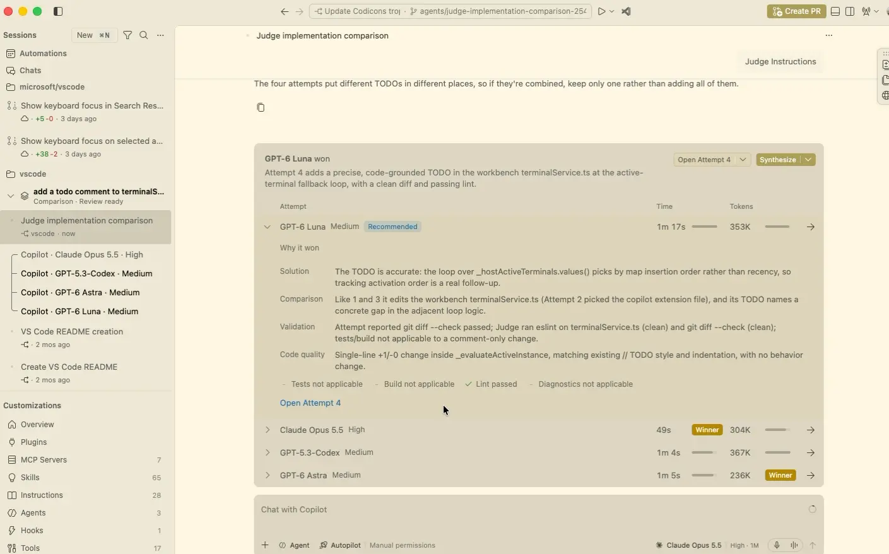

### Tab shortcuts in an empty side pane

When you closed every tab in the [Agents window](https://code.visualstudio.com/docs/agents/run/agents-window) side pane, the editor area was left blank, and you had to find the **Add Tab (+)** menu to get back to your session's changes or files.

The empty editor area now lists the tabs you can add, such as **Changes**, **Files**, **Browser**, and **Search**, each with its icon and keyboard shortcut. Select an entry to open that tab. If you have a canvas extension installed, a **Canvas** entry lists the available canvases. When you switch to a session whose editor area is empty, VS Code shows this list instead of reopening the **Changes** and **Files** tabs automatically.

<video src="images/1_143/empty-editor-add-tab.mp4" title="Video showing the list of tabs to add in an empty side pane editor in the Agents window." autoplay loop controls muted></video>

### Session Activity Bar (Experimental)

**Sessions**: `setting(sessions.showSessionActivityBar)`, `setting(sessions.sessionActivityBar.showLayoutActions)`

The Session Activity Bar brings a session's **Changes**, **Files**, **Browser**, and available canvases next to the side pane, keeping these editors and artifacts visually connected to where they open. You can still open session artifacts from the pills at the top of the session.

The Session Activity Bar is a slim vertical strip of icons at the right edge of the active chat. Select an icon to open that tab in the side pane. If the side pane is closed, it opens with that tab active. If the tab is already open, VS Code focuses it instead of opening a second copy. If you have a canvas extension installed, a **Canvas** entry opens a submenu of the available canvases.

<video src="images/1_143/session-activity-bar.mp4" title="Video showing the Session Activity Bar opening the Changes, Files, and Browser tabs beside the active chat in the Agents window." autoplay loop controls muted></video>

You can drag the Session Activity Bar up or down by its grip to move it out of your way, and double-click the grip to reset its position. When you split the chat area, only the focused group shows the Activity Bar.

To keep session-related layout actions together, right-click the Activity Bar and select **Show Layout Actions**. This moves the **Toggle Side Panel** and **Toggle Panel** actions from the title bar into the Activity Bar.

The Session Activity Bar is off by default in Stable. Select **View** > **Appearance** > **Session Activity Bar** to turn it on. To hide it again, right-click the Activity Bar and select **Hide Session Activity Bar**.

You can also configure these options with `setting(sessions.showSessionActivityBar)` and `setting(sessions.sessionActivityBar.showLayoutActions)`. If you previously set `sessions.showSessionToolbar`, VS Code carries your value over to `setting(sessions.showSessionActivityBar)`.

### Find and create files from the empty Files tab (Experimental)

**Setting**: `setting(sessions.experimental.emptyFileEditorActions)`

In the Agents window, the **Files** tab was blank when no file was open, so you had to switch to the Files view to find or create a file in your session's folder.

When you enable `setting(sessions.experimental.emptyFileEditorActions)`, the empty **Files** tab shows a search box and a **New File** action. The search works like [Quick Open](https://code.visualstudio.com/docs/editing/getting-started/tips-and-tricks#_quick-open) (`kb(workbench.action.quickOpen)`), with the same ranking, highlights, and file icons, and it only finds files in the folders of the current session. Select a result to open it in the editor, or select **New File** to create a file in the session's folder. When you close the file, the search box returns.

<video src="images/1_143/empty-files-tab-search.mp4" title="Video showing a file search and the New File action in the empty Files tab of the Agents window." autoplay loop controls muted></video>

### Improved performance when opening large chats

Opening a long [Agent Host](https://code.visualstudio.com/docs/agents/concepts/agent-host) chat in the Agents window used to freeze the window for up to half a minute while the chat's history was restored. In this release, history is restored in small slices instead of one long blocking task, so the window stays responsive. Opening, switching back to, and reloading large chats is significantly faster.

| Scenario | Chat | Time to open: 1.142 → 1.143 | Window unresponsive: 1.142 → 1.143 |
|---|---|---|---|
| Cold open | Chat A (~1,150 requests, ~530 MB history) | 35.6 s → 9.0 s | 28.3 s → 0.6 s |
| Cold open | Chat B (~1,450 requests, ~200 MB history) | 20.3 s → 3.0 s | 20.3 s → 0.4 s |
| Re-open | Chat A | 26.7 s → 0.6 s | 26.8 s → 0.3 s |
| Re-open | Chat B | 16.4 s → 0.4 s | 16.4 s → 0.2 s |
| Reload window | Chat A | 26.7 s → 2.9 s | 25.3 s → 0.9 s |
| Reload window | Chat B | 22.3 s → 2.2 s | 20.8 s → 0.4 s |

_Median of three runs on macOS, with real chats from day-to-day development. "Cold open" means opening a chat for the first time after the window starts. "Re-open" means switching to another chat and back. "Window unresponsive" is the longest time the window could not respond to input during the open._

### Reclaim storage from inactive worktrees (Experimental)

**Setting**: `setting(chat.agentSessions.sessionStorageCleanupSuggestion.enabled)` (Agents window only)

Worktrees are very useful for letting agents work on multiple features simultaneously without interfering with each other's changes. Over time, inactive worktrees can accumulate and consume significant disk space.

Run **Chat: Open Worktree Cleanup** from the Command Palette to see how much disk space inactive agent session worktrees use and remove the ones you no longer need. Filter sessions by how long they have been inactive, review each worktree's size, and select the worktrees to clean up.

Cleaning up marks the selected sessions as done and deletes their worktrees. You can restore a session later to recreate its worktree. Active, running, needs-input, and pinned sessions are protected from cleanup.

The cleanup editor lets you configure automatic cleanup for sessions with merged pull requests and control whether VS Code suggests cleanup when session storage grows large.

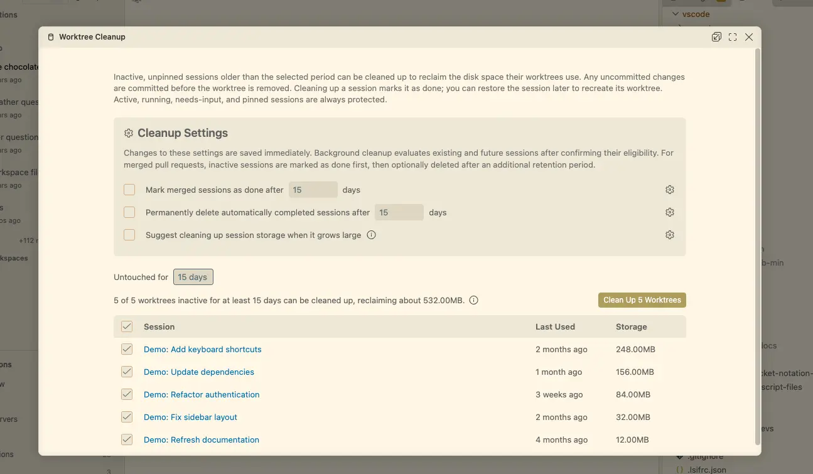

When `setting(chat.agentSessions.sessionStorageCleanupSuggestion.enabled)` is enabled, the Agents window notifies you when inactive worktrees accumulate or they use enough disk space to make cleanup worthwhile.

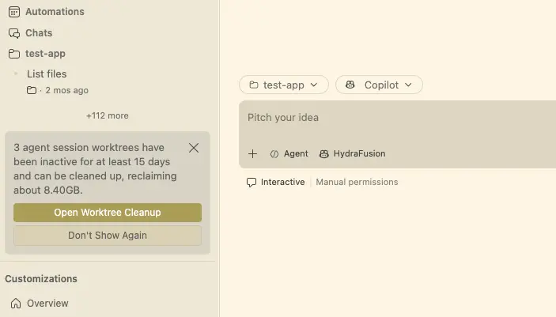

## Models

### Run Copilot models on your device (Experimental)

Laptops such as the new [Surface Laptop Ultra](https://www.microsoft.com/en-us/surface/devices/surface-laptop-ultra), powered by NVIDIA RTX Spark with up to 128 GB of unified memory, have enough GPU memory to run a capable coding model locally. On-device models let you use that hardware with Copilot: download MAI Code 1.1 Flash from the new **On This Device** tab in the model picker and chat with it in Copilot harness sessions, with model processing on your device.

VS Code downloads and manages the model for you. Responses that run on your device are labeled **On-device** and don't use AI credits. To let Auto route suitable requests to the on-device model with cloud fallback, turn on **Use in Auto** on the model's details page.

<video src="images/1_143/on-device-models.mp4" title="Video showing MAI Code 1.1 Flash downloaded from the On This Device tab in the model picker, loaded, and answering a chat prompt on the device." autoplay loop controls muted></video>

To get started:

* Install a [llama.cpp build](https://github.com/ggml-org/llama.cpp/releases) that supports the model
* Set `setting(chat.copilot.localModel.llamaServerPath)` to its `llama-server` executable
* Enable `setting(chat.copilot.localModel.enabled)`

On-device models require GitHub sign-in and an NVIDIA GPU with 96 GB or more of GPU memory.

Learn more about [on-device models](https://code.visualstudio.com/docs/agent-customization/language-models#_use-on-device-models-experimental).

### Bring your own OpenAI model to Voice Mode (Preview)

**Settings**: `setting(agents.voice.enabled)`, `setting(agents.voice.useBYOKVoiceModel)`

Use your own OpenAI API key and live model for voice-driven coding conversations instead of the hosted Voice Mode backend. Add your OpenAI key in the Language Models editor, enable `setting(agents.voice.enabled)`, and set `setting(agents.voice.useBYOKVoiceModel)` to a live model ID, like `gpt-live-1` that your key can access.

## Sandboxing

### Manage sandbox certificate trust

Sandbox certificate trust management is available for agent hosts running Windows or macOS.

The sandbox credential proxy lets tools authenticate to approved services without exposing real authentication tokens to sandboxed processes. It gives tools placeholder credentials, then substitutes the real credentials when forwarding requests to approved destinations. For HTTPS requests, this requires the proxy to present its own TLS certificates, which the tools must trust.

Copilot supplies a certificate bundle for tools that support it. Some tools instead rely on the operating system's certificate trust store and can encounter certificate errors when the proxy's certificate authority (CA) isn't trusted. Installing the CA improves compatibility with these tools. **Domain filtering alone does not require CA installation:** the built-in local proxy can check destinations and tunnel HTTPS traffic without decrypting it.

VS Code shows a dismissible **Sandbox trusted CA is not installed** notice with an **Install** option when trust is missing and installation is supported. Installation adds the locally generated CA's public certificate to the Windows machine-wide trust store or the macOS user's login Keychain and can require operating system authorization.

<video src="images/1_143/sandbox-ca-install.mp4" title="Video showing installation of the sandbox trusted certificate authority in VS Code." autoplay loop controls muted></video>

You can also run **Sandbox: Manage Trusted CA** from the Command Palette to install, rotate, or remove trust for the last-focused chat's agent host, whether local or remote. Each operation asks for confirmation and identifies the target host. **Remove** removes operating system trust but keeps the stored certificate and private key. Running tools might need to restart after a certificate change.

Installation is optional. Missing trust doesn't block chat startup or sending messages, and opening a chat never changes certificate trust.

For more details, see [Trust the sandbox CA certificate on Windows and macOS](https://code.visualstudio.com/docs/agents/run/agent-sandboxing#_trust-the-sandbox-ca-certificate-on-windows-and-macos).

### Change session sandboxing when policy permits

If your organization's managed policy permits sandbox bypass, you can turn [sandboxing](https://code.visualstudio.com/docs/agents/run/agent-sandboxing) off for an individual Copilot harness session without changing your global settings. Use the **Sandboxing for terminal** toggle in the session permissions menu in either the editor or the Agents window. Administrators can continue to require sandboxing by disallowing bypass, which keeps the toggle on and locked.

Changes remain subject to approval by the agent runtime. If a change is rejected, VS Code shows an error and restores the last applied sandbox state. The collapsed permissions control and the reopened menu reflect that state.


## Chat

<!--
### Multiple steering and queued messages

Multiple steering and queued messages are displayed correctly, with earlier pending messages remaining visible when you send another.
-->

### Open canvases from the chat menu (Preview)

**Setting**: `setting(chat.canvases.enabled)`

VS Code 1.142 introduced canvases (Preview), which are shared, interactive surfaces for collaborating with agents.

In this release, you can now open available canvases from **New Chat (+)** > **Canvas** in the editor window, without asking Copilot to open them.

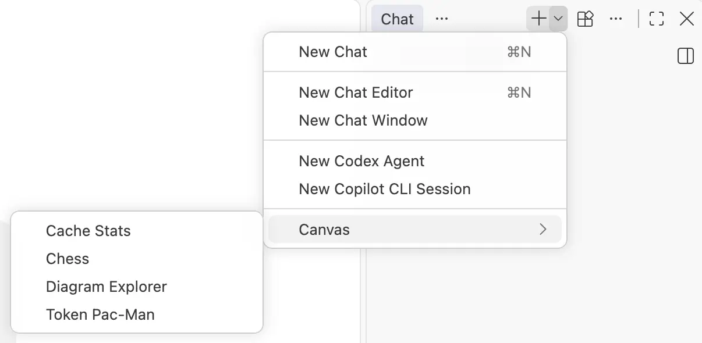

When canvas support is enabled and you have canvas extensions installed, the submenu appears _after your first message_ in a Copilot harness session. You can also open canvases from the `+` menu in the Agents window.

Learn about [installing, creating, and using canvases with the Copilot harness](https://code.visualstudio.com/docs/agents/run/agent-harnesses#_use-canvases-with-the-copilot-harness).

### See output from detached background shells

In [Copilot harness](https://code.visualstudio.com/docs/agents/run/agent-harnesses) sessions, the agent can start commands that need to continue running after it responds in a detached background shell. A dev server or a file watcher are common examples of such commands.

Previously, you couldn't view the output of detached background shells, for example to check whether a dev server started successfully. Detached shells now stream their output like attached shells. Select the **Background Shells** pill, and then select a detached shell to watch its output as the command runs. The shell's terminal output in the chat response also keeps updating after the agent finishes its response. When the command exits, the shell leaves the list, and the chat response keeps the command's output and exit status.

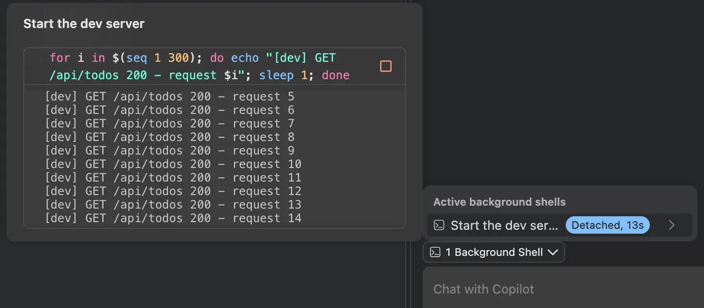

You can now also stop detached shells, which was previously [only available for attached shells](https://code.visualstudio.com/updates/v1_142#_stop-background-shells). When you no longer need a dev server or watcher, select **Stop Shell** in the shell's details.

## Editor Experience

### Diagnostic highlight limits

To improve diagnostic visibility in files with many reported problems, the editor highlight limit has increased from 500 to 5,000 diagnostics per file.

A warning in the editor's language status indicator indicates when diagnostics or their highlights are limited for performance reasons:

* **Diagnostic source limit:** Each extension diagnostic collection can provide up to 1,000 diagnostics per file. If a collection exceeds this limit, the warning indicates that some diagnostics are not shown.

* **Editor highlight limit:** The editor highlights up to 5,000 diagnostics per file across all sources. If this limit is exceeded, the warning indicates that only 5,000 diagnostics are highlighted.

If both limits are reached, the warning reports both conditions. Hover over the language status indicator in the Status Bar to view the details.

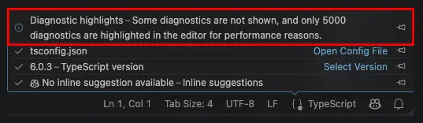

## Source Control

### Multi-file diff editor file list (Experimental)

**Setting**: `setting(multiDiffEditor.experimental.fileList)`

Navigate changes from commits, stashes, and agent sessions with a file list beside the multi-file diff view. Enable `setting(multiDiffEditor.experimental.fileList)` to try it.

Each file in the list has a status letter: A (added), M (modified), D (deleted), or R (renamed). As you scroll, the list highlights the file you're viewing. Select a file in the list to jump to its diff. Open **Files View & Position** in the editor toolbar's **More Actions** (**...**) menu to choose **View as List** or **View as Tree**, and to place the files **On the Left** or **On the Right** of the diffs.

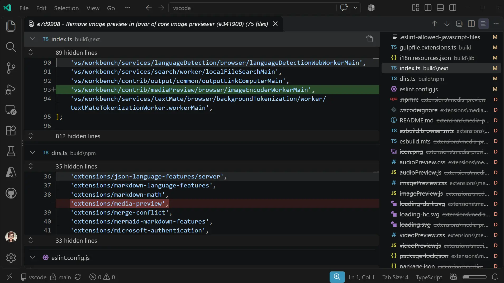

## Enterprise

### Dynamic headers for managed OpenTelemetry

Administrators can generate and refresh HTTP headers for OpenTelemetry (OTel) exports with the new `telemetry.headersProvider` managed setting. For example, use a helper to supply short-lived authentication tokens for your collector, without asking developers to update headers manually or opt in through personal OTel settings.

This setting applies **only to Copilot Agent Host sessions**. Configure it in [enterprise-managed settings](https://docs.github.com/en/copilot/how-tos/administer-copilot/manage-for-enterprise/use-managed-settings/get-started), not user settings:

```json
{
    "telemetry": {
        "enabled": true,
        "endpoint": "https://<collector-host>:4318",
        "protocol": "http",
        "headersProvider": {
            "path": "<absolute-path-to-header-helper>",
            "args": [],
            "refreshIntervalMs": 5000
        }
    }
}
```

The helper writes a JSON object of header names and string values to standard output.

See [Configure dynamic headers](https://code.visualstudio.com/docs/agents/guides/monitoring-agents#_configure-dynamic-headers) for helper requirements and further details.

### Managed model defaults

New Copilot harness chats use your organization's managed defaults, even when you configure `setting(chat.defaultModel)` to another preference. The model picker and setting now explain which defaults apply. You can still change models and supported options per chat.

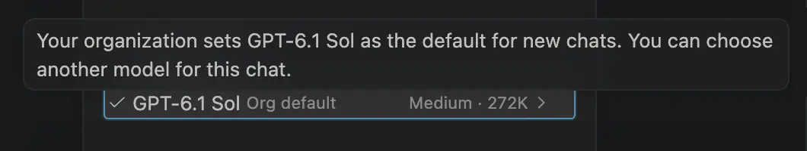

For example, the following configuration defaults new chats to Auto with the Intelligence tier in [enterprise-managed settings](https://docs.github.com/en/copilot/how-tos/administer-copilot/manage-for-enterprise/use-managed-settings/get-started):

```json
{
    "model": "auto",
    "autoTier": "intelligence"
}
```

### Why Local is disabled

When enterprise policy requires the [Copilot harness](https://code.visualstudio.com/docs/agents/run/agent-harnesses), the Local harness now stays visible but is disabled in the harness picker, with a [**Learn why**](https://aka.ms/vscode-copilot-harness-policy) link explaining the restriction.

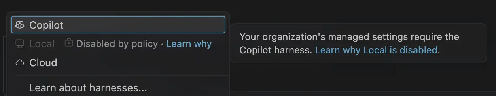

Copilot is required to enforce nonempty managed `permissions.deny` rules or `sandbox.enabled: true`, unless the temporary override below applies. Other `permissions.*` settings and an empty deny list do not trigger this requirement.

Administrators can prohibit Local with these enterprise-managed settings, not user settings:

```json
{
    "vscode": {
        "temporaryAllowLocalHarness": false,
        "temporaryDefaultToLocalHarness": false
    }
}
```

| Setting | Description |
| --- | --- |
| `vscode.temporaryAllowLocalHarness` | `false` prohibits Local, Claude, and Codex harnesses, overriding the temporary default below. `true` does not override other policies. |
| `vscode.temporaryDefaultToLocalHarness` | `true` keeps Local available and suppresses automatic Copilot routing, including deny-list and sandbox requirements. Explicit and remembered choices are preserved. |

When Copilot is required, opening unarchived Local chats moves them to Copilot. Editor inline chat and other Claude and Codex restrictions are unchanged.

> **Note**: These controls are temporary while Local is retired. Local cannot enforce runtime-only permission and sandbox controls. Do not enable the temporary Local override if you require those controls. If Copilot fails in your enterprise environment, [report an issue](https://github.com/microsoft/vscode/issues).

### Fewer interruptions while organization settings load

Copilot harness sessions and model changes now wait for slow organization settings to load, with progress and a retry option on failure. You can still select **Stop** while you're waiting. Organization restrictions apply before requests run.

### Fewer approval prompts for managed tools

[Assisted permissions](https://code.visualstudio.com/updates/v1_142#_manage-copilot-permission-modes-independently) no longer prompt again for eligible managed tool requests they approve. One-time limits, managed denials, and sandbox restrictions still apply.

### Managed plugins install automatically

Copilot harness sessions now install or update the [agent plugins](https://code.visualstudio.com/docs/agent-customization/agent-plugins) that your organization requires before using them.

For example, require a plugin in [enterprise-managed settings](https://docs.github.com/en/copilot/how-tos/administer-copilot/manage-for-enterprise/use-managed-settings/get-started):

```json
{
    "enabledPlugins": {
        "my-plugin@my-marketplace": true
    }
}
```

Plugins enabled by a trusted repository's settings, and plugins your organization assigns to your team, install in the background without blocking chat.

* Managed settings take precedence, followed by trusted repository settings and then your own choices.
* Team assignments apply only when no other choice exists.
* Automatically installed plugins are enabled only for the session and aren't added to your user settings.

### Claude and Codex sessions

When policy requires the Copilot harness, existing Claude and Codex sessions remain visible in the sessions list, so you still can continue them with the Copilot harness. Creating new Claude or Codex sessions remains disabled in this scenario.

## VS Code setup

### Install GitHub Copilot CLI with VS Code

We now make it easier for you to get started with the [GitHub Copilot CLI](https://github.com/features/copilot/cli) by letting you install it with the VS Code installer.

**Note:** Organizations can choose to disable this option via the [Managed AI Settings](https://code.visualstudio.com/docs/enterprise/manage-ai-settings#_enable-or-disable-the-copilot-command).

* Windows

    The VS Code installer on Windows now includes an option to install GitHub Copilot CLI. If you already have it installed, this option is not presented. Find more details in [Set up the copilot command on Windows](https://code.visualstudio.com/docs/setup/windows#_setup-the-copilot-command).

    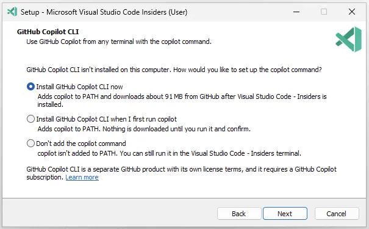

* Linux

    The VS Code Linux installers add a `copilot` executable into the user path.

    If you run the `copilot` command in the terminal, it will either prompt you to install GitHub Copilot CLI if it's not installed, or run GitHub Copilot CLI if it is already installed.

* macOS

    On macOS, you are prompted to install GitHub Copilot CLI when you add VS Code to the `$PATH` environment variable via the Command Palette in VS Code.

    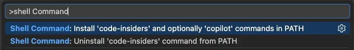

## Deprecated features and settings

None

<!-- RELEASE_THANK_YOU_START -->
## Thank you

Contributions to `vscode`:

* [@bstee615 (Benjamin Steenhoek)](https://github.com/bstee615): nes: Add prompt template which enables only low/medium eagerness modes [PR #340404](https://github.com/microsoft/vscode/pull/340404)
* [@davidfowl (David Fowler)](https://github.com/davidfowl): Fix incomplete Mission Control sandbox session discovery [PR #341823](https://github.com/microsoft/vscode/pull/341823)
* [@denizguney (Deniz Güney Yıldırım)](https://github.com/denizguney): Add version validation check to getContextProviderAPI method [PR #339523](https://github.com/microsoft/vscode/pull/339523)
* [@KRRT7 (Kevin Turcios)](https://github.com/KRRT7): Skip serializing bulk edits when debug logging is off [PR #341765](https://github.com/microsoft/vscode/pull/341765)
* [@matt-sorenson (Matt Sorenson)](https://github.com/matt-sorenson): Mark variables in zsh integration functions as local [PR #290298](https://github.com/microsoft/vscode/pull/290298)
* [@mcumming (Michael Cummings (MSFT))](https://github.com/mcumming)
  * Private Marketplace extension blocking: add gallery and install enforcement [PR #333859](https://github.com/microsoft/vscode/pull/333859)
  * Reject non-manifest 200 responses as extension gallery service index [PR #331804](https://github.com/microsoft/vscode/pull/331804)
  * Fix lost race leaving a signed-out user on an Available marketplace [PR #331800](https://github.com/microsoft/vscode/pull/331800)
* [@na2co3-ftw (na2co3)](https://github.com/na2co3-ftw): Modern UI: fix frosted glass menu background corners [PR #339456](https://github.com/microsoft/vscode/pull/339456)
* [@pwang347 (Paul)](https://github.com/pwang347)
  * Allow retrying pending Copilot connectors [PR #341081](https://github.com/microsoft/vscode/pull/341081)
  * agentHost: enable SDK skill installation [PR #340762](https://github.com/microsoft/vscode/pull/340762)
  * Fix customization marketplace sign-in [PR #341648](https://github.com/microsoft/vscode/pull/341648)
* [@rahadbhuiya (Rahad)](https://github.com/rahadbhuiya): cli: respect VSCODE_PORTABLE and make Quality parsing case-insensitive [PR #341565](https://github.com/microsoft/vscode/pull/341565)
* [@rksharma-owg (RKS)](https://github.com/rksharma-owg): sessions: Stabilize approval row height during sticky scrolling [PR #338210](https://github.com/microsoft/vscode/pull/338210)
* [@SimonSiefke (Simon Siefke)](https://github.com/SimonSiefke)
  * fix: memory leak in timeline providers [PR #340881](https://github.com/microsoft/vscode/pull/340881)
  * fix: memory leak in chat debug providers [PR #340880](https://github.com/microsoft/vscode/pull/340880)
  * fix: memory leak in language model removal notifications [PR #340577](https://github.com/microsoft/vscode/pull/340577)
  * fix: memory leak in canceled tree drag transfers [PR #340845](https://github.com/microsoft/vscode/pull/340845)
  * fix: memory leak in pending quick pick items [PR #340846](https://github.com/microsoft/vscode/pull/340846)
  * fix: guard notebook diff input lifecycle [PR #339389](https://github.com/microsoft/vscode/pull/339389)
  * fix: memory leak in terminal process startup [PR #340582](https://github.com/microsoft/vscode/pull/340582)
  * fix: memory leak in suggest enabled input [PR #340913](https://github.com/microsoft/vscode/pull/340913)
* [@sw23 (Spencer Williams)](https://github.com/sw23): Scope content exclusion path rules to their repository [PR #339415](https://github.com/microsoft/vscode/pull/339415)
* [@VirajMishra1 (Viraj Mishra)](https://github.com/VirajMishra1): fix: path, URI, JSON edit utility bugs [PR #334259](https://github.com/microsoft/vscode/pull/334259)
* [@vscodebot-pr (VS Code PR Bot)](https://github.com/vscodebot-pr)
  * fix: tolerate post-close debug adapter messages (fixes #340511) [PR #340519](https://github.com/microsoft/vscode/pull/340519)
  * fix: guard webview find against disposed frame subtree (fixes #339314) [PR #339331](https://github.com/microsoft/vscode/pull/339331)
  * fix: guard Auto routing stream pushes against cancelled turns (fixes #341067) [PR #341077](https://github.com/microsoft/vscode/pull/341077)
* [@wycats (Yehuda Katz)](https://github.com/wycats): chat: preserve conversation ID for Agent Host BYOK requests [PR #341450](https://github.com/microsoft/vscode/pull/341450)
* [@yuki-nakano-520 (yuki nakano)](https://github.com/yuki-nakano-520): fix: sort terminal type-ahead latencies numerically [PR #341303](https://github.com/microsoft/vscode/pull/341303)

<!-- RELEASE_THANK_YOU_END -->
---

We really appreciate people trying our new features as soon as they are ready, so check back here often and learn what's new.

>If you'd like to read release notes for previous VS Code versions, go to [Updates](https://code.visualstudio.com/updates) on [code.visualstudio.com](https://code.visualstudio.com).

<a id="scroll-to-top" role="button" title="Scroll to top" aria-label="scroll to top" href="#"><span class="icon"></span></a>
<link rel="stylesheet" type="text/css" href="css/inproduct_releasenotes.css"/>
