# Visual Studio Code 1.144

<!-- %IF IN_PRODUCT %
Follow us on [LinkedIn](https://www.linkedin.com/showcase/vs-code), [X](https://go.microsoft.com/fwlink/?LinkID=533687), [Bluesky](https://bsky.app/profile/vscode.dev), [Instagram](https://www.instagram.com/vscode.ig) | [View online](https://code.visualstudio.com/updates)
%ENDIF % -->
<!-- %IF IN_WEB %
<p class="release-metadata"><span>Release date: October 28, 2026</span> <span class="release-channel">Stable</span></p>
%ENDIF % -->
<!-- %IF IN_PRODUCT %
_Release date: October 28, 2026_
%ENDIF % -->

<!-- DOWNLOAD_LINKS_PLACEHOLDER -->

<!-- RELEASE_HIGHLIGHTS_START -->
## Release recap

The road to GitHub Universe ([join us virtually!](https://githubuniverse.com/)) is paved with lots of pull requests! So, let's take a step back and look at what we've shipped recently.

* Remember when agent sessions would stop as soon as you closed your client? We built the [Agent Host](https://code.visualstudio.com/docs/agents/concepts/agent-host), a separate process that keeps your agents running, on your local machine or remotely.

* With language servers in mind, we designed the [Agent Host Protocol (AHP)](https://microsoft.github.io/agent-host-protocol/) to allow any client to interact with agent sessions. All of sudden, session continuity across VS Code, Copilot CLI, GitHub Copilot App, and github.com lets you pick up right where you left off.

* The Agents window lets you manage your agents across workspaces and environments from a single interface, whether you kick off things yourself or use [automations](https://code.visualstudio.com/docs/agents/run/automations) to handle repetitive tasks.

* By default, agents are now powered by the [Copilot harness](https://code.visualstudio.com/docs/agents/run/agent-harnesses), the same harness used in Copilot Code Review, the Copilot CLI, the Copilot App, and Copilot Cloud sessions. Write agent customizations once and use them consistently across all these experiences.

* If you prefer [Anthropic's Claude Code harness or the one from OpenAI Codex](https://code.visualstudio.com/docs/agents/run/agent-harnesses?id=requirements-and-setup), just use those instead with your Copilot subscription and enjoy the familiar VS Code developer experience.

* As we continue to offer new models from different providers, how do you decide which one is best suited for your task? With [model comparisons](https://code.visualstudio.com/docs/agents/run/compare-models) (aka Agent Bake-Off), run the same prompt against multiple models and harnesses to see which performs best. Prefer a hands-off approach? Use [Copilot Fusion](https://code.visualstudio.com/docs/agents/concepts/language-models#_copilot-fusion) to choose the best model and orchestrate multiple models to work together for your task.

* We've had vision capabilities for a while, but you kept asking for more. The wait is over, and now you can also prompt the agent to [generate images](https://code.visualstudio.com/docs/chat/chat-overview#_generate-and-edit-images-experimental) directly in chat.

* Chat is not always the best interface for every task. With [canvas support](https://code.visualstudio.com/docs/agents/run/canvases), you can create rich, interactive UI to interact with your agents and visualize their outputs.

* Coding with agents can be more than just writing code. Let agents interact with the browser to validate their results, or let them [drive apps on your computer](https://code.visualstudio.com/docs/agents/run/tools#_control-desktop-applications-experimental) for automation and task execution.

* If you need it, build it! So, we created a beautiful new [Markdown editor](https://code.visualstudio.com/docs/languages/markdown#_markdown-editor). Instead of editing the raw Markdown, you can edit the rendered Markdown directly. And, of course, you can still edit the source if you prefer.

* And if you didn't notice, we also [refreshed the overall look and feel of VS Code](https://code.visualstudio.com/blogs/2026/10/15/modern-ui), so it looks fresh and beautiful in light and dark themes.

Read all about this, and more, in our [VS Code Wrapped blog post](https://code.visualstudio.com/blogs).
<!-- RELEASE_HIGHLIGHTS_END -->

<!-- RELEASE_HIGHLIGHTS_START -->
## Release highlights

This release helps you keep agent work moving across environments, find the right models for each task, and stay in control of changes and tool calls.

* [Session continuity](#session-continuity): Manage remotes in one place and keep sessions and automations running even when your computer is off.

* [Copilot Fusion and model comparisons](#models): Let Copilot choose and orchestrate models, or compare models side by side.

* [Image generation (Preview)](#image-generation-in-copilot-preview): Create and edit images directly in chat.

* [Computer use (Experimental)](#let-agents-use-desktop-apps-with-computer-use): Let agents use desktop apps on your computer.

* [Working set (Experimental)](#review-copilot-file-edits-with-the-working-set-experimental): Keep or undo agent file edits in the editor.

* [Assisted permissions](#assisted-permissions-are-generally-available): Reduce interruptions with automatic approval for tool calls that pass a risk check.

* [Customization marketplace](#discover-marketplace-customizations-preview) and [Copilot connectors](#connect-services-with-copilot-connectors-preview) (Preview): Discover skills and plugins for your workflow, and bring context from Slack, Notion, and other services into your agent sessions.
<!-- RELEASE_HIGHLIGHTS_END -->

<!-- %IF STABLE %
<p class="release-update-guidance">Already installed? Use <strong>Check for Updates</strong> in VS Code. For upcoming features, use the <a href="https://code.visualstudio.com/insiders">Insiders build</a>.</p>
%ENDIF % -->

<!-- %IF IN_PRODUCT %
Happy Coding!

---
%ENDIF % -->

<!-- TOC
<div class="toc-nav-layout">
  <nav id="toc-nav">
    <div>In this update</div>
    <ul>
      <li><a href="#release-recap">Release recap</a></li>
      <li><a href="#release-highlights">Release highlights</a></li>
      <li><a href="#session-continuity">Session continuity</a></li>
      <li><a href="#models">Models</a></li>
      <li><a href="#agent-integration">Agent integration</a></li>
      <li><a href="#agents">Agents</a></li>
      <li><a href="#agent-customizations">Agent customizations</a></li>
      <li><a href="#session-management">Session management</a></li>
      <li><a href="#chat">Chat</a></li>
      <li><a href="#editor-experience">Editor Experience</a></li>
      <li><a href="#terminal">Terminal</a></li>
      <li><a href="#enterprise">Enterprise</a></li>
      <li><a href="#contributions-to-extensions">Contributions to extensions</a></li>
      <li><a href="#extension-authoring">Extension Authoring</a></li>
      <li><a href="#deprecated-features-and-settings">Deprecated features and settings</a></li>
      <li><a href="#thank-you">Thank you</a></li>
    </ul>
  </nav>
  <div class="notes-main">
Navigation End -->

## Session continuity

### Run and continue Copilot tasks in the cloud

Cloud sessions let you run Copilot tasks from VS Code without keeping your development machine online. Your repository and tools run in a managed environment on GitHub's infrastructure.

From the **Chat view** in the editor window or the **Agents window**, you can:

* Select **Cloud** and choose a GitHub repository to start a task.
* Send follow-up instructions, respond to approval requests, and review the agent's changes.
* Reopen an existing cloud session from the sessions list to continue the same conversation.

Your cloud sessions are also accessible from other Copilot clients. For example, you can check progress on GitHub.com or in the **GitHub Mobile app**, then return to VS Code to continue working.

<video src="images/1_144/cloud-continuity.mp4" title="Video showing cloud continuity in Copilot tasks." autoplay loop controls muted></video>

Cloud sessions use a separate workspace. Local uncommitted changes aren't automatically copied. The new cloud experience requires a paid Copilot plan and is subject to organization policies.

### Manage remote environments

VS Code lets you run agents and perform development tasks across different (remote) environments. To make it easier to manage these environments, we're introducing the **Remote Environments** dialog, which brings your GitHub Environments, Dev Tunnels, WSL distributions, and SSH hosts together in one place.

Select **Manage Remote Environments** at the bottom of the Environment picker to see the status of each remote, connect or disconnect, and choose which remotes should be visible in the pickers.

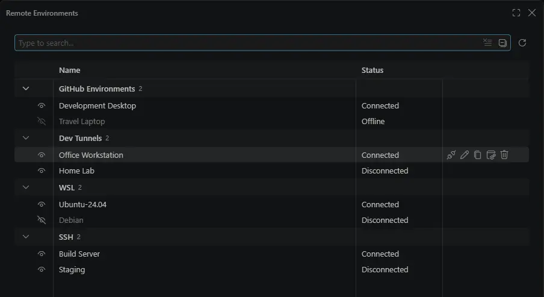

Learn more about [remote agent sessions](https://code.visualstudio.com/docs/agents/run/remote-agent-sessions).

### Cloud Automations (Preview)

**Setting:** `setting(chat.automations.cloud.enabled)`

Create and manage Copilot cloud automations directly in the Agents window. Enabled by default, they run on GitHub infrastructure on a schedule or in response to repository events, even when your computer is off.

To create a cloud automation, you can ask an agent to set one up for you, or use the **Create Automation** button in the Automations view in the Agents window.

With cloud automations, you can:

* **Set up automations that run in response to issue or pull request events**: Act automatically when activity happens in your repository. For example, automatically triaging issues as they get assigned to you.
* **Build shared workflows in the cloud with your team**: Create automations that are visible to everyone with access to the repository and act as Copilot.
* **Control exactly when your agent runs and what it can do**: Limit allowed tools and add filters for precise control over your automations. For example, trigger an automation when you are assigned an issue with a specific label.

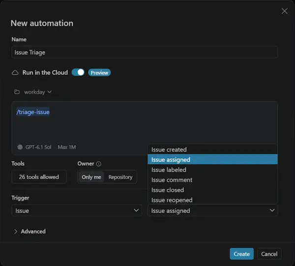

To learn more, see [Create and manage agent automations](https://code.visualstudio.com/docs/agents/run/automations) in the Visual Studio Code docs.

### Agent Host Protocol v1.0

We've published the first version of the [Agent Host Protocol](https://microsoft.github.io/agent-host-protocol/), the protocol that VS Code uses to communicate with its agents locally and on remote machines, including for [cloud automations](#cloud-automations-preview). It's an open, extensible protocol designed to be an easy way to build custom UI's for your agents, or build agent platforms that plug into any UI that speaks it.

You can add a websocket-based agent host to your VS Code instance via the command **Agents: Add Remote Agent Host...** in the Agents window, and run `code agent endpoints` to get the endpoints for your editor's running agent host. We publish libraries in six languages and have found agents are good at making clients and hosts using them.

You can read more about the protocol and find additional resources on the [Agent Host Protocol website](https://microsoft.github.io/agent-host-protocol/).

## Models

### Route and orchestrate models with GitHub Copilot Fusion

Instead of picking a model for each task, select **Copilot Fusion** in the model picker and let Copilot intelligently route requests and orchestrate models for you. Copilot Fusion brings together [Project HydraFusion](https://github.blog/ai-and-ml/github-copilot/project-hydrafusion-frontier-quality-via-multi-model-orchestration/)'s multi-model orchestration and [Copilot auto model selection](https://docs.github.com/copilot/concepts/models/auto-model-selection)'s task-aware model selection to balance performance and cost efficiency.

For each request, Copilot Fusion chooses the models, reasoning effort, and execution pattern for your task. For example, one model completes a simple task, while for harder tasks one model drafts a solution and other models review or critique it. Hover over the effort level below a response to see which models were used.

Choose an effort level to balance quality and cost: **Standard** for everyday coding work, **High** for more demanding tasks, and **Max** for the most complex tasks.

<video src="images/1_144/copilot-fusion.mp4" title="Video showing the model picker in Copilot Chat." autoplay loop controls muted></video>

You're billed for each model that Copilot Fusion uses at its standard rate. Through November 30, 2026, paid Copilot plans receive a 30% discount when using Copilot Fusion.

GitHub Copilot Fusion is now generally available, with Copilot Fusion High and Max offered on Copilot Pro+, Max, Business, and Enterprise plans. To learn more, see our documentation on [GitHub Copilot Fusion](https://aka.ms/vscode-copilot-fusion).

### Compare models and harnesses by default and in more projects

**Setting**: `setting(sessions.chat.compareAgents.enabled)`

[Model comparisons](https://code.visualstudio.com/docs/agents/run/compare-models) run the same prompt across models for side-by-side review. They are enabled by default for eligible new sessions in the Agents window, unless overridden by user settings or experiments.

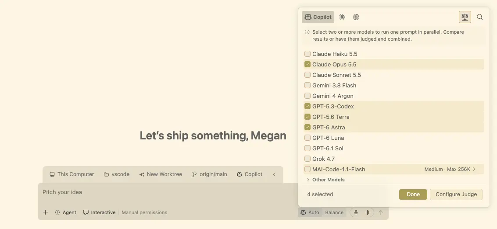

In this release, we expanded model comparison to more scenarios:

* **Explore ideas without a project:** Run independent attempts from a folderless **Chat**, without a Git repository, judge, or synthesizer.
* **Start with a local or empty repository:** A Git remote and an initial commit are no longer required. For repositories without commits, each isolated attempt starts from a snapshot of non-ignored working files without changing your source branch or index.

To open comparison setup from the keyboard, press `kb(sessions.compareModels)` from an eligible chat input or model picker.

Within setup, navigation buttons name their destination, such as **Configure Judge**, **Configure Attempts**, and **Configure Synthesis**, instead of using generic next and previous labels.

> **Note**: Model comparisons are not supported in Dev Containers.

### Image generation in Copilot (Preview)

**Setting:** `setting(chat.copilot.imageGeneration.model)`, `setting(chat.copilot.imageGeneration.watermark)`.

Agents can generate images from your prompts with GPT Image 2.5 Flare. Ask the agent to create an image for your website, a chat background, a new icon, or a website wireframe. You can also add an existing image as chat context and ask the agent to modify it or generate variations.

The default image model is GPT Image 2.5 Flare. To disable image generation, set `setting(chat.copilot.imageGeneration.model)` to `off`. Image generation requires access to the selected model and uses AI credits in addition to those used by the conversation model.

Additionally, set `setting(chat.copilot.imageGeneration.watermark)` to `true` to add a perceptible `Made with AI` watermark to your image.

<video src="images/1_144/image-gen.mp4" title="Video showing an image of a cat in a cafe being generated in the Agents Window." autoplay loop controls muted></video>

## Agent integration

### Let agents use desktop apps with computer use

**Setting**: `setting(chat.agentHost.computerUse.enabled)`

Some tasks happen in desktop apps rather than in your code or the terminal. With Computer Use, the agent can see and control apps on your computer. Computer Use works in [Copilot harness](https://code.visualstudio.com/docs/agents/run/agent-harnesses) sessions that run on your own macOS or Windows machine.

When a task needs Computer Use, the agent asks you to allow turning it on, or you can run `/computer on`. Computer Use stays on for Copilot until you run `/computer off`.

Learn more about [Computer Use](https://code.visualstudio.com/docs/agents/run/tools#_control-desktop-applications-experimental) in the documentation.

### Canvases (Preview)

**Setting**: `setting(chat.canvases.enabled)`

Previously introduced in VS Code 1.142, [Canvases](https://code.visualstudio.com/docs/agents/run/agent-harnesses#_use-canvases-with-the-copilot-harness) are shared, interactive surfaces where you and the agent can inspect and update the same artifact. This release makes canvases easier to find, manage, and open.

#### Manage canvases in the Agent Customizations editor

The Agent Customizations editor's **Canvases** section lists the canvases available to the active Copilot session and groups their contributing canvas extensions by source. To see it, open a Copilot session with at least one message in it, and open the Agent Customizations editor from there.

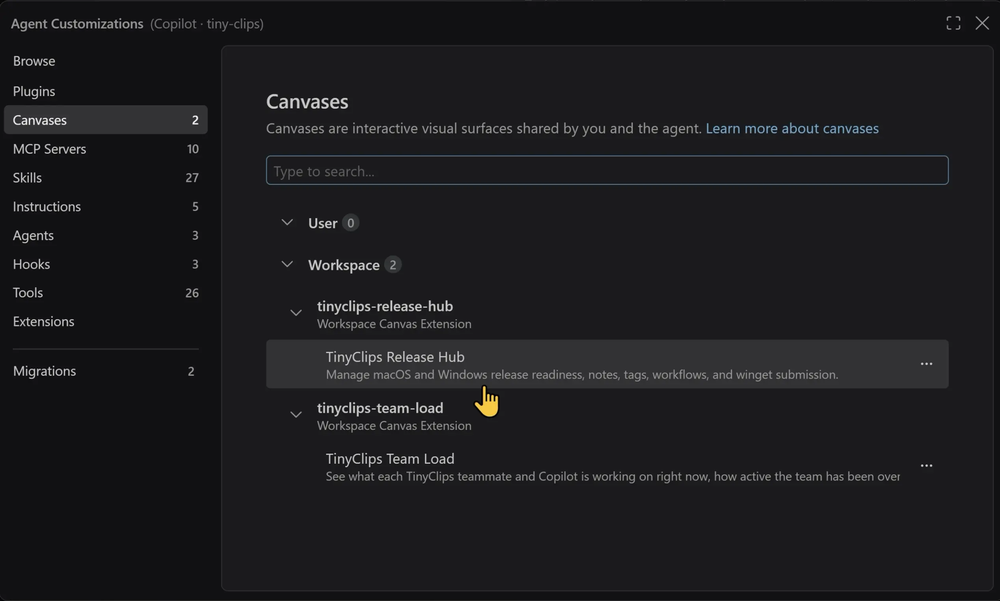

Under the **Browse** section, select **Canvases** to find plugins whose metadata indicates that they provide canvases. Some canvas-capable plugins might not have that metadata and would appear under **Plugins** instead. Learn how to [manage canvas extensions](https://code.visualstudio.com/docs/agent-customization/overview#_manage-canvas-extensions).

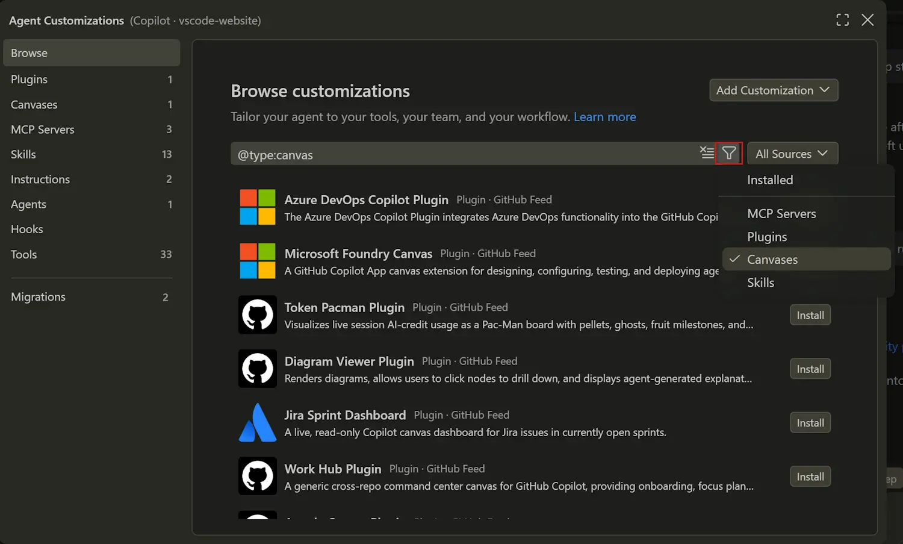

#### Open canvases from the Add Context menu

In chats in the editor or Agents window, select **Add Context (+)** > **Canvas...** to open or refocus an available canvas.

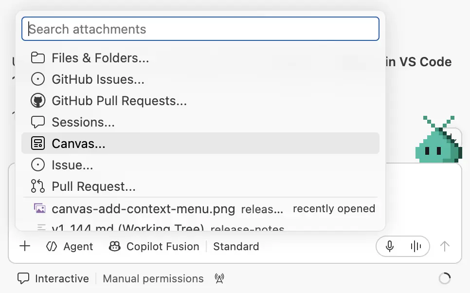

This adds another entry point alongside **New Chat (+)** > **Canvas** in the editor window and **Add Tab (+)** > **Canvas** in the Agents window.

## Agents

### Assisted permissions are generally available

Agents can make many tool calls to accomplish a task. Approving every tool call ensures that each action is explicitly authorized, but it can become cumbersome for frequent or low-risk calls. Giving the agent full autonomy might be risky and result in unintended actions or security issues.

With assisted permissions (now generally available for Copilot sessions), the agent performs an LLM-based risk assessment for each tool call and automatically approves low-risk calls. When a call is deemed higher risk or if the risk cannot be determined, the tool call still requires explicit user approval. This approach gives you a balance between convenience and security.

Select **Assisted permissions** in the permissions picker to have an LLM assess tool-call risk. Calls it approves run without prompting, while other calls still require your confirmation. Assisted permissions require Folder isolation and might be restricted by your organization. Read the [GitHub announcement of assisted permissions general availability](https://github.blog/changelog/2026-10-26-github-copilot-assisted-permissions-generally-available/).

### Session composer controls (Experimental)

Starting a new agent session is something you do often, so we've grouped the key settings at the top and added shortcuts for quick access.

#### Choose the environment first

With session continuity, where you run an agent session and where you access it from is completely up to you. So, when you create a new session in the Agents window, selecting the environment where the session runs is likely the first thing you do. Use the environment picker to choose from **This Computer**, **Cloud**, an eligible remote host, or a supported Dev Container.

The other configuration options will change based on the selected environment. For example, creating a session locally will let you specify the branch and worktree code isolation options.

To hide the Environment picker, disable `setting(sessions.chat.experimental.environmentPicker)`.

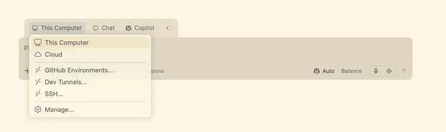

#### Chat without a project

**Setting**: `setting(sessions.chat.experimental.workspaceOptOut)`

Sometimes you just want to start an agent conversation that is not associated with a specific workspace or folder (workspace-less chat). Rather than scrolling through the workspace picker, you can dismiss the current selection by hovering over (or on keyboard focus) the picker and selecting `X`.

Enable `setting(sessions.chat.experimental.workspaceOptOut)` to enable dismissing the selected workspace.

If you dismiss the selected workspace for an ongoing session, your prompt and attachments are preserved. The action is available only for harnesses and environments that support workspace-less chat.

<video src="images/1_144/new-session-composer.mp4" title="Video showing how to remove the workspace folder from the new-session composer to start a chat without a project." autoplay loop controls muted></video>

#### Reduce clutter

To reduce visual clutter, you can reduce each of the key configuration options to only show their icon. Right-click the UI control and select **Collapse to Icon**. Each picker retains its tooltip and accessible name, and your choices persist across reloads and Settings Sync.

#### Use the keyboard

From the focused new-session chat input, use `kb(sessions.focusNewSessionEnvironmentPicker)`, `kb(sessions.focusNewSessionBranchPicker)`, `kb(sessions.focusNewSessionWorktreePicker)`, or `kb(sessions.focusSessionSyncAction)` to reach available controls. Collapsed session options expand as needed. The Sync shortcut only moves focus. Press Enter to synchronize.

### Copilot harness as the default

The Copilot harness continues to be the default for new sessions in VS Code. It's our latest harness, built on the Copilot SDK, a shared foundation that helps align behavior, capabilities, and improvements across Copilot products.

When you start a new session, **Copilot** in the harness picker indicates that the session uses the Copilot harness:

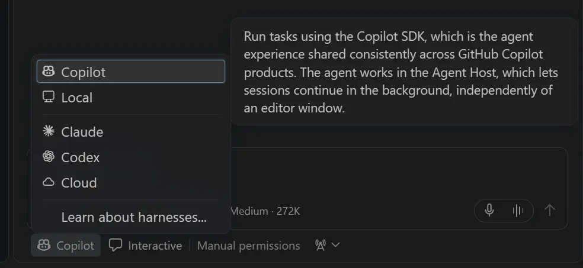

In VS Code, you can keep Copilot harness sessions running in the background and access them from both the VS Code editor window and the Agents window. These sessions run through the [Agent Host](https://code.visualstudio.com/docs/agents/concepts/agent-host).

#### Review Copilot file edits with the working set (Experimental)

**Setting:** `setting(chat.editor.workingSet.enabled)`

The Copilot harness records edits made through agent tools in a working set, so you can review and decide which changes to keep or undo, just like in the Local harness. Use the inline **Keep** and **Undo** controls in the editor for individual changes, or manage files and all pending changes from the working set above the chat input.

Keep and undo are enabled by default in the editor window and remain experimental. Set `setting(chat.editor.workingSet.enabled)` to `false` to show the Changes pill instead. Changes made through terminal commands do not appear in the working set. In the Agents window, use the **Changes** view to discard files.

Thank you so much to everyone who has shared valuable feedback. This release includes more improvements shaped directly by your feedback. Please continue [filing issues](https://github.com/microsoft/vscode/issues) to let us know how the Copilot harness is working for you. Your feedback is a huge help and directly shapes the harness experience.

Learn how to [work with the Copilot harness](https://code.visualstudio.com/docs/agents/run/agent-harnesses), or explore the architecture and workflows in the [agent host blog post](https://code.visualstudio.com/blogs/2026/08/26/agent-host-architecture).

### Copilot Memory in the Copilot harness

Copilot harness sessions can now use [Copilot Memory](https://docs.github.com/copilot/concepts/agents/copilot-memory), the same cloud memory service that other Copilot surfaces like Copilot CLI, Copilot cloud agent, and Copilot code review also use.

Agents recall relevant repository facts and your preferences when a session starts, and store new learnings as you work, so you don't have to repeat the same context in every new conversation.

Memories are stored as repository facts, which are shared with others who have access to the repository, or as user preferences, which apply across your repositories. Ask the agent to remember a convention or preference, and state the scope when it matters:

```prompt
Across all my repositories, remember that I prefer concise commit message subjects.
```

Copilot Memory is enabled by default and respects your [Copilot Memory settings on GitHub](https://github.com/settings/copilot/memory) and your organization's policies. You can review and delete your memories on GitHub at any time.

Learn more about [using memory with agents](https://code.visualstudio.com/docs/agents/run/memory).

### Manage worktree storage (Experimental)

**Setting**: `setting(chat.agentSessions.sessionStorageCleanupSuggestion.enabled)`

Last release, we introduced worktree storage cleanup for agent sessions to help you reclaim disk space used by worktrees. This release adds more ways to find the worktrees you want to remove:

* **See all past worktrees**: The **Any time** option is selected by default, to let you review recent worktrees as well as older ones.
* **Find worktrees by workspace**: Each row shows its workspace, and a workspace filter narrows the results. Changing the workspace filter clears the selection.

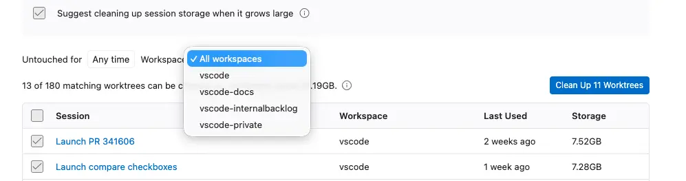

When cleanup suggestions are enabled and a local worktree's disk has less than 5 GB available, the Agents window provides a suggestion below the sessions list to run worktree cleanup, regardless of worktree age or count. The suggestion opens cleanup with **Any time** selected.

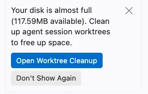

### Enable extensions in agents window

Extensions can run and be enabled or disabled directly from the Agents window. This requires `setting(extensions.experimental.agentsWindowManagement)` to be set to `true`.

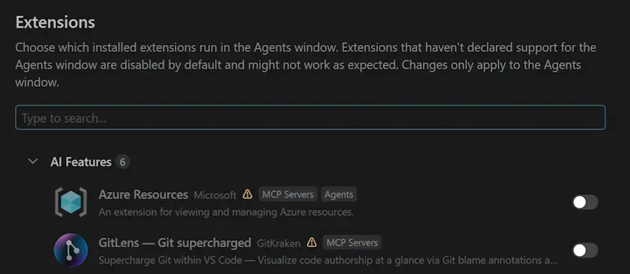

## Agent customizations

### Connect services with Copilot connectors (Preview)

Bring the Slack discussion behind a change, project context from Notion, or API documentation from Microsoft Learn into your agent sessions. [Copilot connectors](https://code.visualstudio.com/docs/agent-customization/copilot-connectors) are GitHub-managed MCP servers that connect your agent to these services without local server setup or MCP configuration.

[Open Browse](vscode://chat-customizations/open?page=discover), choose **Copilot Connectors** in the source menu, and select **Connect** on a service. Authorize access in your browser. Connect once and reuse the connection across supported Copilot clients signed in with the same account.

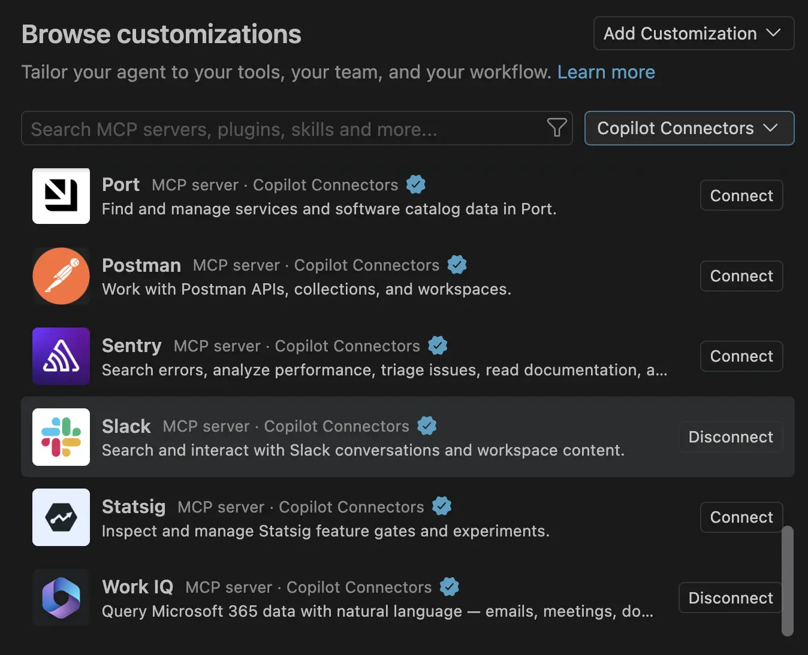

Connectors are enabled by default on all Copilot plans and work only with the Copilot harness. For Business and Enterprise, an administrator must enable **Editor preview features**. Your organization's MCP restrictions apply, and some services require administrator approval.

### Discover marketplace customizations (Preview)

Add skills, tools, and entire workflows to your agent without building them from scratch. [**Browse**](https://code.visualstudio.com/docs/agent-customization/overview#_discover-marketplace-customizations-preview), the new home page for Customizations, brings together **GitHub Feed** and plugins from [marketplaces configured by you or your enterprise](https://code.visualstudio.com/docs/agent-customization/agent-plugins#_configure-plugin-marketplaces).

Explore **Editor's picks**, **Plan, build, and ship**, and **Connect your work**, or search and filter by source or type. [Open Browse](vscode://chat-customizations/open?page=discover) or run **Chat: Open Customizations** to start.

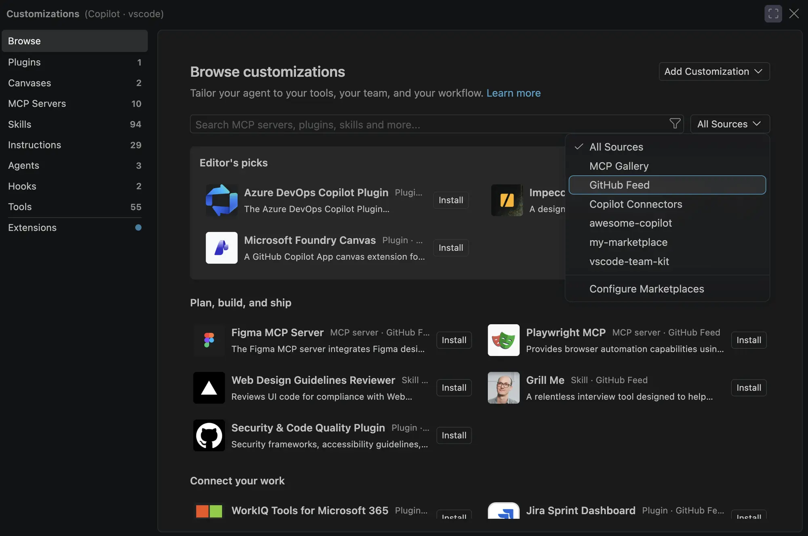

Link to Browse from a README or team guide, optionally with a search. For example, [Browse filtered to MCP servers](vscode://chat-customizations/open?page=discover&search=%40type%3Amcp).

GitHub Feed requires a supported harness and isn't available in Local sessions. For Copilot Business and Enterprise, an administrator must enable **Editor preview features**.

### Richer editing for GitHub Copilot custom agents

When you customize agents for the GitHub Copilot harness, completions, hovers, and validation help you choose available models, tools, and skills and catch configuration errors before you run the agent.

* **Models**: The `model` attribute offers Copilot model IDs as a single value or an ordered list of preferences.
* **Tools**: The `tools` attribute offers Copilot tool aliases, such as `read`, `edit`, and `execute`, alongside qualified client and extension tools.
* **Skills**: The `skills` attribute offers available skills, with descriptions and source information in completions and hovers.
* **Configuration validation**: Copilot-specific attributes and nested structures, including hooks and agent-scoped MCP servers, have completions, hovers, and validation. Unknown models, tools, and skills are only flagged after discovery has finished, so valid values aren't marked as errors while inventories are still loading.
* **Body features**: In GitHub Copilot agent files, placeholders such as `{{cwd}}` and `{{shellToolName}}` are recognized and show hovers. Unknown placeholders and Local-only `#tool:` and `#file:` references are flagged.

<video src="images/1_144/copilot-agent-editing.mp4" title="Video showing model, tool, and skill completions in a GitHub Copilot custom agent file, followed by an unavailable-model diagnostic and hover." autoplay loop controls muted></video>

### Harness-aware defaults for custom agent editing

When your `.agent.md` file has no `target` attribute, the editor now uses the active customization harness to provide matching completions, hovers, and diagnostics. Switching harnesses refreshes this guidance without reopening the file. An explicit `target: vscode` or `target: github-copilot` continues to override the default.

### Share links to plugins and customizations

You can share deep links in a README or team guide to help others add an [agent plugin marketplace](https://code.visualstudio.com/docs/agent-customization/agent-plugins), install a specific plugin, or open a page in the customization dialog.

| Action | Example link |
|--------|--------------|
| Add a marketplace | `vscode://chat-plugin/add-marketplace?ref=owner/repo` |
| Add a marketplace and install a named plugin | `vscode://chat-plugin/install?source=owner/repo&plugin=plugin-name` |
| Open the Plugins page with a search filter | `vscode://chat-customizations/open?page=plugins&search=github` |

Replace `owner/repo` with the marketplace's GitHub repository and `plugin-name` with the plugin's name in that marketplace. VS Code asks for confirmation before adding a marketplace or installing a plugin. These actions use a Copilot harness session; if none is available, VS Code asks before creating one. Only proceed if you trust the source, because plugins can run code on your machine.

Use these links for **Install in VS Code** buttons in your plugin's README, as shown in the [Session timeline plugin's getting started section](https://github.com/microsoft/vscode-team-kit/tree/main/session-timeline#getting-started).

Customization links also support pages such as `agents`, `skills`, `instructions`, `hooks`, `mcp-servers`, `tools`, and `migrations`. Omit `search` to open the page without a filter. Use `vscode-insiders://` instead of `vscode://` to open VS Code Insiders.

### Manage Copilot customizations with slash commands

You can manage plugins, MCP servers, and skills without leaving the Chat view in a Copilot harness session. Type `/plugin`, `/mcp`, or `/skills` followed by a space to see the available subcommands.

* **Plugins**: List, install, update, enable, disable, or uninstall [agent plugins](https://code.visualstudio.com/docs/agent-customization/agent-plugins). Use `/plugin marketplace` to manage marketplaces, or `/plugin install` to choose a plugin to install.
* **MCP servers**: Use `/mcp show`, `/mcp enable`, or `/mcp disable` with a server name to inspect or manage your [MCP servers](https://code.visualstudio.com/docs/agent-customization/mcp-servers).
* **Skills**: Use `/skills info` with a skill name to inspect an available [agent skill](https://code.visualstudio.com/docs/agent-customization/agent-skills).

Completions suggest supported subcommands and relevant plugin, marketplace, server, or skill names. Available commands depend on the Copilot runtime, and results appear directly in chat.

The following video shows browsing the `vscode-team-kit` marketplace and installing the Session timeline plugin with `/plugin install`.

<video src="images/1_144/copilot-plugin-install.mp4" title="Video showing browsing a plugin marketplace and installing Session timeline with slash commands in Copilot Chat." autoplay loop controls muted></video>

## Session management

### Move chats between sessions (Preview)

**Setting**: `setting(chat.agentHost.moveChats.enabled)`

The [Agents window](https://code.visualstudio.com/docs/agents/run/agents-window) lets you organize related conversations into sessions. Rearrange those conversations as your work evolves without starting over or losing their history.

* Drag a nested chat into another session, or drop it between that session's nested chats to choose its position.
* Right-click a nested chat and select **Promote to Session** to give it its own session. You can also drag it onto empty space in the sessions list.
* Drag a single-chat session onto another session to nest it there.
* Reorder nested chats by dragging them, or use **Move Up** and **Move Down** from their context menu. With focus in the sessions list, use `kb(sessionsViewPane.moveChatUp)` and `kb(sessionsViewPane.moveChatDown)`.

Moves preserve the chat's working folder, including an existing worktree or a temporary folder for a chat without a workspace. A shared worktree remains available while another session still uses it. Moves between sessions require the same agent and provider, and a destination that supports multiple chats. Subagent conversations move with their parent chat rather than independently.

The sessions list shows move progress and provides **Undo** after a move. Enable the setting to try this feature in Stable; it is on by default in Insiders.

Learn more about [organizing sessions in the Agents window](https://code.visualstudio.com/docs/agents/run/sessions/manage-sessions#_organize-sessions).

### Choose a workspace for nested sessions

Previously, nested sessions inherited the workspace of their parent session. Now, you can choose a separate workspace for each nested session. This lets you work across repositories while keeping related conversations together in one session. For example, a frontend chat and a backend chat can work in different folders without splitting the task across separate sessions.

Select **New Nested Session** in the Agents window to open a composer with a folder picker that defaults to the parent session's folder. Choose a recent folder, browse to another folder, or select **No Workspace** for a chat with its own temporary folder.

For a Git repository, choose **New Worktree** and a branch to isolate the nested chat's file changes. The nested chat uses its parent session's agent and host. Agents that do not support multiple working directories offer only the parent session's folder.

### Nested sessions in quick chats

Follow up on a quick chat without mixing separate questions into one conversation or losing track of related discussions. For example, explore two approaches in separate nested sessions under the same quick chat, without opening a project folder.

Quick chats in the Agents window support nested sessions: select **+** on a quick chat or use **New Nested Session** from its context menu.

Each nested session starts with **No Workspace** selected and gets its own temporary folder, separate from the parent quick chat. The quick chat stays in the **Chats** section, keeping its related conversations together.

### Custom icons and colors for session groups

Make workspace groups, environment groups (including remote hosts), and custom groups easier to recognize with custom icons and theme-aware colors. In the Agents window, open a group's context menu and select **Change Icon...** or **Change Color...**. Your choices persist across reloads and host reconnections, and **Reset to default** restores the icon or color independently. _[#343576](https://github.com/microsoft/vscode/pull/343576)_

<video src="images/1_144/session-group-appearance.mp4" title="Video showing a group context menu, searchable icon picker, and color picker used to customize a session group." autoplay loop controls muted></video>

## Chat

### Voice conversations with session context (Experimental)

[Voice Mode](https://code.visualstudio.com/docs/configure/accessibility/voice) (`setting(agents.voice.enabled)`) lets you discuss tasks aloud while the coding agent works. Use an OpenAI live model with your own API key (`setting(agents.voice.useBYOKVoiceModel)`) to ask questions such as 'Where were we?' or 'Which session needs input?' without starting a coding request.

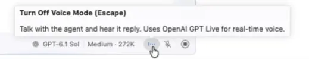

The enabled-by-default `setting(agents.voice.sessionAwareness)` shares a bounded briefing of tracked sessions and recent active-chat context with OpenAI BYOK Voice Mode. It includes session titles, response summaries, pending prompt details, the selected model, and attachment names, but not attachment contents.

Voice Mode's animation uses a single color for a more conversational feel: you can jump in and speak at any time.

<video src="images/1_144/voice-mode-session-awareness.mp4" title="Video showing a user asking where they left off in the current chat and receiving a summary from Voice Mode." autoplay loop controls muted></video>

GPT Live conversations also handle follow-ups and ongoing work more predictably:

* Ask questions while the agent works and hear the answers, with other updates queued and read aloud afterward.
* Single-question forms read the full question, and multi-question forms collect one numbered answer at a time.
* New spoken coding instructions during ongoing work are sent as steering rather than queued until the task finishes. Steering applies at the next opportunity supported by the provider and does not guarantee immediate interruption. Voice-only exchanges during ongoing work are not retained for later requests.

### Localized voice approvals and clearer connection status (Experimental)

Approve or reject GPT Live tool requests in your selected voice language (`setting(agents.voice.language)`), with support for 25 languages and English as a fallback. Answer questions with displayed choice labels, numbers, or free text where allowed. Ambiguous approvals still require an explicit answer or chat controls.

The voice language setting does not translate agent-provided questions or choices. Commands such as 'skip' and 'other' remain English-only.

## Editor Experience

### Issue Reporter

**Settings**: `setting(issueReporter.wizard.enabled)`, `setting(issueReporter.wizard.openLocation)`, `setting(issueReporter.additionalRepositories)`

Issues with clear steps, screenshots, and logs are faster for us to reproduce and fix. The [new issue reporter](https://code.visualstudio.com/updates/v1_122#_improved-issue-reporting-flow), which you turn on with `setting(issueReporter.wizard.enabled)`, makes it easier for you to create high quality issues. You can capture screenshots and screen recordings without leaving VS Code, from the capture bar or with kb(workbench.action.issueReporter.captureScreenshot) and kb(workbench.action.issueReporter.toggleRecording).

This release makes these changes to the new issue reporter:

* The form fits on a single page instead of three steps.
* Attach other files that help us debug your issue, such as log files or zip archives. You can also paste or drop images and videos into the form.
* The reporter opens in its own window. To open it in an editor tab instead, set `setting(issueReporter.wizard.openLocation)` to `editor`.
* To file issues in other GitHub repositories, for example your team's own tracker, add them to `setting(issueReporter.additionalRepositories)` in `owner/repo` format. Then pick the repository in the form.

<video src="images/1_144/issue-reporter-update.mp4" title="Video showing the issue reporter opening in its own window, capturing a screenshot and a screen recording, attaching a file, and previewing the report on GitHub." autoplay loop controls muted></video>

## Terminal

### Dialogs from terminal commands open in front of VS Code on Windows

**Setting**: `setting(terminal.integrated.windowsReparentConsoleWindow)`

On Windows, some command-line tools open dialogs that could appear behind VS Code when run from the terminal. For example, the Azure PowerShell `Connect-AzAccount` sign-in picker opened behind the VS Code window, so the command looked stuck until you moved or minimized VS Code.

VS Code now makes the window that shows each local terminal the owner of that terminal's hidden console window, as Windows Terminal does. Dialogs that tools attach to their console window now open in front of the VS Code window the terminal is in.

This requires `setting(terminal.integrated.windowsUseConptyDll)`, which is enabled by default. To turn off this behavior, set `setting(terminal.integrated.windowsReparentConsoleWindow)` to `false`.

## Enterprise

### Clearer permission restrictions

Assisted and Allow All remain visible but disabled when restricted by your organization, with an explanation instead of disappearing.

Example Copilot managed settings:

```json
{
  "permissions": {
    "disableAssistedPermissionsMode": true,
    "disableBypassPermissionsMode": "disable"
  }
}
```

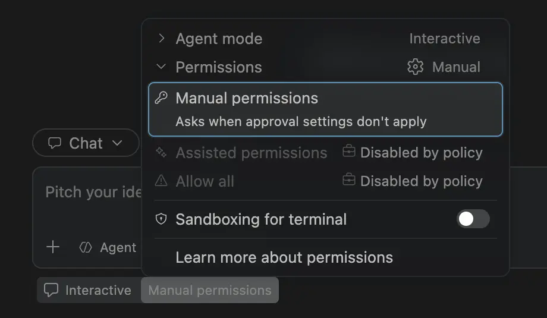

### Organization-managed session defaults

New chats in the Editor and Agents windows respect your organization's default model, [Copilot Fusion](#route-and-orchestrate-models-with-github-copilot-fusion) tier, and permission level, taking precedence over remembered selections. You can change these defaults within a session where policy allows; unavailable permission modes fall back to Manual.

Example Copilot managed settings, for organizations with Fusion Max available:

```json
{
  "model": "fusion",
  "fusionTier": "max",
  "permissions": {
    "defaultMode": "assisted"
  }
}
```

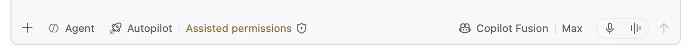

### Managed settings loading progress

When organization settings load slowly, progress appears inline in the waiting chat instead of stacking notification toasts. Background loading no longer interrupts you.

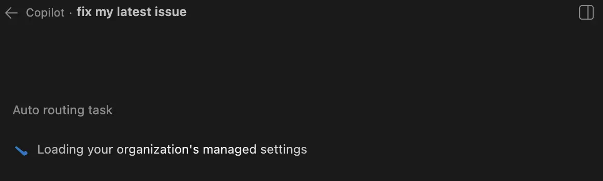


## Contributions to extensions

### GitHub Pull Requests

There has been more progress on the [GitHub Pull Requests](https://marketplace.visualstudio.com/items?itemName=GitHub.vscode-pull-request-github) extension, which enables you to work on, create, and manage pull requests and issues. New features include:

- The "Update stack" action now uses the GitHub API to update a stacked pull request when possible, so you no longer need to have a pull request from the stack checked out.
- The pull request overview shows a banner offering to create a stack when the pull request's branches line up with other open pull requests that aren't stacked yet.
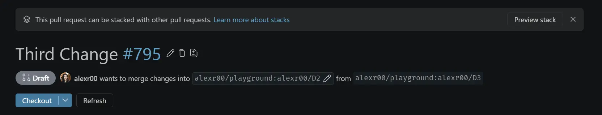

Review the [changelog for the 0.174.0](https://github.com/microsoft/vscode-pull-request-github/blob/main/CHANGELOG.md#01740) release of the extension to learn about everything in the release.

## Extension Authoring

### Publish extensions with OIDC and Trusted Publishing

You can now publish extensions to the Visual Studio Marketplace from GitHub Actions without storing a Personal Access Token (PAT) as a repository secret. The `vsce publish --oidc` command requests a short-lived OpenID Connect (OIDC) token from GitHub Actions and exchanges it for a temporary Marketplace credential that is valid for up to 15 minutes. If the token exchange fails, `vsce` doesn't fall back to a PAT.

To get started, create a Trusted Publishing policy for your repository and workflow in the Visual Studio Marketplace publisher management page, grant the publishing job the `id-token: write` permission, and run `vsce publish --oidc` in your workflow. Use a version of `@vscode/vsce` that supports OIDC, such as `4.0.2` or later.

Trusted Publishing is currently supported for GitHub Actions only. For Azure Pipelines, continue to use Microsoft Entra ID with a service connection. As global PATs in Azure DevOps are retired on December 1, 2026, we recommend that you move your extension publishing to one of these secure methods.

Learn more about [publishing extensions with vsce](https://code.visualstudio.com/api/working-with-extensions/publishing-extension#publish-with-github-actions-and-trusted-publishing).

Learn more about [Trusted Publishing in the Visual Studio Marketplace blog post](https://aka.ms/vsm/trustedpublishing/blogpost).

## Deprecated features and settings

None


<!-- RELEASE_THANK_YOU_START -->
## Thank you

### Issue tracking

Contributions to our issue tracking:

* [@gjsjohnmurray (John Murray)](https://github.com/gjsjohnmurray)
* [@RedCMD (RedCMD)](https://github.com/RedCMD)
* [@IllusionMH (Andrii Dieiev)](https://github.com/IllusionMH)
* [@albertosantini (Alberto Santini)](https://github.com/albertosantini)

### Pull requests

Contributions to `vscode`:

* [@aguashui (Noah Webber)](https://github.com/aguashui): Kitchen sink changes [PR #334932](https://github.com/microsoft/vscode/pull/334932)
* [@bluerose73 (Shengjie Ma)](https://github.com/bluerose73): Add configurable xtab reasoning effort and completion token limits [PR #342204](https://github.com/microsoft/vscode/pull/342204)
* [@cipheraxat (Akshat Anand)](https://github.com/cipheraxat): fix: keep paused debug location range valid in chat [PR #342379](https://github.com/microsoft/vscode/pull/342379)
* [@dhairyajangir (dhairya)](https://github.com/dhairyajangir): Fix UTF-8 encoding of MCP resource URI template values [PR #339846](https://github.com/microsoft/vscode/pull/339846)
* [@HectorHZZZ](https://github.com/HectorHZZZ): NES: add applied-then-undone rejected-edit memory mode [PR #341436](https://github.com/microsoft/vscode/pull/341436)
* [@mcumming (Michael Cummings (MSFT))](https://github.com/mcumming): Authenticate Entra ID marketplace API requests via RFC 9728 PRM negotiation [PR #325804](https://github.com/microsoft/vscode/pull/325804)
* [@r3na7 (renat)](https://github.com/r3na7): Preserve Explorer rename input when the window loses focus [PR #338126](https://github.com/microsoft/vscode/pull/338126)
* [@rfeltis (Ralph Feltis)](https://github.com/rfeltis): Chat: onboarding spotlight tour for the Copilot harness chat input [PR #337814](https://github.com/microsoft/vscode/pull/337814)
* [@SahinurDEV (Sahinur)](https://github.com/SahinurDEV): Debug Extension Host: enable inspector on running extension host instead of requiring restart [PR #343437](https://github.com/microsoft/vscode/pull/343437)
* [@timrogers (Tim Rogers)](https://github.com/timrogers)
  * Default new cloud automations to no allowed tools [PR #342481](https://github.com/microsoft/vscode/pull/342481)
  * Align `require_actor_write_permission` cloud automation option naming with GitHub.com and ensure compliance with repository policies [PR #344444](https://github.com/microsoft/vscode/pull/344444)

<!-- RELEASE_THANK_YOU_END -->
---

We really appreciate people trying our new features as soon as they are ready, so check back here often and learn what's new.

>If you'd like to read release notes for previous VS Code versions, go to [Updates](https://code.visualstudio.com/updates) on [code.visualstudio.com](https://code.visualstudio.com).

<a id="scroll-to-top" role="button" title="Scroll to top" aria-label="scroll to top" href="#"><span class="icon"></span></a>
<link rel="stylesheet" type="text/css" href="css/inproduct_releasenotes.css"/>
