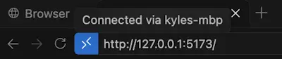
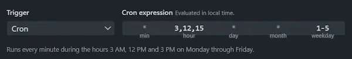
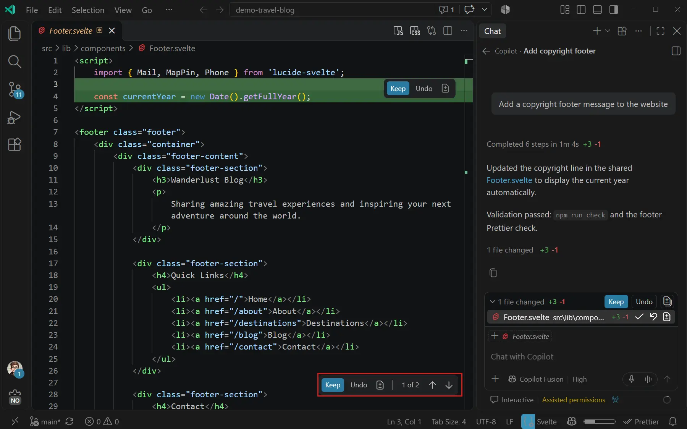
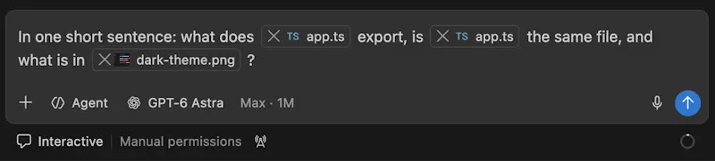
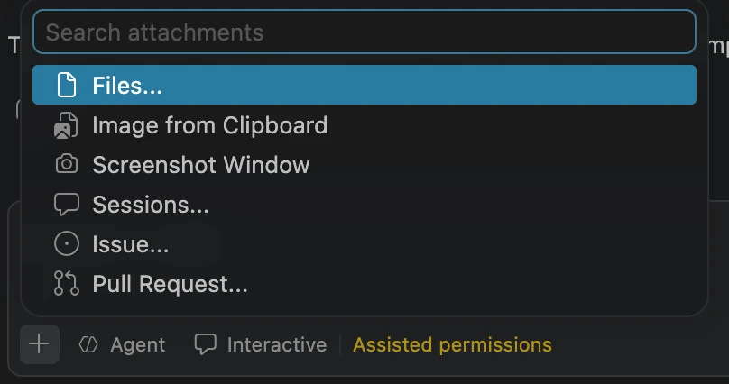
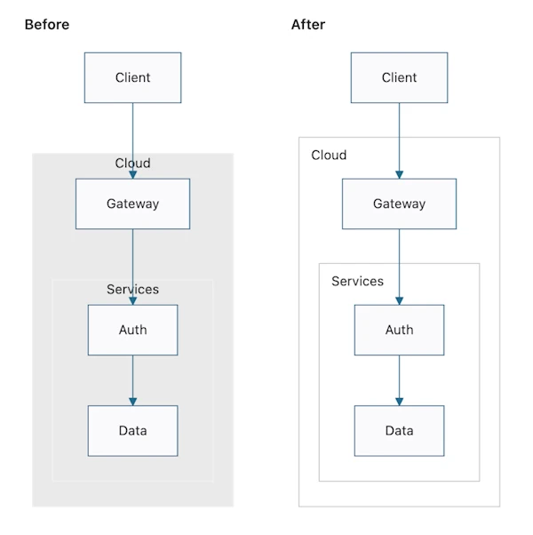
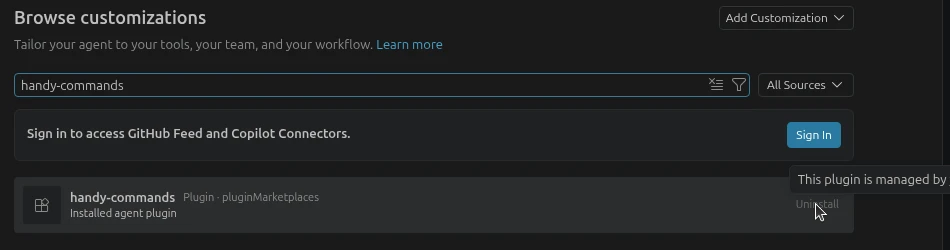

# Visual Studio Code 1.145

<!-- %IF IN_PRODUCT %
Follow us on [LinkedIn](https://www.linkedin.com/showcase/vs-code), [X](https://go.microsoft.com/fwlink/?LinkID=533687), [Bluesky](https://bsky.app/profile/vscode.dev), [Instagram](https://www.instagram.com/vscode) | [View online](https://code.visualstudio.com/updates)
%ENDIF % -->
<!-- %IF IN_WEB %
<p class="release-metadata"><span>Release date: November 4, 2026</span> <span class="release-channel">Stable</span></p>
%ENDIF % -->
<!-- %IF IN_PRODUCT %
_Release date: November 4, 2026_
%ENDIF % -->

**Update 1.145.1**: The update addresses these [issues](https://github.com/microsoft/vscode/issues?q=is%3Aissue+is%3Aclosed+milestone%3A1.145.1).

**Update 1.145.2**: The update addresses these [issues](https://github.com/microsoft/vscode/issues?q=is%3Aissue+is%3Aclosed+milestone%3A1.145.2).

**Update 1.145.3**: The update addresses these [security issues](https://github.com/microsoft/vscode/issues?q=is%3Aissue+is%3Aclosed+milestone%3A1.145.3).

<!-- DOWNLOAD_LINKS_PLACEHOLDER -->

<!-- RELEASE_HIGHLIGHTS_START -->
## Release highlights

This week, your remote agent sessions feel a bit more local. Preview apps and use canvases right in VS Code, fine-tune automation schedules with cron, and turn down the noise in chat. And when you need a break, Blobby is ready to play.

* [Remote agents](#remote-agents): Preview apps and use interactive canvases from remote agent sessions without leaving the Agents window.

* [Automations](#cron-schedules-and-custom-agents-for-local-automations): Run recurring agent tasks on custom schedules beyond the built-in presets with cron.

* [Agent verbosity](#choose-agent-verbosity): Keep chats concise or see the full details of the agent's reasoning and tool calls, your choice.

* [File exclusions](#show-specific-files-in-excluded-folders): Exclude folders while keeping the files you need visible and searchable.

* [Fun](#blobby-jump-game-experimental): Take a short break with a platform-jumping game starring Blobby, the VS Code pet.
<!-- RELEASE_HIGHLIGHTS_END -->

<!-- %IF STABLE %
<p class="release-update-guidance">Already installed? Use <strong>Check for Updates</strong> in VS Code. For upcoming features, use the <a href="https://code.visualstudio.com/insiders">Insiders build</a>.</p>
%ENDIF % -->

<!-- %IF IN_PRODUCT %
Happy Coding!

---
%ENDIF % -->

<!-- TOC
<div class="toc-nav-layout">
  <nav id="toc-nav">
    <div>In this update</div>
    <ul>
      <li><a href="#release-highlights">Release highlights</a></li>
      <li><a href="#remote-agents">Remote agents</a></li>
      <li><a href="#agents">Agents</a></li>
      <li><a href="#chat">Chat</a></li>
      <li><a href="#mcp">MCP</a></li>
      <li><a href="#editor-experience">Editor Experience</a></li>
      <li><a href="#enterprise">Enterprise</a></li>
      <li><a href="#contributions-to-extensions">Contributions to extensions</a></li>
      <li><a href="#extension-authoring">Extension Authoring</a></li>
      <li><a href="#fun">Fun!</a></li>
      <li><a href="#deprecated-features-and-settings">Deprecated features and settings</a></li>
      <li><a href="#notable-fixes">Notable fixes</a></li>
      <li><a href="#thank-you">Thank you</a></li>
    </ul>
  </nav>
  <div class="notes-main">
Navigation End -->

## Remote agents

### Browse over remote agent host connections (Preview)

**Setting**: `setting(workbench.browser.enableRemoteProxy)`

When an agent session runs on a [remote agent host](https://code.visualstudio.com/docs/agents/run/remote-agent-sessions), the integrated browser in the Agents window now loads pages through that host, as it already does in [remote workspaces](https://code.visualstudio.com/updates/v1_125#_browse-over-remote-connections-preview). When the agent starts a dev server on the remote machine, you can open it right in the Agents window to preview the app, validate the agent's changes, and give it feedback, as you would in a local session.



Enable `setting(workbench.browser.enableRemoteProxy)` to try it out, and file any issues you encounter in the [VS Code repository](https://github.com/microsoft/vscode/issues).

### Remote canvases (Preview)

**Settings**: `setting(workbench.browser.enableRemoteProxy)`, `setting(chat.canvases.enabled)`

Thanks to the remote agent host connections support, you can now also use [canvases](https://code.visualstudio.com/docs/agents/run/canvases) that are hosted on a remote agent host.

Enable `setting(chat.canvases.enabled)` and `setting(workbench.browser.enableRemoteProxy)` to try it out, and file any issues you encounter in the [VS Code repository](https://github.com/microsoft/vscode/issues).

## Agents

### Mix and match agent harnesses in one session (Preview)

**Setting**: `setting(chat.agentHost.multipleChatProviders.enabled)`

[Nested sessions](https://code.visualstudio.com/docs/agents/run/sessions/manage-sessions#_run-multiple-chats-in-a-session) let you keep related conversations together within a single main chat session. Previously, every nested session inherited its parent session's harness. If you wanted a second opinion from another agent, you had to start a separate session and lose that grouping.

In this release, nested sessions can use different harnesses than their parent session. For example, ask Claude to review the plan that a Copilot chat wrote, or give Codex the same task, side by side in the same session. When you create a new nested session, use the harness picker to switch to a different harness.

Each chat has its own model, agent, and permission levels, based on its harness. Changing them in one chat doesn't affect the others. When you move a chat, it keeps its history and continues with its selected harness. When you fork a nested session, it continues with the same configuration.

A chat that uses a different harness than its session names its harness when you hover over its chat tab or its row in the sessions list.

<video src="images/1_145/multi-harness-session.mp4" title="Video showing a Copilot session in the Agents window where Claude and Codex nested sessions are added through the harness picker, each answering with its own model and permissions." autoplay loop controls muted></video>

Enable `setting(chat.agentHost.multipleChatProviders.enabled)` to get started. Let us know what you think by [filing an issue](https://github.com/microsoft/vscode/issues).

### Cron schedules and custom agents for local automations

Instead of manually running agent tasks one by one, you can use [automations](https://code.visualstudio.com/docs/agents/run/automations) to schedule and run them automatically, either on demand or on a set schedule.

This release gives you more flexibility for local automations and keeps the Automations view focused on active work:

* **Use cron schedules:** Select **Cron** to enter a five-field cron expression when the other schedule presets aren't precise enough. The dialog validates the expression and describes the resulting schedule. Cron schedules are not available for cloud automations.

* **Use workspace custom agents:** Choose a custom agent from the selected workspace when you create or edit a local automation.

* **Focus on active automations:** Disabled automations appear in a collapsed **Disabled automations** section, so they don't obscure run history and active automations.



Learn more about [creating and managing agent automations](https://code.visualstudio.com/docs/agents/run/automations).

### Pin canvases to sidebar (Experimental)

**Setting**: `setting(chat.canvases.enabled)`

To make it easier to access frequently used canvases, you can now pin a canvas to appear in the left sidebar. To pin a canvas, open it and select the **Add to Sidebar** button above the canvas. Pinned canvases remain accessible in the sidebar even when you navigate away from them.

<video src="images/1_145/pinned-canvases.mp4" title="Video showing how to pin a canvas to the sidebar in VS Code." autoplay loop controls muted></video>

### Copilot harness

The Copilot harness continues to be the default for new sessions in VS Code. It's our latest harness, built on the Copilot SDK, a shared foundation that helps align behavior, capabilities, and improvements across Copilot products.

When you start a new session, **Copilot** in the harness picker indicates that the session uses the Copilot harness. In VS Code, you can keep Copilot harness sessions running in the background and access them from both the VS Code editor window and the Agents window. These sessions run through the [Agent Host](https://code.visualstudio.com/docs/agents/concepts/agent-host).

To help you adopt the Copilot harness with your existing workflows, we've added a [Local-to-Copilot harness transition guide](https://code.visualstudio.com/docs/agents/run/move-to-copilot). It covers customization compatibility, session continuity, and organization rollout and verification.

Thank you for the feedback that continues to shape these improvements. Please continue [filing issues](https://github.com/microsoft/vscode/issues) about your experience, especially if a workflow or integration prevents your organization from moving off the Local harness.

Learn how to [work with the Copilot harness](https://code.visualstudio.com/docs/agents/run/agent-harnesses), or explore the architecture and workflows in the [agent host blog post](https://code.visualstudio.com/blogs/2026/08/26/agent-host-architecture).

### Working set improvements (Experimental)

**Setting**: `setting(chat.editor.workingSet.enabled)`

Last release, we introduced the working set for Copilot harness sessions, letting you review pending agent edits. You can **keep** or **undo** changes, as you could do with the Local harness.



We are further improving the working set experience in Copilot harness sessions:

* Files in WSL, Dev Containers, and SSH workspaces open from the working set on the correct host.
* When several tool calls edit the same file in parallel, the working set tracks those edits and the editor's inline review controls remain available after editing finishes.

The working set functionality remains enabled by default in the editor window. Learn more about [reviewing agent edits with the working set](https://code.visualstudio.com/docs/agents/run/review-code-edits#_review-pending-edits-with-the-working-set), including which edits it tracks.

### Improved guidance when required sandboxing is unavailable

[Agent sandboxing](https://code.visualstudio.com/docs/agents/run/agent-sandboxing) limits what terminal commands can access, like the file system and network resources. Your organization can require it with managed settings that disallow bypassing the sandbox.

If your organization requires sandboxing but your machine can't run it, the warning banner explains why terminal commands are blocked and how to resolve the problem. It shows the specific cause, such as a missing dependency, and links to troubleshooting steps.

If your account and organization support [cloud sessions (Experimental)](https://code.visualstudio.com/docs/agents/run/cloud-agent-sessions), consider running agent tools in the cloud instead of on your machine.

## Chat

### Choose agent verbosity (Experimental)

**Setting**: `setting(chat.persistentProgressVerbosity)`

Keep long chats readable, or follow the agent's reasoning and tool calls in detail when you need to understand its actions. Open the Chat view's **More Actions** menu and select **View Mode**:

* **Conversation**: Focus on the conversation. Reasoning and tool calls are grouped into collapsed sections between blocks of response text. Expand a section to inspect its details.
* **Verbose**: Follow each step with tool calls expanded, without an internal scrolling limit on tool groups.
* **Compact** (default): Preview tool calls while they run, then collapse completed groups to expandable summary rows.

You can switch modes without starting a new chat. The modes change how the conversation is displayed, not its context or the work the agent performs.

<video src="images/1_145/chat-view-modes.mp4" title="Video showing the same Copilot harness session with GPT-6.1 Terra at default model settings, Interactive mode, and Allow All permissions in Conversation, Verbose, and Compact chat views side by side." autoplay loop controls muted></video>

With persistent progress enabled, the active progress indicator stays above the chat input while you scroll back through a response. If you prefer an animated input border instead, enable `setting(chat.progressBorder.enabled)`.

### Chat performance improvements

Reopen and browse long Copilot harness chats more smoothly. VS Code reuses existing reasoning titles and renders terminal output as you reveal it. Terminal output in restored tool calls is rendered when you expand or reveal it, rather than all at once.

This release also reduces repeated progress updates and layout measurements when restoring and navigating long conversations.

### Inline chat attachments (Experimental)

**Setting**: `setting(chat.inlineAttachments.enabled)`

Keep file references and other context next to the instructions they belong to. Enable this setting to insert attachment pills at the cursor in your prompt, rather than in a separate row above the input.

Move across, select, or delete an attachment pill as a single character. Previous messages keep the pills inline, so references stay with the surrounding instructions.

Inline attachments are on by default in Insiders and off by default in Stable.



### Attach files from anywhere on your computer

Previously, to give chat a file outside your workspace, such as a screenshot or mockup on your desktop, you had to drag it in from your file manager or ask the agent to find it. Select **Add Context** (`+`) > **Files** to choose one or more files with the standard file dialog, even in a new chat without a workspace. In cloud sessions, the chooser lists only images.



When [sandboxing](https://code.visualstudio.com/docs/agents/run/agent-sandboxing) is enabled in Copilot harness sessions, the agent can read the files and folders you attach, even when they're outside the workspace. Each attached path is readable for the rest of the session, but the agent can't write to it, and the access isn't saved to your settings. With Manual permissions, the agent no longer asks before reading an attached file. If your organization's managed settings define their own list of readable paths, attachments aren't added to it.

## MCP

### Support for tools provided by MCP apps

MCP apps are interactive interfaces provided by MCP servers. They can now register tools that the language model can call in its next request.

For example, the [ShaderToy server](https://github.com/modelcontextprotocol/ext-apps/tree/main/examples/shadertoy-server) lets the model iterate on shaders in real time.

### Managed MCP allowlist precedence

For MCP servers started by VS Code, the enterprise-managed `allowedMcpServers` list takes precedence over registry-only access, so your organization can approve servers without publishing them to its registry. See the [Enterprise section on managed MCP allowlists](#managed-mcp-allowlists-take-precedence-over-registry-only-access) for configuration details and restrictions.

## Editor Experience

### Show specific files in excluded folders

**Settings**: `setting(files.exclude)`, `setting(search.exclude)`

You can filter which files and folders are shown in the Explorer, Search, and Quick Open by using the `setting(files.exclude)` and `setting(search.exclude)` settings.

To keep part of an excluded folder visible, prefix a pattern with `!` in `setting(files.exclude)`. Matching files and folders show in the Explorer, Search, and Quick Open, even when another pattern or `.gitignore` excludes them. Exceptions in `setting(search.exclude)` apply only to Search and Quick Open.

```json
"files.exclude": {
    "node_modules": true,
    "!node_modules/@types": true
}
```

Exceptions never hide files. Patterns such as `!**/node_modules/@types` match at any depth but can make searches slower.

### Smart subgraph titles in Mermaid diagrams

Edges in [Mermaid diagrams](https://code.visualstudio.com/docs/languages/markdown#_mermaid-diagram-rendering) no longer cover subgraph titles. A title moves to the side when an edge would cross it. With the default `vscode` Mermaid theme, subgraphs are outlined instead of filled, so nested subgraphs stand out.



## Enterprise

### Organization-required plugins can't be uninstalled

When your organization requires an [agent plugin](https://code.visualstudio.com/docs/agent-customization/agent-plugins), for example with the `enabledPlugins` managed setting, the **Customizations** views previously offered **Uninstall** for it. That action always failed and changed to **Retry Uninstall**, which also failed. The same happened for the prompts, skills, agents, hooks, and MCP servers that the plugin contributes.

```json
{
    "enabledPlugins": {
        "my-plugin@my-marketplace": true
    }
}
```

The **Uninstall** action for these plugins and their contributions is now disabled and a message is shown on hover and keyboard focus. This applies to **Browse**, the plugin details, the plugin editor, and the plugin and MCP server menus.



### Managed MCP allowlists take precedence over registry-only access

Previously, when an organization limited MCP to servers from its registry and also defined an allowlist in managed settings, VS Code still required each server to be in the registry. Servers that the allowlist approved but that weren't published to the registry couldn't run.

The enterprise-managed `allowedMcpServers` list is now authoritative. A server that matches the list can run even if it isn't in the registry, and a registry server that doesn't match is blocked. For example, the following [enterprise-managed settings](https://docs.github.com/en/copilot/how-tos/administer-copilot/manage-for-enterprise/use-managed-settings/get-started) allow one remote server and one local server:

```json
{
    "allowedMcpServers": [
        { "serverUrl": "https://mcp.example.com/mcp" },
        { "serverCommand": ["node", "approved-server.js"] }
    ]
}
```

* An empty list (`[]`) blocks all servers. If the list is absent, the registry restriction applies as before.
* User and workspace allowlists can't add servers to the enterprise list.
* `deniedMcpServers` and turning off MCP still take precedence over the allowlist.
* Prefer `serverUrl` and `serverCommand` rules. A `serverName` rule matches a label that the server's author chooses.

> **Note**: This change applies to MCP servers that VS Code starts, not to servers managed by the Agent Host.

## Contributions to extensions

### GitHub Pull Requests

There has been more progress on the [GitHub Pull Requests](https://marketplace.visualstudio.com/items?itemName=GitHub.vscode-pull-request-github) extension, which enables you to work on, create, and manage pull requests and issues. New features include:

* The pull request overview timeline shows more events, including label, milestone, and title changes, review requests and dismissals, draft and ready-for-review changes, force pushes, branch restores, auto-merge changes, and merge queue updates.
* Pull request description templates support issue variables such as `${issueTitle}`, `${issueNumber}`, and `${issueNumberLabel}`, filled in from the issue associated with the branch by "Start Working on Issue".
* When you stack pull requests, you're prompted to disable auto-merge on any pull request in the stack that has it enabled.

Review the [changelog for the 0.176.0](https://github.com/microsoft/vscode-pull-request-github/blob/main/CHANGELOG.md#01760) release of the extension to learn about everything in the release.

## Extension Authoring

### Timeline API finalized

Extensions published to the Marketplace can add their own history to the Timeline view, next to Git commits and Local History. Register providers with `workspace.registerTimelineProvider` for files and folders, or `workspace.registerWorkspaceTimelineProvider` for the whole workspace. Set `TimelineItem.resourceUri` to the resource's content as of that entry so users can compare it with other entries by using **Compare Selected**.

Learn more about the Timeline API in the [Timeline API documentation](https://code.visualstudio.com/api/extension-guides/timeline).

## Fun!

### Blobby jump game (Experimental)

Take a short break with Blobby, the VS Code pet. Enter `/vscode-pet` in chat to show Blobby. On the new-session screen in the Agents window, choose **Play Jump Game** from Blobby's context menu. Hold the spacebar to charge a jump and use the arrow keys to aim for the next platform. The game remembers your high score on this device.

<video src="images/1_145/blobby-jump-game.mp4" title="Video showing Blobby charging jumps, landing on platforms, and increasing the hop counter in the Agents window." autoplay loop controls muted></video>

## Deprecated features and settings

### New deprecations in this release

#### Install Extension tool removed from the Local harness

The **Install Extension** (`#installExtension`) agent tool is no longer available in Local agent sessions. When you create a new workspace from chat, the agent no longer installs extensions. Instead, it adds the extensions the project needs to `.vscode/extensions.json`, so you can review and install them from the Extensions view. When you run a Python cell in a Jupyter notebook without the Jupyter extension, the kernel picker prompts you to install it.

If your custom agents or prompt files reference `#installExtension`, remove that reference.

#### Run VS Code Command tool removed from the Local harness

The **Run VS Code Command** (`#runCommand`) agent tool is no longer available in Local agent sessions. Built-in workflows that relied on it now work without it. For example, when chat diagnoses network issues, it asks you to run **Developer: Chat Diagnostics** and share the report.

If your custom agents or prompt files reference `#runCommand`, remove that reference.

#### Workspace creation tool and slash command removed from the Local harness

The **Create New Workspace** (`#newWorkspace`, previously `#new`) agent tool and the `/new` slash command are no longer available in Local agent sessions. The **Generate New Workspace** link on the Welcome page is also no longer available. The dedicated project-setup skills are removed.

To create a project, open an empty folder and describe the project you want in an agent session. The agent uses its standard tools to create files, run scaffolding commands, and configure tasks.

Remove references to `#newWorkspace`, `#new`, `/new`, `project-setup-info-local`, and `project-setup-info-context7` from your custom agents and prompt files. The `github.copilot.chat.newWorkspaceCreation.enabled`, `github.copilot.chat.newWorkspace.useContext7`, and `github.copilot.chat.useProjectTemplates` settings are also removed. Notebook creation is unchanged.

### Upcoming deprecations

None

## Notable fixes

* When an organization turned off the Claude or Codex agent, users who had picked that agent before got a read-only chat with no input from **New Chat** (`+`), **New Chat Editor**, and new windows. New chats now fall back to the default harness, and an unsent prompt carries over. Your previous choice applies again if the policy is lifted. _[#345207](https://github.com/microsoft/vscode/pull/345207)_

* When an organization set MCP access to registry only in its GitHub Copilot policies, a failed policy refresh, for example from a network error or rate limiting, removed the restriction until the next successful refresh. VS Code now keeps the last known registry policy, and clears it only when GitHub reports that no registry applies. _[#344895](https://github.com/microsoft/vscode/pull/344895)_

<!-- RELEASE_THANK_YOU_START -->
## Thank you

### Issue tracking

Contributions to our issue tracking:

* [@gjsjohnmurray (John Murray)](https://github.com/gjsjohnmurray)
* [@RedCMD (RedCMD)](https://github.com/RedCMD)
* [@IllusionMH (Andrii Dieiev)](https://github.com/IllusionMH)
* [@albertosantini (Alberto Santini)](https://github.com/albertosantini)

### Pull requests

Contributions to `vscode`:

* [@bompus (Aaron Queen)](https://github.com/bompus): Refresh markdown preview html before a hidden panel is rebuilt [PR #334681](https://github.com/microsoft/vscode/pull/334681)
* [@cipheraxat (Akshat Anand)](https://github.com/cipheraxat): web: release `code -w -g file:line` once the file's editor closes [PR #344740](https://github.com/microsoft/vscode/pull/344740)
* [@denizguney (Deniz Güney Yıldırım)](https://github.com/denizguney): test: add mock reset configuration and test coverage support [PR #338159](https://github.com/microsoft/vscode/pull/338159)
* [@hardikkaurani (Hardik K)](https://github.com/hardikkaurani): fix(arrays): throw TypeError for negative indices in quickSelect [PR #342816](https://github.com/microsoft/vscode/pull/342816)
* [@hirossan4049 (hirose)](https://github.com/hirossan4049): editorFind: fix swapped findMatch foreground colors (#228782) [PR #270395](https://github.com/microsoft/vscode/pull/270395)
* [@kinqsradio (Anh Dang)](https://github.com/kinqsradio)
  * Fix requireLocalPort for range, regex, and host-and-port rules [PR #344185](https://github.com/microsoft/vscode/pull/344185)
  * Preserve inherited port protocol for exact-port attributes [PR #344764](https://github.com/microsoft/vscode/pull/344764)
* [@nathan-vincent-dev (nathan vincent)](https://github.com/nathan-vincent-dev): Fix typos "curent" and "filterd" [PR #345134](https://github.com/microsoft/vscode/pull/345134)
* [@Nikhil-4404 (Nikhil Kumar)](https://github.com/Nikhil-4404): Fix SSE stream-wide byte order mark handling [PR #344094](https://github.com/microsoft/vscode/pull/344094)
* [@pl4nty (Tom Plant)](https://github.com/pl4nty): win32: fix installer's context menu COM surrogate kill command [PR #344505](https://github.com/microsoft/vscode/pull/344505)
* [@rfeltis (Ralph Feltis)](https://github.com/rfeltis): Log telemetry when the closed-chat promo pip is armed [PR #337997](https://github.com/microsoft/vscode/pull/337997)
* [@RReverser (Ingvar Stepanyan)](https://github.com/RReverser): Fix copilot code reference output channel race [PR #342272](https://github.com/microsoft/vscode/pull/342272)
* [@SimonSiefke (Simon Siefke)](https://github.com/SimonSiefke)
  * fix: task system readiness races [PR #342418](https://github.com/microsoft/vscode/pull/342418)
  * fix: memory leak in terminal auto replies [PR #336022](https://github.com/microsoft/vscode/pull/336022)
* [@spencrr (Spencer Schoenberg)](https://github.com/spencrr): agentHost: add setting to turn off Copilot's Co-authored-by trailer [PR #339437](https://github.com/microsoft/vscode/pull/339437)
* [@VaggelisGian (Vaggelis Giannopoulos)](https://github.com/VaggelisGian): Progress: store scoped while state with start time and delay swapped [PR #332735](https://github.com/microsoft/vscode/pull/332735)
* [@vscodebot-pr (VS Code PR Bot)](https://github.com/vscodebot-pr): fix: guard ListView dynamic-height probe against shrunk model (fixes #333550) [PR #333563](https://github.com/microsoft/vscode/pull/333563)
* [@wozhenbang2004 (Kayokoi)](https://github.com/wozhenbang2004): testing: respect keybindings before type-to-filter [PR #344892](https://github.com/microsoft/vscode/pull/344892)
* [@wycats (Yehuda Katz)](https://github.com/wycats): Recognize userPromptTransformed plugin hooks in Copilot sessions [PR #345068](https://github.com/microsoft/vscode/pull/345068)

Contributions to `vscode-pull-request-github`:

* [@kinqsradio (Anh Dang)](https://github.com/kinqsradio): Fix orphan stack worktree cleanup through macOS path aliases [PR #9100](https://github.com/microsoft/vscode-pull-request-github/pull/9100)
* [@tamird (Tamir Duberstein)](https://github.com/tamird): Batch Git config reads for branch operations [PR #8978](https://github.com/microsoft/vscode-pull-request-github/pull/8978)

<!-- RELEASE_THANK_YOU_END -->
---

We really appreciate people trying our new features as soon as they are ready, so check back here often and learn what's new.

>If you'd like to read release notes for previous VS Code versions, go to [Updates](https://code.visualstudio.com/updates) on [code.visualstudio.com](https://code.visualstudio.com).

<a id="scroll-to-top" role="button" title="Scroll to top" aria-label="scroll to top" href="#"><span class="icon"></span></a>
<link rel="stylesheet" type="text/css" href="css/inproduct_releasenotes.css"/>

<!-- Closed feature-request query snapshot
{
  "repository": "microsoft/vscode",
  "milestone": "1.145.0",
  "label": "feature-request",
  "closedSince": "2026-10-28",
  "checkedThrough": "2026-11-02",
  "publicInsidersCommit": "67710841ad061a9e253214f87bf5415a185ab2ff",
  "issues": [
    {"number":344588,"title":"Improve bulk worktree cleanup progress and recovery","closedAt":"2026-10-28T00:13:15Z","stateReason":"COMPLETED"},
    {"number":344703,"title":"Markdown editor: hide whitespace indicators by default (markdown.editor.renderWhitespace)","closedAt":"2026-10-28T09:22:28Z","stateReason":"COMPLETED"},
    {"number":243940,"title":"MCP: Customize descriptions for server/tools via mcp.json","closedAt":"2026-10-28T14:43:44Z","stateReason":"COMPLETED"},
    {"number":338336,"title":"MCP Apps: App-provided tools registered via App.registerTool() are not exposed to Copilot agent","closedAt":"2026-10-28T15:48:34Z","stateReason":"COMPLETED"},
    {"number":344755,"title":"Add a setting to show breadcrumbs for untitled files, off by default","closedAt":"2026-10-28T17:04:47Z","stateReason":"COMPLETED"},
    {"number":344781,"title":"Add a built-in skill to record demo videos of web pages","closedAt":"2026-10-28T17:33:31Z","stateReason":"COMPLETED"},
    {"number":344779,"title":"Allow Worktree Cleanup to manage worktrees without a listed session","closedAt":"2026-10-28T19:03:07Z","stateReason":"COMPLETED"},
    {"number":342213,"title":"Allow disabling Copilot's Co-authored-by trailer in agent-host sessions","closedAt":"2026-10-29T01:21:55Z","stateReason":"COMPLETED"},
    {"number":247375,"title":"Add MCP Allow List to MDM Policy","closedAt":"2026-10-29T04:43:12Z","stateReason":"COMPLETED"},
    {"number":341954,"title":"Improve editor tab scrollbar placement","closedAt":"2026-10-30T00:17:24Z","stateReason":"COMPLETED"},
    {"number":178766,"title":"VSCode does not highlight all matches of the highlighted text","closedAt":"2026-10-30T09:19:47Z","stateReason":"DUPLICATE"},
    {"number":131078,"title":"Show bracket in ruler","closedAt":"2026-10-30T09:21:58Z","stateReason":"DUPLICATE"},
    {"number":177400,"title":"selecting text highlights match only if the length is less than or equal to 200","closedAt":"2026-10-30T09:45:20Z","stateReason":"COMPLETED"},
    {"number":261241,"title":"Accessibility Issue: \"Tokenization is skipped...\"","closedAt":"2026-10-30T09:45:27Z","stateReason":"COMPLETED"},
    {"number":304043,"title":"Artifacts tool - have inline action to save the artifact","closedAt":"2026-10-30T09:45:57Z","stateReason":"COMPLETED"},
    {"number":235765,"title":"Missing support for asymmetric visibility when using PHP constructor property promotion","closedAt":"2026-10-30T09:46:04Z","stateReason":"COMPLETED"},
    {"number":165024,"title":"Keybindings for side-by-side diff editor arrow functions","closedAt":"2026-10-30T09:46:20Z","stateReason":"COMPLETED"},
    {"number":147888,"title":"Prevent the blue warning strip at the top that keeps popping up","closedAt":"2026-10-30T09:46:56Z","stateReason":"DUPLICATE"},
    {"number":199316,"title":"Multi-editor diff: Hard to collapse/expand file","closedAt":"2026-10-30T09:47:06Z","stateReason":"COMPLETED"},
    {"number":199293,"title":"Allow to click on the file name to expand","closedAt":"2026-10-30T09:47:14Z","stateReason":"COMPLETED"},
    {"number":164029,"title":"Inline completions and snippets collide","closedAt":"2026-10-30T09:47:59Z","stateReason":"COMPLETED"},
    {"number":207519,"title":"Multi Diff doesn't seem to have Inline View toggle","closedAt":"2026-10-30T09:48:02Z","stateReason":"COMPLETED"},
    {"number":242475,"title":"Merge Editor does not recognize ActiveEditorWriteableInSession setting until reopened","closedAt":"2026-10-30T09:48:30Z","stateReason":"COMPLETED"},
    {"number":235883,"title":"tab is not aligned for 2 bytes languages like Korean, Chinese, Japanese","closedAt":"2026-10-30T09:50:08Z","stateReason":"COMPLETED"},
    {"number":136646,"title":"Feature request: Option to colorize only active bracket pairs","closedAt":"2026-10-30T09:52:01Z","stateReason":"COMPLETED"},
    {"number":204317,"title":"Unable to expand an entry in the multi diff editor when clicking on header","closedAt":"2026-10-30T09:52:07Z","stateReason":"COMPLETED"},
    {"number":84297,"title":"API support for Timeline view","closedAt":"2026-10-30T15:09:55Z","stateReason":"COMPLETED"},
    {"number":869,"title":"Exclude all files except for...","closedAt":"2026-10-30T16:32:58Z","stateReason":"COMPLETED"},
    {"number":330524,"title":"Add corner rounding to dictation and voice mode buttons focus outline","closedAt":"2026-10-30T18:40:13Z","stateReason":"COMPLETED"},
    {"number":345254,"title":"Agents window is usable without GitHub sign-in by default","closedAt":"2026-10-30T19:13:36Z","stateReason":"COMPLETED"},
    {"number":344632,"title":"Sessions Inbox: prioritized, actionable agent notifications","closedAt":"2026-10-30T20:13:48Z","stateReason":"COMPLETED"},
    {"number":343622,"title":"Agents Window: support Compare Agents in local and empty Git repositories","closedAt":"2026-10-30T20:20:10Z","stateReason":"COMPLETED"},
    {"number":342637,"title":"[Worktree Cleanup] Clicking on a session removed it from the list","closedAt":"2026-10-31T09:14:20Z","stateReason":"COMPLETED"},
    {"number":343910,"title":"Why can't I nest a Claude/Codex session under a Copilot session?","closedAt":"2026-11-02T10:15:58Z","stateReason":"COMPLETED"}
  ]
}
-->
