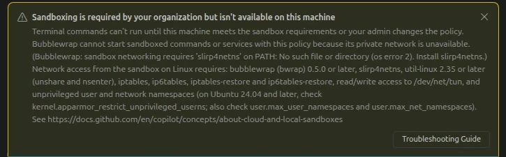

# Visual Studio Code 1.145

<!-- %IF IN_PRODUCT %
Follow us on [LinkedIn](https://www.linkedin.com/showcase/vs-code), [X](https://go.microsoft.com/fwlink/?LinkID=533687), [Bluesky](https://bsky.app/profile/vscode.dev), [Instagram](https://www.instagram.com/vscode) | [View online](https://code.visualstudio.com/updates)
%ENDIF % -->
<!-- %IF IN_WEB %
<p class="release-metadata"><span>Release date: November 4, 2026</span> <span class="release-channel">Stable</span></p>
%ENDIF % -->
<!-- %IF IN_PRODUCT %
_Release date: November 4, 2026_
%ENDIF % -->

<!-- DOWNLOAD_LINKS_PLACEHOLDER -->

<!-- RELEASE_HIGHLIGHTS_START -->
## Release highlights

This release ... <TODO @ntrogh>

* [highlight](#bookmark): <highlight description, including availability or requirements when relevant>
<!-- RELEASE_HIGHLIGHTS_END -->

<!-- %IF STABLE %
<p class="release-update-guidance">Already installed? Use <strong>Check for Updates</strong> in VS Code. For upcoming features, use the <a href="https://code.visualstudio.com/insiders">Insiders build</a>.</p>
%ENDIF % -->

<!-- %IF IN_PRODUCT %
Happy Coding!

---
%ENDIF % -->

<!-- TOC
<div class="toc-nav-layout">
  <nav id="toc-nav">
    <div>In this update</div>
    <ul>
      <li><a href="#release-highlights">Release highlights</a></li>
      <li><a href="#agents">Agents</a></li>
      <li><a href="#chat">Chat</a></li>
      <li><a href="#mcp">MCP</a></li>
      <li><a href="#accessibility">Accessibility</a></li>
      <li><a href="#editor-experience">Editor Experience</a></li>
      <li><a href="#code-editing">Code Editing</a></li>
      <li><a href="#notebooks">Notebooks</a></li>
      <li><a href="#source-control">Source Control</a></li>
      <li><a href="#debugging">Debugging</a></li>
      <li><a href="#tasks">Tasks</a></li>
      <li><a href="#terminal">Terminal</a></li>
      <li><a href="#authentication">Authentication</a></li>
      <li><a href="#languages">Languages</a></li>
      <li><a href="#remote-development">Remote Development</a></li>
      <li><a href="#contributions-to-extensions">Contributions to extensions</a></li>
      <li><a href="#extension-authoring">Extension Authoring</a></li>
      <li><a href="#proposed-apis">Proposed APIs</a></li>
      <li><a href="#engineering">Engineering</a></li>
      <li><a href="#deprecated-features-and-settings">Deprecated features and settings</a></li>
      <li><a href="#notable-fixes">Notable fixes</a></li>
      <li><a href="#thank-you">Thank you</a></li>
    </ul>
  </nav>
  <div class="notes-main">
Navigation End -->

## Agents

### Clear guidance when required sandboxing is unavailable

[Agent sandboxing](https://code.visualstudio.com/docs/agents/run/agent-sandboxing) limits what terminal commands can access. Your organization can require it with managed settings that disallow bypass:

```json
{
    "sandbox": {
        "enabled": true,
        "allowBypass": false
    }
}
```

Previously, if a machine couldn't run the sandbox under this policy, the banner only said that sandboxing might not work as expected. It didn't explain why the option to disable sandboxing was missing. The banner now says that your organization requires sandboxing and that terminal commands can't run until the machine meets the sandbox requirements or your administrator changes the policy. It also includes the reason from the host, such as a missing dependency, and a link to the troubleshooting guide. _[#344815](https://github.com/microsoft/vscode/pull/344815)_



### Copilot harness

The Copilot harness continues to be the default for new sessions in VS Code. It's our latest harness, built on the Copilot SDK, a shared foundation that helps align behavior, capabilities, and improvements across Copilot products.

When you start a new session, **Copilot** in the harness picker indicates that the session uses the Copilot harness. In VS Code, you can keep Copilot harness sessions running in the background and access them from both the VS Code editor window and the Agents window. These sessions run through the [Agent Host](https://code.visualstudio.com/docs/agents/concepts/agent-host).

Thank you so much to everyone who has shared valuable feedback - our releases continue to include improvements shaped directly by your feedback. Please continue [filing issues](https://github.com/microsoft/vscode/issues) to let us know how the Copilot harness is working for you.

Learn how to [work with the Copilot harness](https://code.visualstudio.com/docs/agents/run/agent-harnesses), or explore the architecture and workflows in the [agent host blog post](https://code.visualstudio.com/blogs/2026/08/26/agent-host-architecture).

## Chat

### Attach files from anywhere on your computer

Previously, to give chat a file outside your workspace, such as a screenshot or mockup on your desktop, you had to drag it in from your file manager or ask the agent to find it. Select **Add Context** (`+`) > **Files...** to choose one or more files with the standard file dialog, even in a new chat without a workspace. In cloud sessions, the chooser lists only images. _[#344792](https://github.com/microsoft/vscode/pull/344792)_


When [sandboxing](https://code.visualstudio.com/docs/agents/run/agent-sandboxing) is on in Copilot harness sessions, the agent can read the files and folders you attach, even when they're outside the workspace. Each attached path is readable for the rest of the session, but the agent can't write to it, and the access isn't saved to your settings. With Manual permissions, the agent no longer asks before reading an attached file. If your organization's managed settings define their own list of readable paths, attachments aren't added to it. _[#345057](https://github.com/microsoft/vscode/pull/345057)_

### Organization-required plugins can't be uninstalled

When your organization requires an [agent plugin](https://code.visualstudio.com/docs/agent-customization/agent-plugins), for example with the `enabledPlugins` managed setting, the **Customizations** views previously offered **Uninstall** for it. That action always failed and changed to **Retry Uninstall**, which also failed. The same happened for the prompts, skills, agents, hooks, and MCP servers that the plugin contributes.

```json
{
    "enabledPlugins": {
        "my-plugin@my-marketplace": true
    }
}
```

**Uninstall** for these plugins and their contributions is now disabled, with the message "This plugin is managed by your organization." on hover and keyboard focus. This applies to **Browse**, the plugin details, the plugin editor, and the plugin and MCP server menus. _[#345130](https://github.com/microsoft/vscode/pull/345130)_


### Install Extension tool removed from the Local harness

The **Install Extension** (`#installExtension`) agent tool is no longer available in Local agent sessions. When you create a new workspace from chat, the agent no longer installs extensions. Instead, it adds the extensions the project needs to `.vscode/extensions.json`, so you can review and install them from the Extensions view. When you run a Python cell in a Jupyter notebook without the Jupyter extension, the kernel picker prompts you to install it.

If your custom agents or prompt files reference `#installExtension`, remove that reference. _[#343118](https://github.com/microsoft/vscode/issues/343118)_

### Run VS Code Command tool removed from the Local harness

The **Run VS Code Command** (`#runCommand`) agent tool is no longer available in Local agent sessions. Built-in workflows that relied on it now work without it. For example, when chat diagnoses network issues, it asks you to run **Developer: Chat Diagnostics** and share the report.

If your custom agents or prompt files reference `#runCommand`, remove that reference. _[#343125](https://github.com/microsoft/vscode/issues/343125)_

### New Workspace tool and new slash command removed from the Local harness

The **Create New Workspace** (`#newWorkspace`, previously `#new`) agent tool and the `/new` slash command are no longer available in Local agent sessions. The **Generate New Workspace** link on the Welcome page is also no longer available. The dedicated project-setup skills are removed.

To create a project, open an empty folder and describe the project you want in an agent session. The agent uses its standard tools to create files, run scaffolding commands, and configure tasks.

Remove references to `#newWorkspace`, `#new`, `/new`, `project-setup-info-local`, and `project-setup-info-context7` from your custom agents and prompt files. The `github.copilot.chat.newWorkspaceCreation.enabled`, `github.copilot.chat.newWorkspace.useContext7`, and `github.copilot.chat.useProjectTemplates` settings are also removed. Notebook creation is unchanged. _[#344452](https://github.com/microsoft/vscode/issues/344452)_


## MCP

### Support for Tools Provided by MCP Apps

MCP Apps can now register tools that the language model can call in its next request. For example, the [ShaderToy server](https://github.com/modelcontextprotocol/ext-apps/tree/main/examples/shadertoy-server) lets the model iterate on shaders in real time.

### Managed MCP allowlists take precedence over registry-only access

Previously, when an organization limited MCP to servers from its registry and also defined an allowlist in managed settings, VS Code still required each server to be in the registry. Servers that the allowlist approved but that weren't published to the registry couldn't run.

The enterprise-managed `allowedMcpServers` list is now authoritative. A server that matches the list can run even if it isn't in the registry, and a registry server that doesn't match is blocked. For example, the following [enterprise-managed settings](https://docs.github.com/en/copilot/how-tos/administer-copilot/manage-for-enterprise/use-managed-settings/get-started) allow one remote server and one local server:

```json
{
    "allowedMcpServers": [
        { "serverUrl": "https://mcp.example.com/mcp" },
        { "serverCommand": ["node", "approved-server.js"] }
    ]
}
```

* An empty list (`[]`) blocks all servers. If the list is absent, the registry restriction applies as before.
* User and workspace allowlists can't add servers to the enterprise list.
* `deniedMcpServers` and turning off MCP still take precedence over the allowlist.
* Prefer `serverUrl` and `serverCommand` rules. A `serverName` rule matches a label that the server's author chooses.

This change applies to MCP servers that VS Code starts, not to servers managed by the Agent Host. _[#344816](https://github.com/microsoft/vscode/pull/344816)_

## Accessibility


## Editor Experience

### Mermaid subgraph titles stay clear of edges

Edges in [Mermaid diagrams](https://code.visualstudio.com/docs/languages/markdown#_mermaid-diagram-rendering) no longer cover subgraph titles: a title moves aside when an edge would cross it. With the default `vscode` Mermaid theme, subgraphs are outlined instead of filled, so nested subgraphs stand out. _[#344771](https://github.com/microsoft/vscode/pull/344771)_


## Code Editing


## Notebooks


## Source Control


## Debugging


## Tasks


## Terminal


## Authentication


## Languages


## Remote Development

The [Remote Development extensions](https://marketplace.visualstudio.com/items?itemName=ms-vscode-remote.vscode-remote-extensionpack), allow you to use a [Dev Container](https://code.visualstudio.com/docs/devcontainers/containers), remote machine via SSH or [Remote Tunnels](https://code.visualstudio.com/docs/remote/tunnels), or the [Windows Subsystem for Linux](https://learn.microsoft.com/windows/wsl) (WSL) as a full-featured development environment.

Highlights include:

* TODO: @ntrogh

You can learn more about these features in the [Remote Development release notes](https://github.com/microsoft/vscode-docs/blob/main/remote-release-notes/v1_145.md).


## Contributions to extensions


## Extension Authoring


## Proposed APIs


## Engineering


## Deprecated features and settings

### New deprecations in this release

* [Install Extension tool removed from the Local harness](#install-extension-tool-removed-from-the-local-harness)
* [Run VS Code Command tool removed from the Local harness](#run-vs-code-command-tool-removed-from-the-local-harness)
* [New Workspace tool and new slash command removed from the Local harness](#new-workspace-tool-and-new-slash-command-removed-from-the-local-harness)

### Upcoming deprecations


## Notable fixes

* When an organization turned off the Claude or Codex agent, users who had picked that agent before got a read-only chat with no input from **New Chat** (`+`), **New Chat Editor**, and new windows. New chats now fall back to the default harness, and an unsent prompt carries over. Your previous choice applies again if the policy is lifted. _[#345207](https://github.com/microsoft/vscode/pull/345207)_

* When an organization set MCP access to registry only in its GitHub Copilot policies, a failed policy refresh, for example from a network error or rate limiting, removed the restriction until the next successful refresh. VS Code now keeps the last known registry policy, and clears it only when GitHub reports that no registry applies. _[#344895](https://github.com/microsoft/vscode/pull/344895)_


<!-- RELEASE_THANK_YOU_START -->
## Thank you

<!-- RELEASE_THANK_YOU_END -->
---

We really appreciate people trying our new features as soon as they are ready, so check back here often and learn what's new.

>If you'd like to read release notes for previous VS Code versions, go to [Updates](https://code.visualstudio.com/updates) on [code.visualstudio.com](https://code.visualstudio.com).

<a id="scroll-to-top" role="button" title="Scroll to top" aria-label="scroll to top" href="#"><span class="icon"></span></a>
<link rel="stylesheet" type="text/css" href="css/inproduct_releasenotes.css"/>
