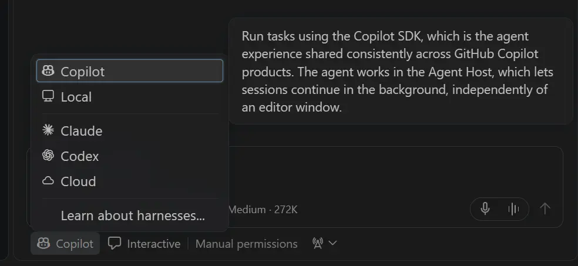
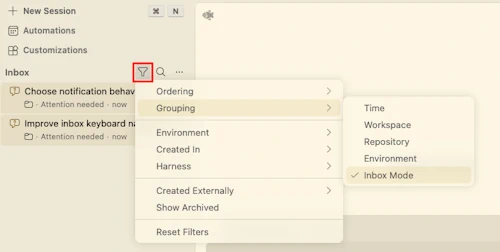
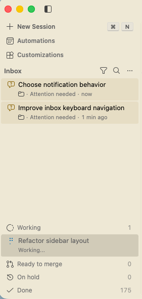
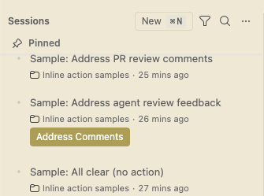
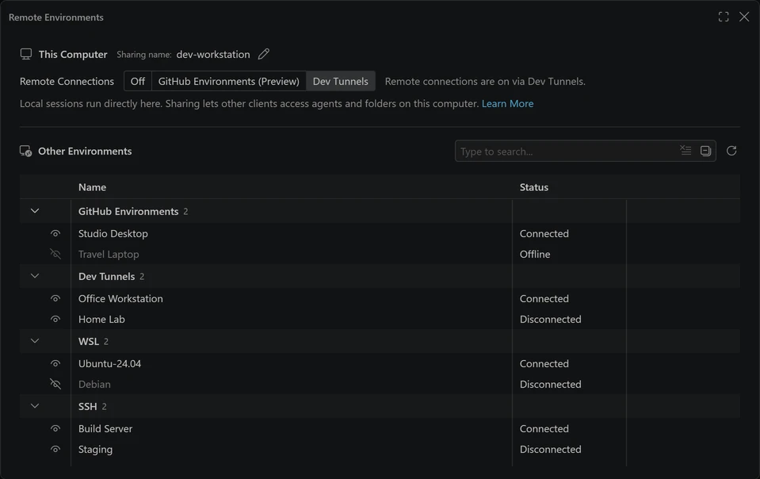

# Visual Studio Code 1.146

<!-- %IF IN_PRODUCT %
Follow us on [LinkedIn](https://www.linkedin.com/showcase/vs-code), [X](https://go.microsoft.com/fwlink/?LinkID=533687), [Bluesky](https://bsky.app/profile/vscode.dev), [Instagram](https://www.instagram.com/vscode) | [View online](https://code.visualstudio.com/updates)
%ENDIF % -->
<!-- %IF IN_WEB %
<p class="release-metadata"><span>Release date: November 11, 2026</span> <span class="release-channel">Stable</span></p>
%ENDIF % -->
<!-- %IF IN_PRODUCT %
_Release date: November 11, 2026_
%ENDIF % -->

<!-- DOWNLOAD_LINKS_PLACEHOLDER -->

<!-- RELEASE_HIGHLIGHTS_START -->
## Release highlights

This week, focus your attention where it's needed most, let your agent compare models for you, and pick up terminal conversations right in VS Code.

* [Inbox mode (Experimental)](#inbox-mode-for-sessions-experimental): Focus on sessions that need your attention across all your projects, and snooze others for later.

* [Model comparison (Preview)](#model-comparison-improvements-preview): Let an agent compare results and help you choose the strongest approach, now with Copilot Fusion as an option.

* [Continue from Copilot CLI (Experimental)](#continue-a-copilot-cli-session-in-vs-code-experimental): Move terminal conversations into VS Code with their history intact.

* [Local harness deprecation](#copilot-harness-and-deprecation-of-the-local-harness): Move to the Copilot harness before the Local harness is removed in February 2027.
<!-- RELEASE_HIGHLIGHTS_END -->

<!-- %IF STABLE %
<p class="release-update-guidance">Already installed? Use <strong>Check for Updates</strong> in VS Code. For upcoming features, use the <a href="https://code.visualstudio.com/insiders">Insiders build</a>.</p>
%ENDIF % -->

<!-- %IF IN_PRODUCT %
Happy Coding!

---
%ENDIF % -->

<!-- TOC
<div class="toc-nav-layout">
  <nav id="toc-nav">
    <div>In this update</div>
    <ul>
      <li><a href="#release-highlights">Release highlights</a></li>
      <li><a href="#agents">Agents</a></li>
      <li><a href="#chat">Chat</a></li>
      <li><a href="#mcp">MCP</a></li>
      <li><a href="#accessibility">Accessibility</a></li>
      <li><a href="#editor-experience">Editor Experience</a></li>
      <li><a href="#code-editing">Code Editing</a></li>
      <li><a href="#notebooks">Notebooks</a></li>
      <li><a href="#source-control">Source Control</a></li>
      <li><a href="#debugging">Debugging</a></li>
      <li><a href="#tasks">Tasks</a></li>
      <li><a href="#terminal">Terminal</a></li>
      <li><a href="#authentication">Authentication</a></li>
      <li><a href="#languages">Languages</a></li>
      <li><a href="#remote-development">Remote Development</a></li>
      <li><a href="#enterprise">Enterprise</a></li>
      <li><a href="#contributions-to-extensions">Contributions to extensions</a></li>
      <li><a href="#extension-authoring">Extension Authoring</a></li>
      <li><a href="#proposed-apis">Proposed APIs</a></li>
      <li><a href="#engineering">Engineering</a></li>
      <li><a href="#deprecated-features-and-settings">Deprecated features and settings</a></li>
      <li><a href="#notable-fixes">Notable fixes</a></li>
      <li><a href="#thank-you">Thank you</a></li>
    </ul>
  </nav>
  <div class="notes-main">
Navigation End -->

## Agents

### Copilot harness and deprecation of the Local harness

The Copilot harness is our latest agent harness and has been the default for new sessions since [VS Code 1.143](https://code.visualstudio.com/updates/v1_143#_copilot-harness-as-the-default). It's built on the Copilot SDK, a shared foundation that helps align behavior, capabilities, and improvements across Copilot products. Copilot harness sessions run through the [Agent Host](https://code.visualstudio.com/docs/agents/concepts/agent-host), so you can keep them running in the background and access them from both the VS Code editor window and the Agents window. For organizations, the Copilot harness also enforces managed sandbox and permission policies that the Local harness doesn't.

Thank you to everyone who has shared feedback on using the Copilot harness as your default. Your feedback has shaped the harness experience, and it will continue to guide us through this next step. As of this release, the **Local harness is deprecated and will be removed in three months (February 2027)**:

* **Next three months**: You can still use the Local harness while you move your workflows.
* **After three months**: The Local harness will no longer be available. The `vscode.temporaryDefaultToLocalHarness` enterprise-managed setting, introduced in VS Code 1.142 to [keep the Local harness as the default](https://code.visualstudio.com/docs/enterprise/manage-ai-settings#_keep-local-harness-as-default), will also be removed.

Because the Copilot harness is already the default for new sessions, you might not need to take any new actions. To confirm you're using the Copilot harness, look for **Copilot** in the harness picker when you start a new session:



If you still use the Local harness, plan to move completely to the Copilot harness before February 2027. The [Local-to-Copilot harness transition guide](https://code.visualstudio.com/docs/agents/run/move-to-copilot) covers customization compatibility, continuing existing Local conversations, and organization rollout and verification. If you run into any problems, let us know by [filing an issue](https://github.com/microsoft/vscode/issues).

### More accurate agent editing metrics

We fixed an issue where some agent file edits counted unchanged text as newly added or deleted code. After updating to VS Code 1.146, affected users may see lower lines-added and lines-deleted totals in [GitHub Copilot usage metrics](https://docs.github.com/en/copilot/reference/copilot-usage-metrics).

### Inbox mode for sessions (Experimental)

**Setting**: `setting(sessions.list.inboxEnabled)`

Focus on sessions that need attention without reorganizing or archiving your work. Enable this setting (off by default), then select **Grouping > Inbox Mode** in the Agents window's Sessions list.



Inbox mode keeps sessions needing attention above **Working**, **Ready to merge**, **On hold**, and **Done** categories. Use **Dismiss from Inbox**, **Put on Hold**, or **Snooze...** to defer items, with **Undo** available. Dismissing an item does not archive its session; use **Mark Session as Done** to archive it.



### Inline session feedback actions (Experimental)

**Setting**: `setting(sessions.list.inlineActions)`

Fix failing checks and address review comments directly from the Agents window's sessions list. Enable this setting (off by default) to show **Fix Checks**, **Address Comments**, or **Fix Checks & Address Comments** beneath eligible rows.

Each action sends a request to that row's session or nested session in the background without opening it. The setting does not enable Agent Merge or change action permissions.



### Share this computer from Remote Environments (Experimental)

**Setting**: `setting(sessions.chat.experimental.remoteEnvironmentsThisComputer)`

The **Remote Environments** editor in the Agents window can now show a **This Computer** section, where you manage how this computer is shared with other clients. Turn remote connections **Off** or share via **GitHub Environments (Preview)** or **Dev Tunnels**, and rename the sharing name that other clients show for this computer. Your other remotes are listed below under **Other Environments**. Local sessions keep running directly on this computer whether sharing is on or off. Open the editor with **Manage Remote Environments** from the Environment picker, the Command Palette, or the title bar's **Remote Connections** menu, which also offers the same sharing options.



Learn more about [making a host available for remote access](https://code.visualstudio.com/docs/agents/run/remote-agent-sessions#_make-a-host-available-for-remote-access).

### Model comparison improvements (Preview)

**Setting**: `setting(sessions.chat.compareAgents.tools.enabled)`

Introduced last week, [Compare Models](https://code.visualstudio.com/docs/agents/run/compare-models) in the Agents window lets you run the same prompt across models, evaluate their results with a judge, and combine their strengths with a synthesizer. This release makes comparisons easier to configure, organize, and automate:

* **Judge and synthesize chat-only responses**: Add a judge and synthesizer without selecting a workspace. Synthesis starts when you select **Synthesize** and creates a new chat without changing the original attempts.
* **Compare Copilot Fusion**: Select Fusion and its supported effort tiers for an attempt, the judge, or the synthesizer.
* **Let an agent run evaluations (Experimental)**: Enable `setting(sessions.chat.compareAgents.tools.enabled)` to let agents discover models, launch comparisons, and read results and conversation references to summarize findings across scenarios. The tools are off by default and require Compare Models to be enabled. Disabling them leaves manual comparisons available.

### Chat windows (Preview)

**Setting**: `setting(sessions.chatWindows.enabled)`

When several chats run at once, keeping them all in one Agents window means switching between them and losing sight of the one you are waiting on. With chat windows, you can open a chat in a window of its own, and arrange that window so that the chat, its editors, and its terminals fit the task. This setting is on by default in VS Code Insiders and off in Stable. To try this preview feature in Stable, enable `setting(sessions.chatWindows.enabled)`.

**Open a chat in its own window**

Open a chat in a new window from the **Open in** > **New Window** menu of a session or chat in the sessions list, from **Open in New Window** in the **...** menu of the session header, or with **Agents: Open Chat in New Window**. You can also drag a chat tab or a row in the sessions list out of the window. Use **Move to Main Window** to bring a chat back.

Each chat window shows its chat beside an editor area that holds the Changes, files, browser, canvases, and terminals of that chat. Nothing from one chat appears in another chat's window. A chat window can hold several chats from one or more sessions: pick another session in its title bar, drag a chat in from another window, or select **New Session** (`kb(sessions.chatWindow.newSession)`) at the left of the title bar to start a new session in that window. Chat windows reopen with their chats and editors after you restart VS Code.

**Arrange the window to fit the task**

A chat window is made of parts that you can arrange. Each part is a card that holds tabs, and a tab can be anything: a chat, an editor, or a view such as the terminal or Changes.

* **Move parts:** Drag a part by the grabber on the top edge of its card to another side of the window, or beside another part. You can also use **Move Part Left**, **Move Part Right**, **Move Part Up**, and **Move Part Down**.
* **Move tabs between parts:** Drag a tab to another part, or drop it on a part's edge to split that part. Use **Move Editor to Part...** or **Move Editor into New Part Left/Right/Above/Below** to do the same from the Command Palette. Drag an editor tab onto the chat input to attach it to the chat as context.
* **Place the terminal:** Dragging the terminal under the editor or under the chat sets **Terminal Position** to **Under Editor** or **Under Chat**. Dropping it on the bottom edge of the window sets **Full Width**. You can also change the position from the **...** menu of the terminal.
* **Switch the layout:** Use **Configure Layout** in the title bar to show the chat, the editor, or both, side by side or stacked. In the stacked layout, **Agents: Toggle Chat Conversation** collapses the chat to only its input, so the editor takes the rest of the window.

Use **Developer: Reset Chat Window Layout** to return a window to how it first opened.

Let us know what you think by [filing an issue](https://github.com/microsoft/vscode/issues).

### Canvases improvements (Preview)

**Setting**: `setting(chat.canvases.enabled)`

[Canvases](https://code.visualstudio.com/docs/agents/run/canvases) are shared, interactive surfaces where you and Copilot work together on plans, dashboards, and other artifacts. This release adds permission prompts and improves canvas discovery and continuity:

* **Permissions for canvas extensions**: In Copilot harness sessions, canvas extensions ask for your approval before initializing privileged capabilities, such as hooks.
* **Find and reopen canvases**: Canvas menus distinguish **Running** canvases whose tabs you've closed from **Available** canvases you can open. In the Agents window, discovery actions appear under **Discover More**.
* **Resume without another prompt**: When you return to an inactive Copilot harness session, its canvases restore without sending another message.
* **Smoother reconnection**: While a canvas provider restarts, the last canvas image stays visible with a reconnecting indicator.
* **Keep canvases with their chats**: In separate chat windows, canvas tabs close when their chat leaves the window and can reopen alongside it. Canvases also restore after a window reload without taking focus.

### Mask environment variables in the sandbox

**Setting**: `setting(chat.agent.sandbox.credentials.envVars)`

In sandboxed Copilot harness sessions, you can mask environment variables whose values you don't want agent tools to see. Sandboxed tools receive placeholders, and the real values are supplied only to approved HTTPS destinations.

In this example, sandboxing replaces the value of the `API_TOKEN` environment variable with a placeholder. The real value is restored only in outgoing HTTPS requests to hosts listed in `injectHosts`, here `api.example.com`. Requests to other hosts retain the placeholder and don't receive the actual value.

```json
{
    "chat.agent.sandbox.credentials.envVars": {
        "API_TOKEN": {
            "injectHosts": ["api.example.com"]
        }
    }
}
```

Enter variable names, not secret values, in settings. On Windows, environment variable masking requires local-network access. On macOS and Windows, trust the sandbox CA certificate for tools that require OS certificate trust. See [sandbox network access](https://code.visualstudio.com/docs/agents/run/agent-sandboxing#_configure-network-access) and [certificate trust](https://code.visualstudio.com/docs/agents/run/agent-sandboxing#_trust-the-sandbox-ca-certificate-on-windows-and-macos).

### Sandbox status in the chat input

See whether terminal sandboxing is enabled without opening the Permissions menu. In both the editor and the Agents window, the empty chat input shows **(sandbox enabled)** when **Sandboxing for terminal** is on. The placeholder stays in sync as you switch chats or change the setting.


### Install and manage extensions in the Agents window (Experimental)

The **Extensions** section of Agent Customizations lets you choose which installed extensions run in the Agents window without changing their enablement in editor windows. Previously, adding an extension meant switching to an editor window to install it. In this release, you can find, install, and uninstall extensions without leaving the Agents window:

* **Install from the Marketplace**: Searching also queries the Marketplace and lists matching extensions that you don't have yet, with their publisher, install count, and rating. Installing an extension adds it to VS Code and enables it in the Agents window. To install a different version, such as a pre-release, use the dropdown next to **Install**.
* **Know what won't work before installing**: Extensions that contribute views, debuggers, status bar items, or walkthroughs without declaring support for the Agents window show a warning that lists the unsupported features. Extensions that can't be installed, for example because your organization doesn't allow them, show the reason.
* **Open with a keyboard shortcut**: Press `kb(workbench.view.extensions)` or run **Extensions: Manage Extensions...** to open the section. If you changed the shortcut for the Extensions view in editor windows, your shortcut also works in the Agents window.

### Improved Permission Prompts

The new Copilot harness previously suggested overly-broad tool-level allowances for operations like web fetches, terminal commands, and file reads. For example, the default action for fetching a URL was "Allow in this Session", which would let the model access any URL during that session. Now, permission prompts are more granular, by default adding allowances for specific domains, commands, and directories.

### Agent Host Support for Virtual Repositories

VS Code supports virtual workspaces, allowing you to do things like [viewing a GitHub repository without having to clone it](/docs/sourcecontrol/github.md#github-repositories-extension). The new Copilot harness previously did not work in virtual repositories, and now it does, allowing you to use the same Copilot features and workflows as you do in local folders.

## Chat

### Configurable background-send shortcut

Start a new session without opening it by pressing `kb(sessions.sendInBackground)` in the Agents window composer. You can rebind or remove the shortcut for **Chat: Send in Background** in **Keyboard Shortcuts**.

An optional tip shows your configured shortcut and links to **Keyboard Shortcuts**. Enable it with `setting(chat.sendInBackgroundTip.enabled)` (Experimental, off by default).

### Continue a Copilot CLI session in VS Code (Experimental)

When you're working with the [GitHub Copilot CLI](https://github.com/features/copilot/cli) in a terminal outside VS Code, you can now move the session into VS Code and keep going. Run `/code` in the CLI, or `/code-insiders` for VS Code Insiders. The CLI exits, and VS Code opens the same session in the Chat view of the window for the session's folder, starting VS Code if it isn't running. The session keeps its conversation history, its model and reasoning effort, and its mode and permissions.

<video src="images/1_146/copilot-cli-code.mp4" title="Video showing the /code-insiders command in the Copilot CLI launching VS Code Insiders, which opens the same session in the Chat view with its history, model, and permissions." autoplay loop controls muted></video>

`/code` is an experimental Copilot CLI command. It requires Copilot CLI 1.0.107 or later, with experimental features turned on (`/settings experimental on`). Permissions that apply only to the CLI process, such as `--allow-tool` or approvals you granted for the session, don't carry over, and the CLI lists them before handing off. If another Copilot CLI process still has the session open, VS Code asks before opening it. To return to the CLI, run the `copilot --resume` command that the CLI shows when it hands off.

## MCP

### Skills over MCP (Preview)

This release of VS Code adds support for SEP-2640 [Skills over MCP](https://github.com/modelcontextprotocol/ext-skills), allowing MCP servers to automatically provide skills to the model. The first time you connect to an MCP server that provides skills, you'll be asked to allow them into your model context. Afterwards, the model can interact with them and you can see them on the **Skills** tab of the **Chat Customizations** view.

Skills over MCP can be turned on with the setting `setting(chat.agentHost.mcpSkills.enabled)`.

## Accessibility

### Visible keyboard focus on Welcome

The Welcome page shows a visible outline when the page itself has keyboard focus, so you can track your position while navigating. The page remains focusable for screen reader users.

## Editor Experience

### Mermaid 12 support

VS Code now uses Mermaid 12 when rendering Mermaid diagrams in chat, Markdown previews, and notebooks. You can use new diagram types, including use-case diagrams, and benefit from updated automatic layout behavior. _[#346548](https://github.com/microsoft/vscode/pull/346548)_

### Copy the address of local HTML files in the Integrated Browser

When you preview a local HTML file in the [Integrated Browser](https://code.visualstudio.com/docs/debugtest/integrated-browser), you can select and copy its `file://` address to paste it into an external browser or a terminal.

## Code Editing


## Notebooks


## Source Control


## Debugging


## Tasks


## Terminal


## Authentication


## Languages


## Remote Development

The [Remote Development extensions](https://marketplace.visualstudio.com/items?itemName=ms-vscode-remote.vscode-remote-extensionpack), allow you to use a [Dev Container](https://code.visualstudio.com/docs/devcontainers/containers), remote machine via SSH or [Remote Tunnels](https://code.visualstudio.com/docs/remote/tunnels), or the [Windows Subsystem for Linux](https://learn.microsoft.com/windows/wsl) (WSL) as a full-featured development environment.

Highlights include:

* TODO: @ntrogh

You can learn more about these features in the [Remote Development release notes](https://github.com/microsoft/vscode-docs/blob/main/remote-release-notes/v1_146.md).


## Enterprise

### Copilot sessions behind enterprise proxies

Copilot sessions follow VS Code's [proxy configuration](https://code.visualstudio.com/docs/setup/network), including proxy auto-configuration (PAC) and Kerberos authentication, when running locally, in WSL, or in a local Dev Container. Your organization's routing rules can select different proxies or a direct connection for each destination, rather than forcing requests through a single proxy.

### Organization help links for policy restrictions

Organizations can direct blocked developers to their own help page by setting `communication.support.url` in [enterprise-managed settings](https://code.visualstudio.com/docs/enterprise/manage-ai-settings). We recommend pointing this URL to a page where employees can find their organization's Copilot usage policies and support guidance. A valid absolute HTTP or HTTPS URL adds **Contact Admin** links to supported policy restrictions, such as disabled Agents or organization-disabled models.

For example, in your organization's managed settings:

```json
{
  "communication": {
    "support": {
      "url": "https://ai.example.com/your-companys-ai-landing-support-page"
    }
  }
}
```

### Enterprise controls for canvas extensions

In Copilot harness sessions, `strictPluginOnlyCustomization` already restricted standalone skills, agents, hooks, and MCP servers. It now also blocks standalone canvas extensions from user, project, and session directories, so administrators can require that any canvas extensions used come from eligible plugins.

In [enterprise-managed settings](https://docs.github.com/en/copilot/how-tos/administer-copilot/manage-for-enterprise/use-managed-settings/get-started), use `true` to block all supported standalone categories while allowing eligible plugin content:

```json
{
  "strictPluginOnlyCustomization": true
}
```

To restrict only selected categories, replace `true` with a list containing any of `"skills"`, `"agents"`, `"hooks"`, `"mcp"`, and `"extensions"`.

> **Note:** VS Code's boolean-only `ChatStrictPluginOnlyCustomization` policy does not control canvas extensions. The Copilot SDK manages them, so use the Copilot managed setting above.

See the [enterprise-managed settings reference](https://docs.github.com/en/copilot/reference/enterprise-administrators/enterprise-managed-settings) for policy details.

## Contributions to extensions


## Extension Authoring


## Proposed APIs


## Engineering


## Deprecated features and settings

### New deprecations in this release

* [The Local harness is deprecated](#copilot-harness-and-deprecation-of-the-local-harness) and will be removed in February 2027.

### Upcoming deprecations


## Notable fixes


<!-- RELEASE_THANK_YOU_START -->
## Thank you

### Issue tracking

Contributions to our issue tracking:

* [@gjsjohnmurray (John Murray)](https://github.com/gjsjohnmurray)
* [@RedCMD (RedCMD)](https://github.com/RedCMD)
* [@IllusionMH (Andrii Dieiev)](https://github.com/IllusionMH)
* [@albertosantini (Alberto Santini)](https://github.com/albertosantini)

### Pull requests

Contributions to `vscode`:

* [@Aditya-kumar-yadav (Aditya Kumar Yadav)](https://github.com/Aditya-kumar-yadav): terminal: fix collapseTildePath substring collisions and exact home collapse [PR #343203](https://github.com/microsoft/vscode/pull/343203)
* [@alok-108 (Alok Pandey)](https://github.com/alok-108): debug: send the mode of exception breakpoints to the debug adapter [PR #341972](https://github.com/microsoft/vscode/pull/341972)
* [@andysalerno (Andy Salerno)](https://github.com/andysalerno): Show Copilot Fusion reasoning in the agent host chat [PR #346434](https://github.com/microsoft/vscode/pull/346434)
* [@Carrotstudiosoftwarehouse (Carrotstudio.it)](https://github.com/Carrotstudiosoftwarehouse): Keep the full URI reachable in the prompt URL confirmation dialog [PR #332937](https://github.com/microsoft/vscode/pull/332937)
* [@Chethan616 (Chethan Krishna)](https://github.com/Chethan616): Fix terminal not focusing when clicking blank space below inline chat widget [PR #334804](https://github.com/microsoft/vscode/pull/334804)
* [@ericbaum (Eric Baum)](https://github.com/ericbaum): mcp: use URI-backed defaultCwd for home-directory discovery adapters [PR #345650](https://github.com/microsoft/vscode/pull/345650)
* [@genius-0963 (Saurabh Sungh)](https://github.com/genius-0963): Fix #345692: Preserve draft open editors when replacing new draft session [PR #345807](https://github.com/microsoft/vscode/pull/345807)
* [@LuisPeixoto (Luis Peixoto)](https://github.com/LuisPeixoto): Fix Hooks section description [PR #346593](https://github.com/microsoft/vscode/pull/346593)
* [@maxteneff (Max Bartenev)](https://github.com/maxteneff): Fix parentTerminal being ignored for terminals that have already opened [PR #342420](https://github.com/microsoft/vscode/pull/342420)
* [@mcumming (Michael Cummings (MSFT))](https://github.com/mcumming)
  * Fix marketplace 403 responses prompting repeated sign-in [PR #343686](https://github.com/microsoft/vscode/pull/343686)
  * Private Marketplace extension blocking: add workbench UX and update gating [PR #341049](https://github.com/microsoft/vscode/pull/341049)
  * Do not forward request credentials across origins on redirects [PR #343690](https://github.com/microsoft/vscode/pull/343690)
  * Cache and coalesce marketplace protected resource discovery [PR #343687](https://github.com/microsoft/vscode/pull/343687)
* [@minwookshin (Minwook Shin)](https://github.com/minwookshin): Honor explicit inline edit gutter menu visibility [PR #339575](https://github.com/microsoft/vscode/pull/339575)
* [@monil-patel](https://github.com/monil-patel): Allow Policy Helper registration through VS Code settings [PR #345712](https://github.com/microsoft/vscode/pull/345712)
* [@nkramber](https://github.com/nkramber)
  * Keep terminal editors working after moving them to another editor group [PR #339488](https://github.com/microsoft/vscode/pull/339488)
  * Find terminal profiles at the login shell path when it's not on PATH [PR #339556](https://github.com/microsoft/vscode/pull/339556)
* [@RealThanhNguyxn (Thanh Nguyen)](https://github.com/RealThanhNguyxn): Preserve unresolved variables in process task command path (fixes #160891) [PR #316369](https://github.com/microsoft/vscode/pull/316369)
* [@rksharma-owg (RKS)](https://github.com/rksharma-owg)
  * tasks: pass task type through ITaskHandleDTO to prevent provider fanout [PR #336159](https://github.com/microsoft/vscode/pull/336159)
  * Flush final task markers before completion notification [PR #339551](https://github.com/microsoft/vscode/pull/339551)
  * Preserve distinct task errors from the same resource [PR #339550](https://github.com/microsoft/vscode/pull/339550)
* [@ShehabSherif0 (Shehab Sherif)](https://github.com/ShehabSherif0): Fix duplicated condition in accessibility signal property change detection [PR #303604](https://github.com/microsoft/vscode/pull/303604)
* [@SimonSiefke (Simon Siefke)](https://github.com/SimonSiefke)
  * perf: make the Test Explorer faster when running many tests [PR #345896](https://github.com/microsoft/vscode/pull/345896)
  * fix: memory leak in notebook text diff editor [PR #331805](https://github.com/microsoft/vscode/pull/331805)
  * fix: memory leak in color picker [PR #345461](https://github.com/microsoft/vscode/pull/345461)
  * fix: memory leak in aiSearchModel [PR #342528](https://github.com/microsoft/vscode/pull/342528)
  * fix: memory leak in file search listeners [PR #345781](https://github.com/microsoft/vscode/pull/345781)
  * fix: memory leak in terminal find widget [PR #346139](https://github.com/microsoft/vscode/pull/346139)
  * fix: memory leak in search progress emitter [PR #346126](https://github.com/microsoft/vscode/pull/346126)
  * perf: reduce memory usage by 24 kB [PR #342397](https://github.com/microsoft/vscode/pull/342397)
  * fix: task provider counter bug [PR #339387](https://github.com/microsoft/vscode/pull/339387)
  * fix: memory leak in marker resource maps [PR #346501](https://github.com/microsoft/vscode/pull/346501)
  * fix: memory leak in debouncedObservable [PR #346498](https://github.com/microsoft/vscode/pull/346498)
  * fix: memory leak in keybindings search [PR #346268](https://github.com/microsoft/vscode/pull/346268)
* [@sumit-2007-git (Sumit kumar)](https://github.com/sumit-2007-git): fix(chat): truncate suggested prompt titles to prevent overflow in narrow chat (fixes #275257) [PR #345436](https://github.com/microsoft/vscode/pull/345436)
* [@vscodebot-pr (VS Code PR Bot)](https://github.com/vscodebot-pr)
  * fix: guard terminal scroll operations before renderer is attached (fixes #339313) [PR #339330](https://github.com/microsoft/vscode/pull/339330)
  * fix: guard notebook cursor-selection reveal during cell disposal (fixes #328986) [PR #329000](https://github.com/microsoft/vscode/pull/329000)
* [@xingsy97 (xingsy97)](https://github.com/xingsy97): terminal: fix type-ahead prediction incorrectly rejecting valid style sequences [PR #305103](https://github.com/microsoft/vscode/pull/305103)
* [@zohnannor](https://github.com/zohnannor): fix: remove regression causing minimap to always have opacity [PR #311689](https://github.com/microsoft/vscode/pull/311689)

<!-- RELEASE_THANK_YOU_END -->
---

We really appreciate people trying our new features as soon as they are ready, so check back here often and learn what's new.

>If you'd like to read release notes for previous VS Code versions, go to [Updates](https://code.visualstudio.com/updates) on [code.visualstudio.com](https://code.visualstudio.com).

<a id="scroll-to-top" role="button" title="Scroll to top" aria-label="scroll to top" href="#"><span class="icon"></span></a>
<link rel="stylesheet" type="text/css" href="css/inproduct_releasenotes.css"/>
