# Visual Studio Code 1.147

<!-- %IF IN_PRODUCT %
Follow us on [LinkedIn](https://www.linkedin.com/showcase/vs-code), [X](https://go.microsoft.com/fwlink/?LinkID=533687), [Bluesky](https://bsky.app/profile/vscode.dev), [Instagram](https://www.instagram.com/vscode) | [View online](https://code.visualstudio.com/updates)
%ENDIF % -->
<!-- %IF IN_WEB %
<p class="release-metadata"><span>Release date: November 18, 2026</span> <span class="release-channel">Stable</span></p>
%ENDIF % -->
<!-- %IF IN_PRODUCT %
_Release date: November 18, 2026_
%ENDIF % -->

<!-- DOWNLOAD_LINKS_PLACEHOLDER -->

<!-- RELEASE_HIGHLIGHTS_START -->
## Release highlights

Have a task in mind but not ready to send it? This week, save requests as drafts or schedule them for later. When you're ready, let a model router match the task to your preferred model. And when a result is easier to show than explain, ask for a chart or mockup.

* [Send later (Experimental)](#send-later-for-chat-requests-experimental): Schedule local agent requests and follow-ups for later in the Agents window.

* [Browser integration (Preview)](#browser-integration): Let agents control your default browser, and preview remote HTML files without copying them to your machine.

* [Draft requests (Experimental)](#save-and-resume-drafts-experimental): Keep multiple unsent requests with their context and configuration in the Agents window, ready to send when you are.

* [Customize assisted permissions](#more-context-for-assisted-permissions): Tell the permission reviewer which actions you consider safe and which should need your approval.

* [Visual chat responses](#html-previews-and-native-visuals-in-agent-responses): Review reports, mockups, and charts inline in the Agents window with HTML previews and experimental native visuals.

* [Model routers (Experimental)](#decision-model-based-model-routers-experimental): Let a model router choose from your preferred models for different tasks.

<!-- %IF HIGHLIGHTS_VIDEO %
<details class="release-highlights-video" open>
  <summary>Watch release highlights</summary>
  <video src="images/1_147/release-highlights.mp4" poster="images/1_147/release-highlights.webp" title="Video showing the highlights of VS Code 1.147." controls></video>
</details>
%ENDIF % -->
<br/>
Happy coding!
<!-- RELEASE_HIGHLIGHTS_END -->

<!-- %IF STABLE %
<p class="release-update-guidance">Already installed? Use <strong>Check for Updates</strong> in VS Code. For upcoming features, use the <a href="https://code.visualstudio.com/insiders">Insiders build</a>.</p>
%ENDIF % -->

<!-- TOC
<div class="toc-nav-layout">
  <nav id="toc-nav">
    <div>In this update</div>
    <ul>
      <li><a href="#release-highlights">Release highlights</a></li>
      <li><a href="#agent-sessions">Agent sessions</a></li>
      <li><a href="#agent-experience">Agent experience</a></li>
      <li><a href="#chat">Chat</a></li>
      <li><a href="#mcp">MCP</a></li>
      <li><a href="#browser-integration">Browser integration</a></li>
      <li><a href="#sandboxing">Sandboxing</a></li>
      <li><a href="#accessibility">Accessibility</a></li>
      <li><a href="#editor-experience">Editor Experience</a></li>
      <li><a href="#enterprise">Enterprise</a></li>
      <li><a href="#contributions-to-extensions">Contributions to extensions</a></li>
      <li><a href="#deprecated-features-and-settings">Deprecated features and settings</a></li>
      <li><a href="#thank-you">Thank you</a></li>
    </ul>
  </nav>
  <div class="notes-main">
Navigation End -->

## Agent sessions

### Send Later for chat requests (Experimental)

**Setting**: `setting(sessions.sendLater.enabled)` (Agents window only)

Sometimes you want an agent to run a request after some time has passed. You might want to check a build after it finishes, or follow up on a review in the morning. With the Send Later feature, you can postpone sending a chat request until a specific time.

You can schedule a chat request by using the **Send Later** menu on the send button in chat.

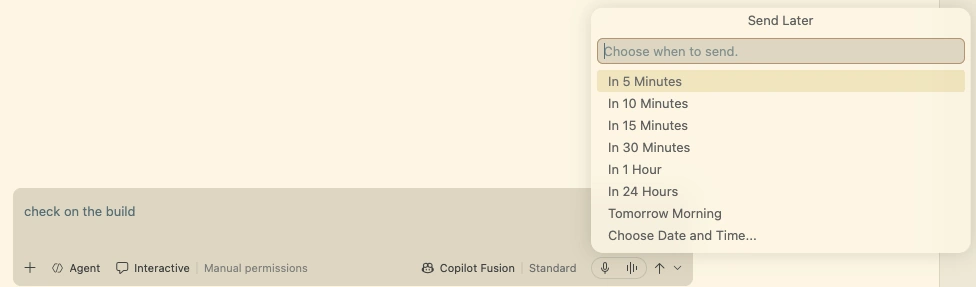

For a specific time, select **Choose Date and Time**, pick a day in the calendar and a time from the dropdown, and select **Schedule**.

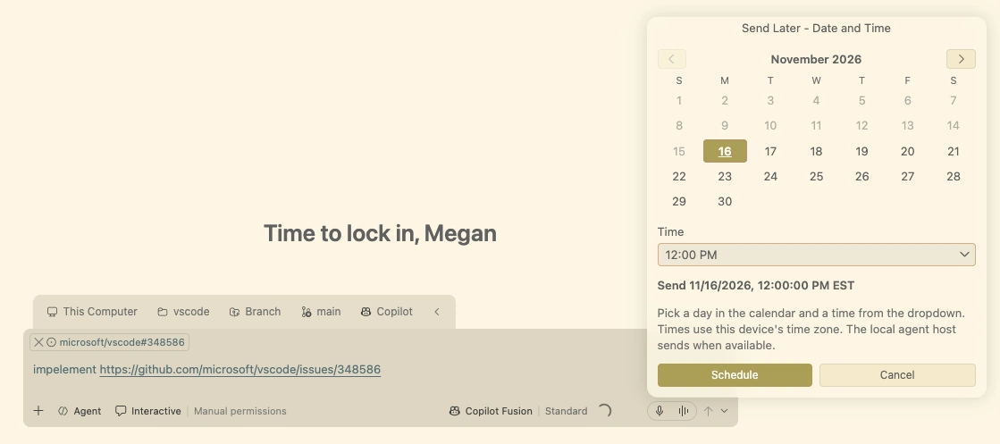

Where the request waits depends on where you scheduled it:

* **New session**: In the **Drafts** section of the sessions list.
* **Existing chat**: In that chat's **Scheduled** area, with its send time. If the agent is still busy at the scheduled time, the request waits its turn instead of interrupting.

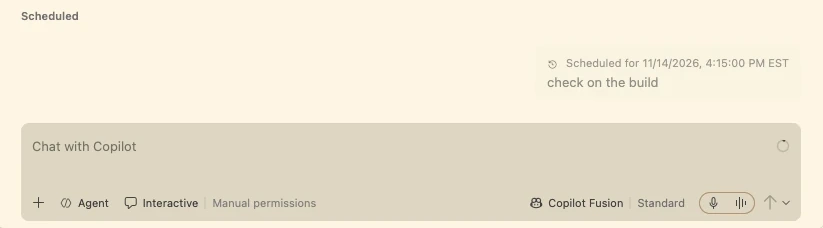

Alternatively, you can ask the agent to schedule a request for you by using plain language in the chat prompt, for example: `"Check the build in 10 minutes."`

The agent schedules a one-time, text-only request in the current chat and confirms when it will be sent. The request appears in the chat's **Scheduled** area, like one you scheduled from the menu.

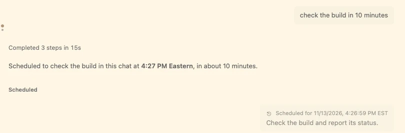

The local agent host must be running at the scheduled time. Scheduling doesn't wake a sleeping computer. A missed request is processed once the host is available again.

To manage your scheduled requests (edit, send immediately, reschedule, or cancel), use the options available when you hover over them in the chat or session list. To find sessions with pending requests, look for the clock indicator in the session list, or select **Scheduled Only** in the sessions filter menu.

Learn more about scheduling requests in the [Send Later documentation](https://code.visualstudio.com/docs/agents/run/agents-window#_send-a-request-later).

> **Note**: Scheduled requests work only for sessions on **This Computer** and require automations to be enabled (`setting(chat.automations.enabled)`).

### Save and resume drafts (Experimental)

**Setting**: `setting(sessions.drafts.enabled)`

Previously, the new-session input held a single unsent request at a time. With drafts, you can keep several unsent requests side by side, each with its own workspace, agent, and configuration, and come back to any of them later.

When you leave a new session that has content, VS Code saves it to the **Drafts** section of the sessions list. Nothing is sent, and no agent session starts. To jump right back, select **Open Draft** in the notification.


Each draft keeps everything you set up: text, attachments, inline references, workspace, agent, model, and other configuration. Drafts survive reloads and restarts.

From the Drafts list, you can preview, open, or delete a draft. When you send a draft, it's removed only after the request is accepted, so a failed send doesn't lose your work.

Turning off the setting hides the Drafts section but keeps your saved drafts.

### Share remote environments as GitHub Environments

Share a remote as a GitHub Environment to pick up its agent sessions from another device or supported Copilot app, using your GitHub account.

To share a connected SSH host, WSL distribution, or Dev Tunnel, open the Remote Environments editor in the Agents window and select **Share as GitHub Environment** (GitHub icon) on the remote's row.

A shared remote stays in its group and shows a GitHub icon after its name. Select the action again to stop sharing.

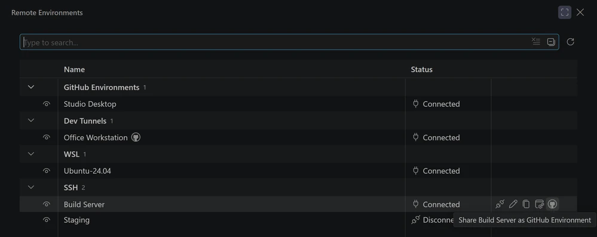

Learn more about [remote agent sessions](https://code.visualstudio.com/docs/agents/run/remote-agent-sessions).

### Keep chat sessions across Dev Container rebuilds (Experimental)

**Settings**: `setting(dev.containers.stateVolume.enabled)`, `setting(chat.agentHost.devContainer.stateVolume.enabled)`

Rebuilding a Dev Container used to remove the Copilot chat sessions stored inside it. When you enable these settings, VS Code stores the user and agent state of a new Dev Container on a Docker volume, preserving your chat sessions across rebuilds.

> **Important**: A container gets the volume only when it's created with the setting enabled, so rebuild once to start keeping your sessions.

### Inbox mode improvements (Experimental)

**Setting**: `setting(sessions.list.inboxEnabled)`

Inbox mode groups your Agents window sessions by what needs your attention. You can switch to Inbox mode at any time with **Grouping > Inbox Mode** in the sessions list. The `setting(sessions.list.inboxEnabled)` setting makes it the default grouping.

This release builds on your feedback to make Inbox mode more useful and manageable:

* **Acknowledge sessions you've handled**

    If a session doesn't need your attention but isn't finished, you can mark it as acknowledged (eye icon). Acknowledging a session moves it out of the Inbox and into the **Acknowledged** section. The session isn't marked as read or done, archived, or closed.

    When there is new activity in the session, it returns to the Inbox. You can acknowledge several selected sessions at once.

* **Focus on one workspace or environment**

    Use the workspace and environment pickers at the top of the sessions list to see only the sessions you care about right now. The filter applies to every section, including pinned and archived sessions, and is remembered across reloads.

    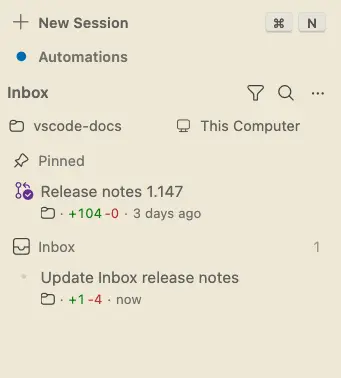

## Agent experience

### Decision model-based model routers (Experimental)

**Setting**: `chat.copilot.modelRouter.enabled`

With a model router, you describe which model you want for which kind of work. A decision model, `gpt-6-luna-decisions`, then matches your request to one of your routes, and VS Code runs the chat on that route's model. A router is a YAML file in `~/.agents/model-routers/` that appears in the model picker in [Copilot harness](https://code.visualstudio.com/docs/agents/run/agent-harnesses#_copilot) sessions.

Model routers are at an early stage, and your feedback will help shape them. Tell us what works and what doesn't by [filing an issue](https://github.com/microsoft/vscode/issues).

```yaml
version: 1
description: Opus to build, GPT-6 Luna for quick questions.
routes:
  - model: opus
    when: Building or changing code over many steps, such as a feature, a bug fix, or a refactor.
  - model: gpt-6-luna
    when: Quick answers and small chores, such as where something is or what a setting does.
```

To try model routers, add `"chat.copilot.modelRouter.enabled": true` to your user [`settings.json`](https://code.visualstudio.com/docs/configure/settings#_settings-json-file) file.

To author a router, type `/model-router` in a Copilot harness chat and describe how you want your requests routed. Then select the router in the model picker.

### Model comparison improvements (Preview)

[Model comparison](https://code.visualstudio.com/docs/agents/run/compare-models) lets you run the same prompt across models in the Agents window, so you can review, judge, and combine their results. This release makes comparisons easier to find and understand:

* **Comparisons stay with their chat**: When you [ask an agent to run a comparison](https://code.visualstudio.com/docs/agents/run/compare-models#_ask-an-agent-to-run-a-comparison), it appears beneath that chat in the sessions list. The agent's response includes an **Open Comparison** action to go straight to the results.

* **See how a comparison was set up**: Hover over a comparison in the sessions list to see its original settings: repository, isolation, base branch, each attempt's model and effort level, judge, and synthesizer. You no longer need to open each attempt to check.

    

### HTML previews and native visuals in agent responses

**Settings**: `setting(chat.htmlPreview.enabled)`, `setting(chat.nativeComponents.enabled)` (Agents window only)

Some agent responses are easier to review as a visual or a chart than as text, such as a comparison of approaches, a mockup, or build times before and after a change. In the [Agents window](https://code.visualstudio.com/docs/agents/run/agents-window), agents can show these inline in the response in two ways. Each has its own setting, which is off by default.

* **HTML previews**: For free-form layouts, such as reports, diagrams, and mockups. Previews display HTML, CSS, tables, inline SVG, and expandable sections. Scripts, forms, external links, and external resources aren't supported. Enable `setting(chat.htmlPreview.enabled)` and use the built-in `/html-preview` [skill](https://code.visualstudio.com/docs/agent-customization/agent-skills) in your request, for example `/html-preview compare the two caching approaches`.

* **Native visuals (Experimental)**: For data, such as key numbers and comparisons. Agents can show metrics, badges, tables, bar charts, and expandable details that VS Code renders itself, so they match your theme, including high-contrast themes. Enable `setting(chat.nativeComponents.enabled)` and use the built-in `/vscode-ui` skill in your request, for example `/vscode-ui compare the full and incremental build times`.

<video src="images/1_147/html-preview-native-visuals.mp4" title="Video showing agent responses in the Agents window: an inline HTML preview with three mockups, native visuals with metrics, a bar chart, and a table, and an HTML preview of a chart with hover details." autoplay loop controls muted></video>

Both appear as part of the response, without a title bar or permanent buttons. Right-click a preview or visual and select **Show Source** to see its markup. For an HTML preview, you can also select **Open Preview** for a larger view or **Save HTML** to export a self-contained HTML file.

### Automations

Automations allow you to define tasks that run automatically based on specific triggers and conditions. You can create, manage, and monitor automations from the Automations view in the Agents window. This release adds guided setup, end dates, and filters for automation runs:

* **Agent-guided automation creation**

    Creating an automation with an agent is now a more guided experience. The agent helps you define what a successful result looks like, decide when the automation runs, and choose where it runs. To start, ask an agent to create an automation. You can also select **Create with Agent** in the Automations view to continue in chat.

    If you prefer configuring everything yourself, open the dropdown next to **Create with Agent** and select **Create Manually**.

* **Set an end date for automations**

    Automations can stop automatically after a specified duration. Set an end date when creating an automation with an agent, or choose **Days**, **Weeks**, or **Months** under **Advanced Settings** in the manual configuration form. Select **Never** to remove an existing end date.

* **Filter automation runs in session lists**

    Automation runs are hidden from session lists by default. Use the **Automations** filter to include or exclude them in the Agents window and the editor Chat sessions list.

### More context for assisted permissions

**Setting**: `setting(chat.permissions.assisted.instructions)`

With [assisted permissions](https://code.visualstudio.com/docs/agents/run/approvals#_permission-levels), an LLM reviewer assesses each tool call in Copilot harness sessions and approves low-risk calls for you. Previously, the reviewer relied only on its default guidance, so it couldn't account for what you consider safe or risky in your own work.

Use `setting(chat.permissions.assisted.instructions)` to give the LLM reviewer your own instructions, for example:

```text
Always ask before installing packages or pushing to a remote.
Running tests and read-only Git commands doesn't need my approval.
```

Your instructions take precedence over the reviewer's default guidance. Changes to the setting apply to sessions that are already open. They can't override permission rules, organization policy, or the sandbox, and they aren't sent to the agent.

The reviewer also takes into account who asked for the work:

* **Automations and other agents**: Requests that an [automation](https://code.visualstudio.com/docs/agents/run/automations) starts or that another agent sends are no longer treated as if you wrote them. In these sessions, tool calls might ask for approval where they previously didn't.

* **Your answers**: Your answers to an agent's questions and plan reviews count, including when you decline. An approval can cover later work that your answer describes, and a refusal can block an action that was approved before.

### Arrange the Details panel around the editor (Experimental)

**Settings**: `setting(sessions.experimental.detailsPosition)`, `setting(sessions.experimental.floatingDetails)` (Agents window only)

In the Agents window, you can position Files, Changes, and other Details views around the editor to make better use of the available space. Open **View > Appearance > Details Position** and choose **Left**, **Right**, **Above Editor**, **Below Editor**, or **Floating**. **Right** is the default.

Floating Details overlays the editor instead of reserving space. Hover over or focus the widget to preview its contents, then select the pin control to keep it open. You can also drag and resize it.

<video src="images/1_147/details-position.mp4" title="Video showing floating and docked Details views in the Agents window." autoplay loop controls muted></video>

### View extension info

The Extensions section of Customizations shows the same detailed information about each installed extension, including its version, publisher, and available commands, as you can from the Extensions view in the editor window.

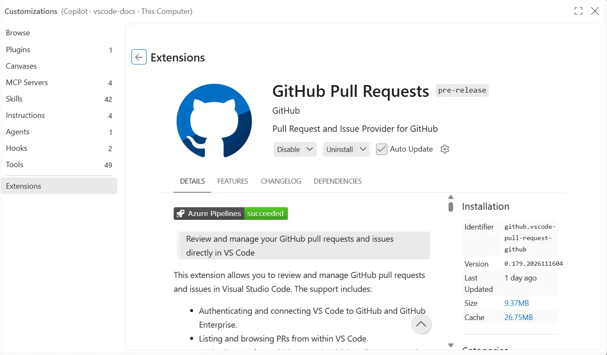

## Chat

### Attach screenshots of other apps (Experimental)

**Setting**: `setting(chat.appWindowScreenshots.enabled)`

Give the agent a view of the app you're building, even when it runs in another application. Select **Add Context** > **Screenshot App Window** and choose a window, such as a browser or simulator.

You can also press `kb(workbench.action.chat.attachAppWindowScreenshot)` while another app is in the foreground to capture its window and attach it to the chat. From VS Code, the shortcut captures the app window you just left. You can mark up the image before sending.

<video src="images/1_147/app-screenshots-demo.mp4" title="Video showing screenshots from other apps being added to chat." autoplay loop controls muted></video>

### Capture and mark up images in chat

Select **Mark Up** on any image attachment in the chat input to crop it, draw arrows or shapes, or add text before sending. This works with screenshots, pasted images, and images attached from files, so you can point out a layout problem or highlight the part you want changed.

### Inline chat attachment pills (Experimental)

**Setting**: `setting(chat.inlineAttachments.enabled)`

[Inline chat attachments](https://code.visualstudio.com/updates/v1_145#_inline-chat-attachments-experimental) show files, images, and other context as pills at the position where you added them in your prompt, so references stay next to the instructions they belong to. Recent updates make the pills more useful in the chat input and in sent requests:

* **Preview and open GitHub references**: Hover over or focus a GitHub issue or pull request pill to see its title, status, and description. Select the pill to open the issue or pull request. In sent requests, where selecting a pill previously did nothing, this also works when inline attachments are off.

* **Rearrange pills by dragging**: Drag a pill to a new position in the same chat input, rather than removing the context and attaching it again.

* **Clearer sent requests**: Sent requests show attached images as thumbnails above the text, in addition to the inline pills. Pills and slash commands line up with the surrounding text. Image and GitHub pills are restored after you reload the window, instead of appearing as plain links.


Inline attachments are enabled by default in Insiders and off by default in Stable.

## MCP

### Skills over MCP

[Skills over MCP](https://github.com/modelcontextprotocol/ext-skills) (SEP-2640) is now enabled by default, allowing MCP servers to automatically provide skills to the model.

The first time you connect to an MCP server that provides skills, you are asked to allow them into your model context. Afterwards, the model can interact with these skills and you can see them on the **Skills** tab of the Agent Customizations editor.

You can opt out of skills over MCP by disabling the `setting(chat.agentHost.mcpSkills.enabled)` setting.

## Browser integration

### Let agents use your browser with browser use (Preview)

**Setting**: `setting(chat.agentHost.browserUse.enabled)`

Browser Use lets agents interact directly with your default browser (Google Chrome or Microsoft Edge). This complements VS Code's integrated browser, for example by allowing agents to reuse existing authenticated sessions and interact with web pages outside of VS Code.

Browser Use requires the [GitHub Copilot browser extension](https://chromewebstore.google.com/detail/github-copilot/hblomdgalaelcilcdepgohfcogjiijhe), a [Copilot harness](https://code.visualstudio.com/docs/agents/run/agent-harnesses) session that runs on your own machine, and Node.js 22 or later on your `PATH`.

To get started with Browser Use:

1. Enable the `setting(chat.agentHost.browserUse.enabled)` setting and restart VS Code.
1. Open a local Copilot session and enter `/plugin enable browser-use` to enable the browser-use plugin.
1. Ask Copilot to perform a browser task, for example: `Open my app at localhost:3000, check the navigation, and capture a screenshot.`
1. Approve site access when prompted; complete sign-in and sensitive steps yourself.
1. Run `/browser-use:doctor` and follow its guidance to check your setup in case of any issues.

### Preview remote HTML files in the integrated browser (Preview)

**Setting**: `setting(workbench.browser.enableRemoteProxy)`

You can now open HTML files from a remote workspace, such as SSH, WSL, or a Dev Container, in the [integrated browser](https://code.visualstudio.com/docs/debugtest/integrated-browser), just like [local HTML files](https://code.visualstudio.com/updates/v1_134#_open-html-files-in-the-integrated-browser-by-default). In the Explorer, right-click an HTML file and select **Open in Integrated Browser**. The page keeps its `file://` address, and the file and the resources it references, such as scripts, styles, images, and fonts, load from the remote workspace. Remote files only load from folders you trust.

This also works in the Agents window for sessions on a [remote agent host](https://code.visualstudio.com/docs/agents/run/remote-agent-sessions), so you and the agent can preview a page the agent wrote without copying it to your machine.

Enable `setting(workbench.browser.enableRemoteProxy)` to try it out, and file any issues you encounter in the [VS Code repository](https://github.com/microsoft/vscode/issues).

### Open non-localhost links in the integrated browser

**Setting**: `setting(workbench.externalUriOpeners)`

Localhost links could already open in the integrated browser with `setting(workbench.browser.openLocalhostLinks)`. The integrated browser is now listed as an opener in the `setting(workbench.externalUriOpeners)` setting, so you can choose it for other links instead of using the default browser. For example, to open links to your company's sites in the integrated browser:

```json
"workbench.externalUriOpeners": {
  "*.contoso.com": "workbench.integratedBrowser"
}
```

Use `*` as the pattern to open every link there instead.

### Turn off dimming in the integrated browser

**Setting**: `setting(workbench.browser.dimOnOverlay)`

When something overlaps the integrated browser, such as a tab hover or a tooltip, the page pauses and dims. As hovers come and go, the page repeatedly darkens and returns to normal, which might appear as flicker and be uncomfortable for users who are sensitive to it.

You can now disable `setting(workbench.browser.dimOnOverlay)` to keep the page undimmed while it's paused. Notifications still dim the page.

## Sandboxing

### Retry with updated permissions inside the sandbox

If a terminal command fails because it can't access a file or folder, you can grant access at the session, workspace, or user level. With [sandbox bypass](https://code.visualstudio.com/docs/agents/run/agent-sandboxing#_control-approval-and-fallback-behavior) enabled, Copilot can use that permission to retry the command inside the sandbox instead of asking to run it outside.

<video src="images/1_147/sandboxing.mp4" title="Video showing file access approval and a command retry inside the sandbox." autoplay loop controls muted></video>

Use the approval dropdown to choose where the permission applies:

* **Allow for This Session** (default): Applies to all chats in this session, even after you resume it.
* **Allow for This Workspace** (when available): Applies to sessions with the same workspace folders on the same Agent Host. The host saves the permission without changing your workspace settings.
* **Allow for This User**: Saves the permission in your User settings so it applies across sessions and workspaces.

The command retries inside the sandbox. None of these options grants permission to run outside it.

## Accessibility

### Clearer focus and session attention

In high-contrast themes, Agents window controls now use a dashed outline for pointer hover and a solid outline for keyboard focus and open or expanded states. This makes it easier to follow your focus when navigating.

Sessions that need input are also easier to spot: light themes use a clearer amber indicator, and high-contrast themes show a marker at the left edge of the session row. You can customize the color with `agentSessionNeedsInput.foreground` in `setting(workbench.colorCustomizations)`.

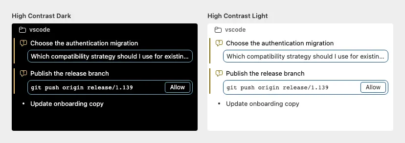

## Editor Experience

### Customize panel corners and spacing

**Setting**: `setting(workbench.sizeCustomizations)`

Customize panel corners and spacing in the editor window and in Agents windows with the Modern UI enabled. Set corner radii in whole pixels from 0 to 8 and spacing from 0 to 16. For example, you can use square panel corners, add space between panels, and give agent chat panels their own corners:

```json
{
  "workbench.sizeCustomizations": {
    "panels.cornerRadius": 0,
    "panels.spacing": 12,
    "agentsWindow.chatPanels.cornerRadius": 4
  }
}
```

<video src="images/1_147/size-customizations.mp4" title="Video showing size customizations in the Editor window." autoplay loop controls muted></video>

Compact layouts remain gapless, and the setting doesn't change controls, individual tabs, or native window corners.

### Connected panel tabs (Experimental)

With the Modern UI enabled, the connected tab style now extends from editor tabs to horizontal panel and side bar tabs. Selected views visually connect to their content, including when the Activity Bar is at the top or bottom. Choose `connected` (the default) or `pill` with `setting(workbench.experimental.modernUIEditorTabStyle)`. The default vertical Activity Bar is unchanged.

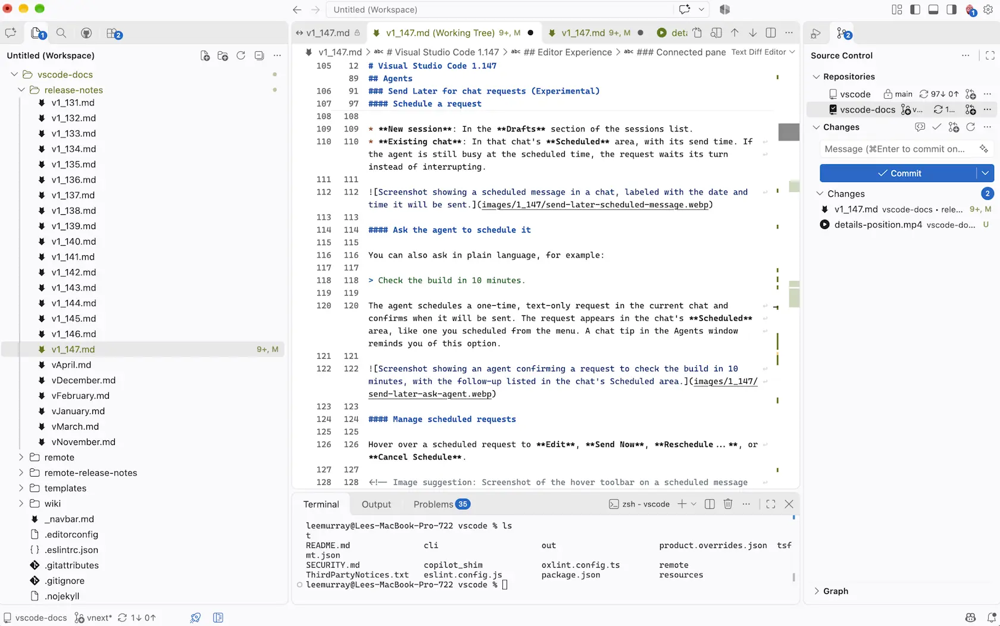

### Edit Markdown tables cell by cell

Editing a Markdown table in the source means keeping pipes and separator rows intact by hand. In the Markdown editor, tables stay rendered while you edit them, and you edit one cell at a time.

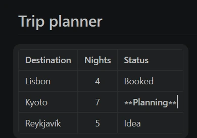

### Collapsible details sections in the Markdown editor

Long documents often hide optional content in `<details>` sections. The Markdown editor now renders `<details>` and `<summary>` as collapsible sections, like GitHub does. Sections with the `open` attribute start expanded, and other sections start collapsed.

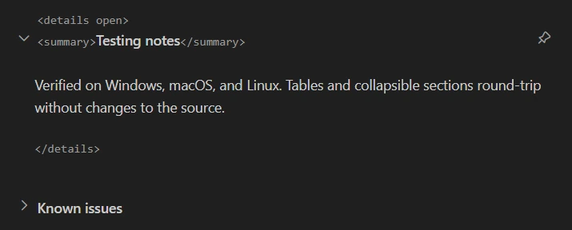

## Enterprise

### Permit Claude and Codex alongside managed settings

Previously, any Copilot [enterprise-managed setting](https://code.visualstudio.com/docs/enterprise/manage-ai-settings) disabled the Claude and Codex [harnesses](https://code.visualstudio.com/docs/agents/run/agent-harnesses), because they don't enforce those settings. An organization couldn't govern Copilot and still offer Claude or Codex to its developers.

Administrators can now permit one or both harnesses by listing them in `vscode.allowedHarnesses`:

```json
{
  "permissions": {
    "disableBypassPermissionsMode": "disable"
  },
  "vscode": {
    "allowedHarnesses": ["claude", "codex"]
  }
}
```


* The list permits the harnesses it names and blocks the others, so an empty list blocks both. Without the setting, managed settings disable both harnesses, as before.
* Valid entries are `claude` and `codex`, in lowercase. Other entries are ignored.
* Permitting a harness only lifts this restriction. Other controls still apply, such as `vscode.temporaryAllowLocalHarness: false`.
* Set it in file-based or MDM-managed settings. Server-managed settings don't support it yet.

> **Note:** Permitting a harness doesn't make it enforce your managed settings. Claude and Codex sessions run without Copilot's managed permission, sandbox, MCP, and plugin controls.

### Regular expressions in managed shell permission rules

Previously, managed shell permission rules matched only exact text or `*` wildcards, so a single rule couldn't cover alternatives or word boundaries. In Copilot harness sessions, `Shell(...)`, `Bash(...)`, and `PowerShell(...)` rules in [enterprise-managed settings](https://code.visualstudio.com/docs/enterprise/manage-ai-settings) accept a JavaScript regular expression written as `/pattern/flags` in `permissions.deny`, `permissions.ask`, and `permissions.allow`.

For example, require approval for commands that start with `git push` or `git pull`:

```json
{
  "permissions": {
    "ask": ["Shell(/^git\\s+(push|pull)\\b/)"]
  }
}
```

## Contributions to extensions

### GitHub Pull Requests

There has been more progress on the [GitHub Pull Requests](https://marketplace.visualstudio.com/items?itemName=GitHub.vscode-pull-request-github) extension, which enables you to work on, create, and manage pull requests and issues. New features include:

* When GitHub Actions workflows are waiting for a maintainer's approval, such as for a pull request from a first-time contributor, the checks section of the pull request overview has an **Approve workflows to run** button.

* Comments and other timeline items in the pull request overview use the full width once they're below the sidebar, and the overview switches to a single column below 1000px wide instead of 768px.

* In the Agents window, the pull request overview can be split into **Timeline**, **Checks/Merge**, and **Metadata** tabs with the experimental setting `"githubPullRequests.experimental.agentsOverviewTabs"`. The Timeline tab shows the number of unresolved conversations, and the Checks/Merge tab shows whether the pull request is ready to merge.

Review the [changelog for the 0.180.0](https://github.com/microsoft/vscode-pull-request-github/blob/main/CHANGELOG.md#01800) release of the extension to learn about everything in the release.

## Deprecated features and settings

### New deprecations in this release

* VS Code desktop on **macOS Ventura** and **macOS Sonoma** is deprecated. For details, see the [VS Code FAQ](https://code.visualstudio.com/docs/supporting/faq#_can-i-run-vs-code-on-old-macos-versions).

* VS Code desktop on **32-bit ARM Linux** is deprecated. For details, see the [VS Code FAQ](https://code.visualstudio.com/docs/supporting/faq#_can-i-run-vs-code-on-32-bit-arm-linux).

* The experimental AI usage statistics in the Status Bar (`editor.aiStats.enabled`) are removed because of low usage.

### Upcoming deprecations

* [The Local harness is deprecated](https://code.visualstudio.com/updates/v1_146#_copilot-harness-and-deprecation-of-the-local-harness) and will be removed in February 2027.

<!-- RELEASE_THANK_YOU_START -->
## Thank you

### Issue tracking

Contributions to our issue tracking:

* [@gjsjohnmurray (John Murray)](https://github.com/gjsjohnmurray)
* [@RedCMD (RedCMD)](https://github.com/RedCMD)
* [@IllusionMH (Andrii Dieiev)](https://github.com/IllusionMH)
* [@albertosantini (Alberto Santini)](https://github.com/albertosantini)

### Pull requests

Contributions to `vscode`:

* [@AAAkater](https://github.com/AAAkater): agentHost: fix incorrect model attribution in Codex subagent responses [PR #340470](https://github.com/microsoft/vscode/pull/340470)
* [@Aryan9891 (Aryan Sachin)](https://github.com/Aryan9891): fix(terminal): support multiple action view items for create terminal dropdown (#346848) [PR #346854](https://github.com/microsoft/vscode/pull/346854)
* [@Boulea7 (Langning Zhang)](https://github.com/Boulea7): Fix PWA manifest start URL for server base paths [PR #330360](https://github.com/microsoft/vscode/pull/330360)
* [@DivyaRaval1909 (Divya Raval)](https://github.com/DivyaRaval1909): Hide action list item icon and submenu indicator from screen readers [PR #339952](https://github.com/microsoft/vscode/pull/339952)
* [@Iyanuoluwa007 (Oke Iyanuoluwa Enoch)](https://github.com/Iyanuoluwa007): Report problems of pending lines when a task problem collector is done [PR #346122](https://github.com/microsoft/vscode/pull/346122)
* [@mcumming (Michael Cummings (MSFT))](https://github.com/mcumming): Never send Entra sign-in tokens to the marketplace [PR #343689](https://github.com/microsoft/vscode/pull/343689)
* [@NeoMetric](https://github.com/NeoMetric): agentHost: stream BYOK model output as it is produced [PR #341851](https://github.com/microsoft/vscode/pull/341851)
* [@rudy-07 (Rudransh Shekhar)](https://github.com/rudy-07): terminal-suggest: fix root directory check in npm and yarn package.json lookup [PR #347265](https://github.com/microsoft/vscode/pull/347265)
* [@sameerihs (Sameer)](https://github.com/sameerihs)
  * Reset notebook controller language restrictions [PR #347068](https://github.com/microsoft/vscode/pull/347068)
  * Clean up obsolete webview resource caches [PR #346867](https://github.com/microsoft/vscode/pull/346867)
  * Use pending URLs when restoring browser tabs [PR #346996](https://github.com/microsoft/vscode/pull/346996)
  * Invalidate cached TS responses after document reopen [PR #347028](https://github.com/microsoft/vscode/pull/347028)
  * Keep the latest debugger source refresh [PR #347124](https://github.com/microsoft/vscode/pull/347124)
  * Track forwarded tunnel connections by socket [PR #347033](https://github.com/microsoft/vscode/pull/347033)
  * Keep task problem markers scoped to each terminal [PR #346994](https://github.com/microsoft/vscode/pull/346994)
  * Isolate copied notebook output items [PR #347117](https://github.com/microsoft/vscode/pull/347117)
  * Cancel stale format-on-type requests [PR #347115](https://github.com/microsoft/vscode/pull/347115)
  * Keep configuration retries on their original file [PR #347074](https://github.com/microsoft/vscode/pull/347074)
  * Keep in-memory working copy backups distinct [PR #347066](https://github.com/microsoft/vscode/pull/347066)
  * Serialize rapid virtual document refreshes [PR #346986](https://github.com/microsoft/vscode/pull/346986)
  * Clear buffered results before a new Quick Search [PR #347031](https://github.com/microsoft/vscode/pull/347031)
* [@ShakilUrRehman21 (SHAKIL UR REHMAN)](https://github.com/ShakilUrRehman21): map: preserve custom toKey and re-key on ResourceMap copy [PR #347344](https://github.com/microsoft/vscode/pull/347344)
* [@shoutoutuoadi325 (Zhiqi Zhang)](https://github.com/shoutoutuoadi325): Fix UTF-16 column counts in TextLength [PR #345715](https://github.com/microsoft/vscode/pull/345715)
* [@SimonSiefke (Simon Siefke)](https://github.com/SimonSiefke)
  * fix: memory leak in word highlighter [PR #346673](https://github.com/microsoft/vscode/pull/346673)
  * fix: memory leak in task providers [PR #338231](https://github.com/microsoft/vscode/pull/338231)
  * fix: memory leak in untitled editor resolution [PR #346674](https://github.com/microsoft/vscode/pull/346674)
  * perf: avoid rescanning test children in Test Explorer [PR #347176](https://github.com/microsoft/vscode/pull/347176)
  * perf: batch Test Explorer test run updates [PR #346656](https://github.com/microsoft/vscode/pull/346656)
  * fix: memory leak in test results terminal [PR #347183](https://github.com/microsoft/vscode/pull/347183)
  * feature: reduce idle CPU usage by up to 75% [PR #338767](https://github.com/microsoft/vscode/pull/338767)
  * fix: race condition in notebook kernel picker [PR #341483](https://github.com/microsoft/vscode/pull/341483)
  * fix: memory leak in SCM repository context keys [PR #346683](https://github.com/microsoft/vscode/pull/346683)
  * fix: memory leak in emitter warning names [PR #347966](https://github.com/microsoft/vscode/pull/347966)
  * perf: reduce memory usage by 44 kB [PR #342392](https://github.com/microsoft/vscode/pull/342392)
  * fix: memory leak in markersView [PR #348007](https://github.com/microsoft/vscode/pull/348007)
* [@trivikr (Trivikram Kamat)](https://github.com/trivikr): Add --hidden-window to run extension tests without showing a window [PR #344174](https://github.com/microsoft/vscode/pull/344174)
* [@wasim-builds (MOHAMMED WASIM KHAN)](https://github.com/wasim-builds): fix: prevent DisposableStore leak per tree node in ExtHostTreeView (#346620) [PR #346727](https://github.com/microsoft/vscode/pull/346727)
* [@wozhenbang2004 (Kayokoi)](https://github.com/wozhenbang2004): Fix authentication provider cleanup when an extension host stops [PR #345127](https://github.com/microsoft/vscode/pull/345127)
* [@wynnsimon (wynn)](https://github.com/wynnsimon): fix: Fix findWithArgs ignoring empty search strings (#151311) [PR #334803](https://github.com/microsoft/vscode/pull/334803)
* [@YOSHII-Hiroto (吉井　啓人（YOSHII, Hiroto）)](https://github.com/YOSHII-Hiroto): Fix element picker with mobile emulation [PR #332183](https://github.com/microsoft/vscode/pull/332183)

Contributions to `vscode-pull-request-github`:

* [@hungud (Uong Dong Hung)](https://github.com/hungud): fix: handle null review comment commit in parseGraphQLComment (fixes #9159) [PR #9168](https://github.com/microsoft/vscode-pull-request-github/pull/9168)

<!-- RELEASE_THANK_YOU_END -->
---

We really appreciate people trying our new features as soon as they are ready, so check back here often and learn what's new.

>If you'd like to read release notes for previous VS Code versions, go to [Updates](https://code.visualstudio.com/updates) on [code.visualstudio.com](https://code.visualstudio.com).

<a id="scroll-to-top" role="button" title="Scroll to top" aria-label="scroll to top" href="#"><span class="icon"></span></a>
<link rel="stylesheet" type="text/css" href="css/inproduct_releasenotes.css"/>
