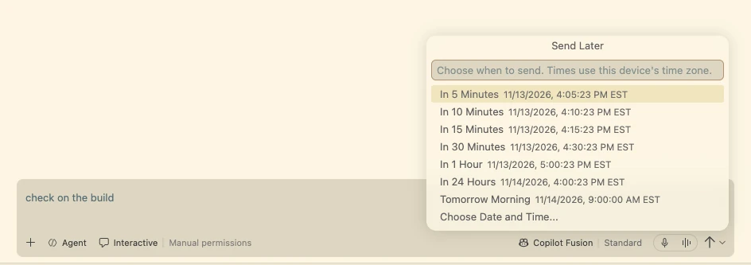
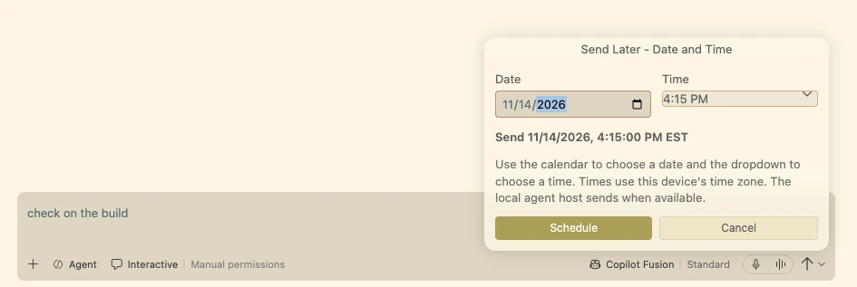
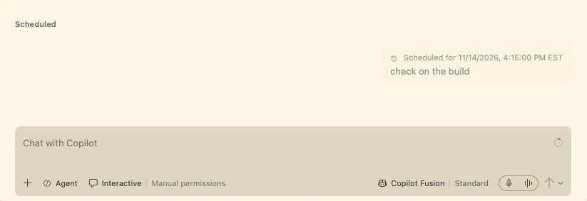
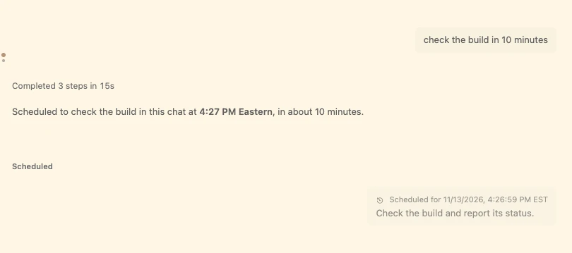
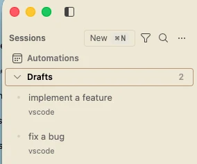

# Visual Studio Code 1.147

<!-- %IF IN_PRODUCT %
Follow us on [LinkedIn](https://www.linkedin.com/showcase/vs-code), [X](https://go.microsoft.com/fwlink/?LinkID=533687), [Bluesky](https://bsky.app/profile/vscode.dev), [Instagram](https://www.instagram.com/vscode) | [View online](https://code.visualstudio.com/updates)
%ENDIF % -->
<!-- %IF IN_WEB %

Release date: November 18, 2026 Stable

%ENDIF % -->
<!-- %IF IN_PRODUCT %
_Release date: November 18, 2026_
%ENDIF % -->

<!-- DOWNLOAD_LINKS_PLACEHOLDER -->

<!-- RELEASE_HIGHLIGHTS_START -->
## Release highlights

This release ... <TODO @ntrogh>

* [highlight](#bookmark): <highlight description, including availability or requirements when relevant>

<!-- Optional video: remove this block when no highlights video is available.
Before publishing, verify the media paths, add the actual duration to the summary,
and provide captions and a descriptive transcript for narrated content. -->
<!-- %IF IN_WEB %

  
Watch release highlights

  <video src="images/1_147/release-highlights.mp4" poster="images/1_147/release-highlights.webp" title="Video showing the highlights of VS Code 1.147." controls preload="none" playsinline></video>
  
<a href="/assets/updates/1_147/release-highlights.mp4">Open the highlights video</a>.

%ENDIF % -->
<!-- RELEASE_HIGHLIGHTS_END -->

<!-- %IF STABLE %

Already installed? Use <strong>Check for Updates</strong> in VS Code. For upcoming features, use the <a href="https://code.visualstudio.com/insiders">Insiders build</a>.

%ENDIF % -->

<!-- %IF IN_PRODUCT %
Happy Coding!

---
%ENDIF % -->

<!-- TOC

  <nav id="toc-nav">
    
In this update

    <ul>
      <li><a href="#release-highlights">Release highlights</a></li>
      <li><a href="#agents">Agents</a></li>
      <li><a href="#chat">Chat</a></li>
      <li><a href="#mcp">MCP</a></li>
      <li><a href="#accessibility">Accessibility</a></li>
      <li><a href="#editor-experience">Editor Experience</a></li>
      <li><a href="#code-editing">Code Editing</a></li>
      <li><a href="#notebooks">Notebooks</a></li>
      <li><a href="#source-control">Source Control</a></li>
      <li><a href="#debugging">Debugging</a></li>
      <li><a href="#tasks">Tasks</a></li>
      <li><a href="#terminal">Terminal</a></li>
      <li><a href="#authentication">Authentication</a></li>
      <li><a href="#languages">Languages</a></li>
      <li><a href="#remote-development">Remote Development</a></li>
      <li><a href="#contributions-to-extensions">Contributions to extensions</a></li>
      <li><a href="#extension-authoring">Extension Authoring</a></li>
      <li><a href="#proposed-apis">Proposed APIs</a></li>
      <li><a href="#engineering">Engineering</a></li>
      <li><a href="#deprecated-features-and-settings">Deprecated features and settings</a></li>
      <li><a href="#notable-fixes">Notable fixes</a></li>
      <li><a href="#thank-you">Thank you</a></li>
    </ul>
  </nav>
  

Navigation End -->

## Agents

### Send Later for chat requests (Experimental)

**Setting**: `setting(sessions.sendLater.enabled)`

Sometimes you want an agent to run a request after some time has passed. You might want to check a build after it finishes, or follow up on a review tomorrow morning. With Send Later, you write the request now and choose when the Agents window sends it.

#### Schedule a request

In a new session or an existing chat, open the send button's dropdown and select **Send Later**. Pick one of the preset times, which show the exact send time in your local time zone.

For a specific time, select **Choose Date and Time...**, pick a date and time, and select **Schedule**.

Where the request waits depends on where you scheduled it:

* **New session**: In the **Drafts** section of the sessions list.
* **Existing chat**: In that chat's **Scheduled** area, with its send time. If the agent is still busy at the scheduled time, the request waits its turn instead of interrupting.

#### Ask the agent to schedule it

You can also ask in plain language, for example:

> Check the build in 10 minutes.

The agent schedules a one-time, text-only request in the current chat and confirms when it will be sent. The request appears in the chat's **Scheduled** area, like one you scheduled from the menu. A chat tip in the Agents window reminds you of this option.

#### Manage scheduled requests

Hover over a scheduled request to **Edit**, **Send Now**, **Reschedule...**, or **Cancel Schedule**.

<!-- Image suggestion: Screenshot of the hover toolbar on a scheduled message with Edit, Send Now, Reschedule, and Cancel Schedule. Suggested file: images/1_147/send-later-manage-toolbar.webp -->

To find sessions with pending requests, look for the clock indicator, or select **Scheduled Only** in the sessions filter menu.

#### Requirements

* Send Later works for sessions on **This Computer**.
* It uses [Automations](https://code.visualstudio.com/docs/agents/run/automations), so `setting(chat.automations.enabled)` must stay enabled (it's on by default).
* The local agent host must be running at the scheduled time. Scheduling doesn't wake a sleeping computer. A missed request is sent once the host is available again.
* Turning off Send Later doesn't cancel requests you already scheduled. You can still manage them in Automations.

### Save and resume drafts (Experimental)

**Setting**: `setting(sessions.drafts.enabled)`

Previously, the new-session input held a single unsent request at a time. With drafts, you can keep several unsent requests side by side, each with its own workspace, agent, and configuration, and come back to any of them later.

When you leave a new session that has content, VS Code saves it to the **Drafts** section of the sessions list. Nothing is sent, and no agent session starts. To jump right back, select **Open Draft** in the notification.

Each draft keeps everything you set up: text, attachments, inline references, workspace, agent, model, and other configuration. Drafts survive reloads and restarts.

From the Drafts list, you can preview, open, or delete a draft. When you send a draft, it's removed only after the request is accepted, so a failed send doesn't lose your work.

Turning off the setting hides the Drafts section but keeps your saved drafts.

### Inbox mode improvements (Experimental)

**Setting**: `setting(sessions.list.inboxEnabled)`

Inbox mode groups your Agents window sessions by what needs your attention, so you can triage agent work across all your projects in one place. This release builds on your feedback from the previous release.

You can switch to Inbox mode at any time with **Grouping > Inbox Mode** in the sessions list. The `setting(sessions.list.inboxEnabled)` setting makes it the default grouping.

<!-- Image suggestion: Screenshot of the sessions list in Inbox mode with the workspace and environment pickers at the top, the Acknowledge (eye) action on a hovered row, and the Acknowledged section below On hold. Suggested file: images/1_147/sessions-inbox-scope-acknowledge.webp -->

#### Acknowledge sessions you've handled

Sometimes a session has nothing left for you to do, but it's not finished either. Select **Acknowledge** (eye icon) to move it out of the Inbox and into the **Acknowledged** section. The session isn't marked as read or done, archived, or closed. It returns to the Inbox when there's new activity.

You can acknowledge several selected sessions at once.

#### Focus on one workspace or environment

Use the workspace and environment pickers at the top of the list to see only the sessions you care about right now. The filter applies to every section, including Pinned and archived sessions, and is remembered across reloads.

#### Move and merge sessions from the list

* **Drag and drop**: Drag sessions onto **On hold**, **Pinned**, or the archived section to put them on hold, pin them, or archive them. Drag them back to **Inbox**, **Working**, or **Ready to merge** to return them.
* **Merge**: Sessions in **Ready to merge** have an inline **Merge** action, so you can merge a pull request without opening the session.

#### Less clutter

All sections share one scrolling list, and empty sections are hidden. Snoozed sessions show when they'll return, and you can snooze a session **Until New Activity**.

### Model comparison improvements (Preview)

[Compare Models](https://code.visualstudio.com/docs/agents/run/compare-models) runs the same prompt across models in the Agents window, so you can review, judge, and combine their results. This release makes comparisons easier to find and understand:

* **Comparisons stay with their chat**: When you [ask an agent to run a comparison](https://code.visualstudio.com/docs/agents/run/compare-models#_ask-an-agent-to-run-a-comparison), it appears beneath that chat in the sessions list. The agent's response includes an **Open Comparison** action to go straight to the results.
* **See how a comparison was set up**: Hover over a comparison in the sessions list to see its original models, judge, and synthesizer, including the effort level for Copilot Fusion. You no longer need to open each attempt to check.

<!-- Image suggestion: Screenshot of the hover over a comparison in the sessions list, showing Original comparison settings with the models, judge, and synthesizer. Suggested file: images/1_147/compare-models-settings-hover.webp -->

## Chat

## MCP

## Accessibility

## Editor Experience

## Code Editing

## Notebooks

## Source Control

## Debugging

## Tasks

## Terminal

## Authentication

## Languages

## Remote Development

The [Remote Development extensions](https://marketplace.visualstudio.com/items?itemName=ms-vscode-remote.vscode-remote-extensionpack), allow you to use a [Dev Container](https://code.visualstudio.com/docs/devcontainers/containers), remote machine via SSH or [Remote Tunnels](https://code.visualstudio.com/docs/remote/tunnels), or the [Windows Subsystem for Linux](https://learn.microsoft.com/windows/wsl) (WSL) as a full-featured development environment.

Highlights include:

* TODO: @ntrogh

You can learn more about these features in the [Remote Development release notes](https://github.com/microsoft/vscode-docs/blob/main/remote-release-notes/v1_147.md).

## Contributions to extensions

## Extension Authoring

## Proposed APIs

## Engineering

## Deprecated features and settings

### New deprecations in this release

### Upcoming deprecations

## Notable fixes

<!-- RELEASE_THANK_YOU_START -->
## Thank you

<!-- RELEASE_THANK_YOU_END -->
---

We really appreciate people trying our new features as soon as they are ready, so check back here often and learn what's new.

>If you'd like to read release notes for previous VS Code versions, go to [Updates](https://code.visualstudio.com/updates) on [code.visualstudio.com](https://code.visualstudio.com).

<a id="scroll-to-top" role="button" title="Scroll to top" aria-label="scroll to top" href="#"></a>
<link rel="stylesheet" type="text/css" href="css/inproduct_releasenotes.css"/>
