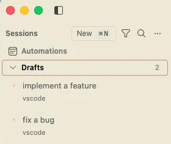
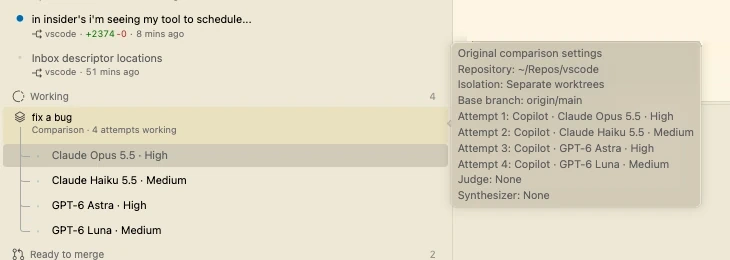
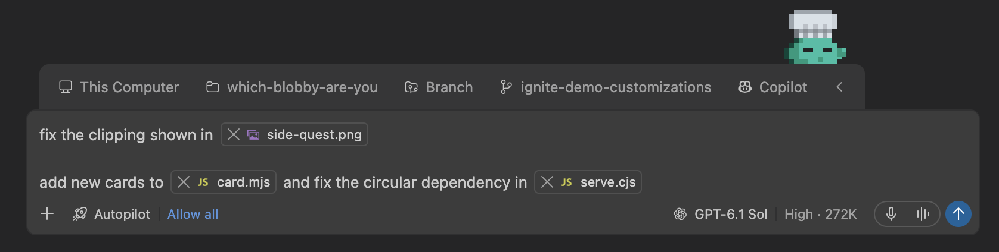
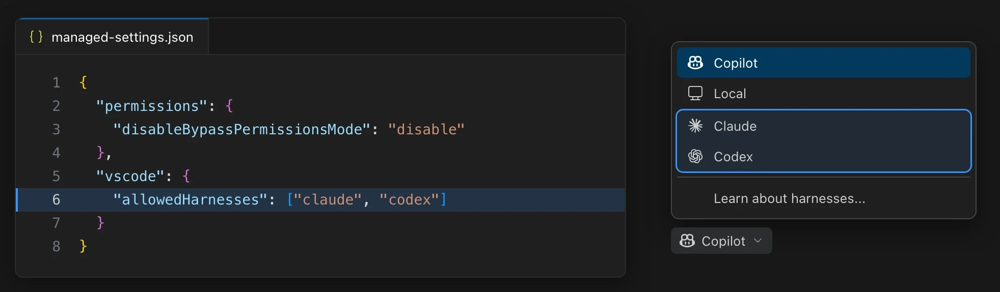

# Visual Studio Code 1.147

<!-- %IF IN_PRODUCT %
Follow us on [LinkedIn](https://www.linkedin.com/showcase/vs-code), [X](https://go.microsoft.com/fwlink/?LinkID=533687), [Bluesky](https://bsky.app/profile/vscode.dev), [Instagram](https://www.instagram.com/vscode) | [View online](https://code.visualstudio.com/updates)
%ENDIF % -->
<!-- %IF IN_WEB %
<p class="release-metadata"><span>Release date: November 18, 2026</span> <span class="release-channel">Stable</span></p>
%ENDIF % -->
<!-- %IF IN_PRODUCT %
_Release date: November 18, 2026_
%ENDIF % -->

<!-- DOWNLOAD_LINKS_PLACEHOLDER -->

<!-- RELEASE_HIGHLIGHTS_START -->
## Release highlights

This release ... <TODO @ntrogh>

* [highlight](#bookmark): <highlight description, including availability or requirements when relevant>

<!-- Optional video: remove this block when no highlights video is available.
Before publishing, verify the media paths, add the actual duration to the summary,
and provide captions and a descriptive transcript for narrated content. -->
<!-- %IF IN_WEB %
<details class="release-video">
  <summary>Watch release highlights</summary>
  <video src="images/1_147/release-highlights.mp4" poster="images/1_147/release-highlights.webp" title="Video showing the highlights of VS Code 1.147." controls preload="none" playsinline></video>
  <p><a href="/assets/updates/1_147/release-highlights.mp4">Open the highlights video</a>.</p>
</details>
%ENDIF % -->
<!-- RELEASE_HIGHLIGHTS_END -->

<!-- %IF STABLE %
<p class="release-update-guidance">Already installed? Use <strong>Check for Updates</strong> in VS Code. For upcoming features, use the <a href="https://code.visualstudio.com/insiders">Insiders build</a>.</p>
%ENDIF % -->

<!-- %IF IN_PRODUCT %
Happy Coding!

---
%ENDIF % -->

<!-- TOC
<div class="toc-nav-layout">
  <nav id="toc-nav">
    <div>In this update</div>
    <ul>
      <li><a href="#release-highlights">Release highlights</a></li>
      <li><a href="#agents">Agents</a></li>
      <li><a href="#chat">Chat</a></li>
      <li><a href="#sandboxing">Sandboxing</a></li>
      <li><a href="#mcp">MCP</a></li>
      <li><a href="#accessibility">Accessibility</a></li>
      <li><a href="#editor-experience">Editor Experience</a></li>
      <li><a href="#code-editing">Code Editing</a></li>
      <li><a href="#notebooks">Notebooks</a></li>
      <li><a href="#source-control">Source Control</a></li>
      <li><a href="#debugging">Debugging</a></li>
      <li><a href="#tasks">Tasks</a></li>
      <li><a href="#terminal">Terminal</a></li>
      <li><a href="#authentication">Authentication</a></li>
      <li><a href="#languages">Languages</a></li>
      <li><a href="#remote-development">Remote Development</a></li>
      <li><a href="#contributions-to-extensions">Contributions to extensions</a></li>
      <li><a href="#extension-authoring">Extension Authoring</a></li>
      <li><a href="#proposed-apis">Proposed APIs</a></li>
      <li><a href="#engineering">Engineering</a></li>
      <li><a href="#enterprise">Enterprise</a></li>
      <li><a href="#deprecated-features-and-settings">Deprecated features and settings</a></li>
      <li><a href="#notable-fixes">Notable fixes</a></li>
      <li><a href="#thank-you">Thank you</a></li>
    </ul>
  </nav>
  <div class="notes-main">
Navigation End -->

## Agents

### Send Later for chat requests (Experimental)

**Setting**: `setting(sessions.sendLater.enabled)`

Sometimes you want an agent to run a request after some time has passed. You might want to check a build after it finishes, or follow up on a review tomorrow morning. With Send Later, you write the request now and choose when the Agents window sends it.

#### Schedule a request

In a new session or an existing chat, open the send button's dropdown and select **Send Later**.


For a specific time, select **Choose Date and Time...**, pick a day in the calendar and a time from the dropdown, and select **Schedule**.


Where the request waits depends on where you scheduled it:

* **New session**: In the **Drafts** section of the sessions list.
* **Existing chat**: In that chat's **Scheduled** area, with its send time. If the agent is still busy at the scheduled time, the request waits its turn instead of interrupting.


#### Ask the agent to schedule it

You can also ask in plain language, for example:

> Check the build in 10 minutes.

The agent schedules a one-time, text-only request in the current chat and confirms when it will be sent. The request appears in the chat's **Scheduled** area, like one you scheduled from the menu. A chat tip in the Agents window reminds you of this option.


#### Manage scheduled requests

Hover over a scheduled request to **Edit**, **Send Now**, **Reschedule...**, or **Cancel Schedule**.

<!-- Image suggestion: Screenshot of the hover toolbar on a scheduled message with Edit, Send Now, Reschedule, and Cancel Schedule. Suggested file: images/1_147/send-later-manage-toolbar.webp -->

To find sessions with pending requests, look for the clock indicator, or select **Scheduled Only** in the sessions filter menu.

#### Requirements

* Send Later works for sessions on **This Computer**.
* It uses [Automations](https://code.visualstudio.com/docs/agents/run/automations), so `setting(chat.automations.enabled)` must stay enabled (it's on by default).
* The local agent host must be running at the scheduled time. Scheduling doesn't wake a sleeping computer. A missed request is sent once the host is available again.
* Turning off Send Later doesn't cancel requests you already scheduled. You can still manage them in Automations.

### Save and resume drafts (Experimental)

**Setting**: `setting(sessions.drafts.enabled)`

Previously, the new-session input held a single unsent request at a time. With drafts, you can keep several unsent requests side by side, each with its own workspace, agent, and configuration, and come back to any of them later.

When you leave a new session that has content, VS Code saves it to the **Drafts** section of the sessions list. Nothing is sent, and no agent session starts. To jump right back, select **Open Draft** in the notification.



Each draft keeps everything you set up: text, attachments, inline references, workspace, agent, model, and other configuration. Drafts survive reloads and restarts.

From the Drafts list, you can preview, open, or delete a draft. When you send a draft, it's removed only after the request is accepted, so a failed send doesn't lose your work.

Turning off the setting hides the Drafts section but keeps your saved drafts.

### Inbox mode improvements (Experimental)

**Setting**: `setting(sessions.list.inboxEnabled)`

Inbox mode groups your Agents window sessions by what needs your attention, so you can triage agent work across all your projects in one place. This release builds on your feedback from the previous release.

You can switch to Inbox mode at any time with **Grouping > Inbox Mode** in the sessions list. The `setting(sessions.list.inboxEnabled)` setting makes it the default grouping.

<!-- Image suggestion: Screenshot of the sessions list in Inbox mode with the workspace and environment pickers at the top, the Acknowledge (eye) action on a hovered row, and the Acknowledged section below On hold. Suggested file: images/1_147/sessions-inbox-scope-acknowledge.webp -->

#### Acknowledge sessions you've handled

Sometimes a session has nothing left for you to do, but it's not finished either. Select **Acknowledge** (eye icon) to move it out of the Inbox and into the **Acknowledged** section. The session isn't marked as read or done, archived, or closed. It returns to the Inbox when there's new activity.

You can acknowledge several selected sessions at once.

#### Focus on one workspace or environment

Use the workspace and environment pickers at the top of the list to see only the sessions you care about right now. The filter applies to every section, including Pinned and archived sessions, and is remembered across reloads.


### Arrange the Details panel around the editor (Experimental)

**Settings**: `setting(sessions.experimental.detailsPosition)`, `setting(sessions.experimental.floatingDetails)`

In the Agents window, you can position Files, Changes, and other Details views around the editor to make better use of the available space. Open **View > Appearance > Details Position** and choose **Left**, **Right**, **Above Editor**, **Below Editor**, or **Floating**. **Right** is the default.

Floating Details overlays the editor instead of reserving space. Hover over or focus the widget to preview its contents, then select the pin control to keep it open. You can also drag and resize it.

<video src="images/1_147/details-position.mp4" title="Video showing floating and docked Details views in the Agents window." autoplay loop controls muted></video>

### Model comparison improvements (Preview)

[Compare Models](https://code.visualstudio.com/docs/agents/run/compare-models) runs the same prompt across models in the Agents window, so you can review, judge, and combine their results. This release makes comparisons easier to find and understand:

* **Comparisons stay with their chat**: When you [ask an agent to run a comparison](https://code.visualstudio.com/docs/agents/run/compare-models#_ask-an-agent-to-run-a-comparison), it appears beneath that chat in the sessions list. The agent's response includes an **Open Comparison** action to go straight to the results.
* **See how a comparison was set up**: Hover over a comparison in the sessions list to see its original settings: repository, isolation, base branch, each attempt's model and effort level, judge, and synthesizer. You no longer need to open each attempt to check.



### Let agents use your browser with browser use (Preview)

**Setting**: `setting(chat.agentHost.browserUse.enabled)`

Agents can already work with pages in the integrated browser. Some tasks happen in the browser you use every day instead, such as a site you're signed in to in Google Chrome or Microsoft Edge. With Browser Use, the agent can operate pages in Chrome or Edge through the [GitHub Copilot browser extension](https://chromewebstore.google.com/detail/github-copilot/hblomdgalaelcilcdepgohfcogjiijhe). Browser Use works in [Copilot harness](https://code.visualstudio.com/docs/agents/run/agent-harnesses) sessions that run on your own machine, and requires Node.js 22 or later on your `PATH`.

After you enable the setting, run `/plugin enable browser-use` in a Copilot chat to turn it on, and start a new session. If the agent can't reach your browser, run `/browser-use:doctor` to check your setup.

### HTML previews and native visuals in agent responses

**Settings**: `setting(chat.htmlPreview.enabled)`, `setting(chat.nativeComponents.enabled)`

Some answers are easier to review as a layout or a chart than as text, such as a comparison of approaches, a mockup, or build times before and after a change. In the [Agents window](https://code.visualstudio.com/docs/agents/run/agents-window), agents can show these inline in the response in two ways. Each has its own setting, which is off by default.

* **HTML previews**: For free-form layouts, such as reports, diagrams, and mockups. Previews display HTML, CSS, tables, inline SVG, and expandable sections. Scripts, forms, external links, and external resources aren't supported. Enable `setting(chat.htmlPreview.enabled)` and use the built-in `/html-preview` [skill](https://code.visualstudio.com/docs/agent-customization/agent-skills) in your request, for example `/html-preview compare the two caching approaches`.
* **Native visuals (Experimental)**: For data, such as key numbers and comparisons. Agents can show metrics, badges, tables, bar charts, and expandable details that VS Code renders itself, so they match your theme, including high contrast themes. Enable `setting(chat.nativeComponents.enabled)` and use the built-in `/vscode-ui` skill in your request, for example `/vscode-ui compare the full and incremental build times`.

<video src="images/1_147/html-preview-native-visuals.mp4" title="Video showing agent responses in the Agents window: an inline HTML preview with three mockups, native visuals with metrics, a bar chart, and a table, and an HTML preview of a chart with hover details." autoplay loop controls muted></video>

Both appear as part of the response, without a title bar or permanent buttons. Right-click a preview or visual and select **Show Source** to see its markup. For an HTML preview, you can also select **Open Preview** for a larger view, or **Save HTML...** to export a self-contained HTML file.

### More context for Assisted permissions

**Setting**: `setting(chat.permissions.assisted.instructions)`

With [Assisted permissions](https://code.visualstudio.com/docs/agents/run/approvals#_permission-levels), an LLM reviewer assesses each tool call in Copilot harness sessions and approves low-risk calls for you. Previously, the reviewer relied only on its default guidance, so it couldn't account for what you consider safe or risky in your own work.

Use `setting(chat.permissions.assisted.instructions)` to give the reviewer your own instructions, for example:

```json
"chat.permissions.assisted.instructions": "Always ask before installing packages or pushing to a remote. Running tests and read-only Git commands doesn't need my approval."
```

Your instructions take precedence over the reviewer's default guidance, and changes to the setting apply to sessions that are already open. They can't override permission rules, organization policy, or the sandbox, and they aren't sent to the agent.

The reviewer also takes into account who asked for the work:

* **Automations and other agents**: Requests that an [automation](https://code.visualstudio.com/docs/agents/run/automations) starts or that another agent sends are no longer treated as if you wrote them. In these sessions, tool calls might ask for approval where they previously didn't.
* **Your answers**: Your answers to an agent's questions and plan reviews count, including when you decline. An approval can cover later work that your answer describes, and a refusal can block an action that was approved before.

## Chat

### Inline chat attachment pills (Experimental)

**Setting**: `setting(chat.inlineAttachments.enabled)`

[Inline chat attachments](https://code.visualstudio.com/updates/v1_145#_inline-chat-attachments-experimental) show files, images, and other context as pills at the position where you added them in your prompt, so references stay next to the instructions they belong to. Recent updates make the pills more useful in the chat input and in sent requests:

* **Preview and open GitHub references**: Hover over or focus a GitHub issue or pull request pill to see its title, status, and description. Select the pill to open the issue or pull request. In sent requests, where selecting a pill previously did nothing, this also works when inline attachments are off.
* **Rearrange pills by dragging**: Drag a pill to a new position in the same chat input, rather than removing the context and attaching it again.
* **Clearer sent requests**: Sent requests show attached images as thumbnails above the text, in addition to the inline pills. Pills and slash commands line up with the surrounding text. Image and GitHub pills are restored after you reload the window, instead of appearing as plain links.



Inline attachments are on by default in Insiders and off by default in Stable.

## Sandboxing

### Retry with updated permissions inside the sandbox

If a terminal command fails because it can't access a file or folder, you can grant access at the session, workspace, or user level. With [sandbox bypass](https://code.visualstudio.com/docs/agents/run/agent-sandboxing#_control-approval-and-fallback-behavior) enabled, Copilot can use that permission to retry the command inside the sandbox instead of asking to run it outside.

<video src="images/1_147/sandboxing.mp4" title="Video showing file access approval and a command retry inside the sandbox." autoplay loop controls muted></video>

Use the approval dropdown to choose where the permission applies:

* **Allow for This Session** (default): Applies to all chats in this session, even after you resume it.
* **Allow for This Workspace** (when available): Applies to sessions with the same workspace folders on the same Agent Host. The host saves the permission without changing your workspace settings.
* **Allow for This User**: Saves the permission in your User settings so it applies across sessions and workspaces.

The command retries inside the sandbox. None of these options grants permission to run outside it.


## MCP


## Accessibility

### Clearer focus and session attention

In high-contrast themes, Agents window controls now distinguish pointer hover with a dashed outline from keyboard focus and open or expanded states with a solid outline. This makes it easier to follow your focus when navigating.

Sessions that need input are also easier to spot: light themes use a clearer amber indicator, and high-contrast themes show a marker at the left edge of the session row. You can customize the color with `agentSessionNeedsInput.foreground` in `setting(workbench.colorCustomizations)`.


## Editor Experience

### Customize panel corners and spacing

**Setting**: `setting(workbench.sizeCustomizations)`

Customize panel corners and spacing in the editor window and in Agents windows with the Modern UI enabled. Set corner radii in whole pixels from 0 to 8 and spacing from 0 to 16. For example, you can use square panel corners, add space between panels, and give agent chat panels their own corners:

```json
{
  "workbench.sizeCustomizations": {
    "panels.cornerRadius": 0,
    "panels.spacing": 12,
    "agentsWindow.chatPanels.cornerRadius": 4
  }
}
```

<video src="images/1_147/size-customizations.mp4" title="Video showing size customizations in the Editor window" autoplay loop controls muted></video>

Compact layouts remain gapless, and the setting doesn't change controls, individual tabs, or native window corners.

### Connected panel tabs (Experimental)

With the Modern UI enabled, the connected tab style now extends from editor tabs to horizontal panel and side bar tabs. Selected views visually connect to their content, including when the Activity Bar is at the top or bottom. Choose `connected` (the default) or `pill` with `setting(workbench.experimental.modernUIEditorTabStyle)`. The default vertical Activity Bar is unchanged.


### Preview remote HTML files in the integrated browser (Preview)

**Setting**: `setting(workbench.browser.enableRemoteProxy)`

You can now open HTML files from a remote workspace, such as SSH, WSL, or a Dev Container, in the [integrated browser](https://code.visualstudio.com/docs/debugtest/integrated-browser), just like [local HTML files](https://code.visualstudio.com/updates/v1_134#_open-html-files-in-the-integrated-browser-by-default). In the Explorer, right-click an HTML file and select **Open in Integrated Browser**. The page keeps its `file://` address, and the file and the resources it references, such as scripts, styles, images, and fonts, load from the remote. Remote files only load from folders you trust.

This also works in the Agents window for sessions on a [remote agent host](https://code.visualstudio.com/docs/agents/run/remote-agent-sessions), so you and the agent can preview a page the agent wrote without copying it to your machine.

Enable `setting(workbench.browser.enableRemoteProxy)` to try it out, and file any issues you encounter in the [VS Code repository](https://github.com/microsoft/vscode/issues).

### Open non-localhost links in the integrated browser

**Setting**: `setting(workbench.externalUriOpeners)`

Localhost links can already open in the integrated browser with `setting(workbench.browser.openLocalhostLinks)`. The integrated browser is now listed as an opener in the `setting(workbench.externalUriOpeners)` setting, so you can choose it for other links too, instead of your default browser. For example, to open links to your company's sites in the integrated browser:

```json
"workbench.externalUriOpeners": {
  "*.contoso.com": "workbench.integratedBrowser"
}
```

Use `*` as the pattern to open every link there instead.

### Turn off dimming in the integrated browser

**Setting**: `setting(workbench.browser.dimOnOverlay)`

When something overlaps the integrated browser, such as a tab hover or a tooltip, the page pauses and dims. As hovers come and go, the page repeatedly darkens and returns to normal, which can appear as flicker and be uncomfortable for users who are sensitive to it. You can now disable `setting(workbench.browser.dimOnOverlay)` to keep the page undimmed while it's paused. Notifications still dim the page.


## Code Editing


## Notebooks


## Source Control


## Debugging


## Tasks


## Terminal


## Authentication


## Languages


## Remote Development

The [Remote Development extensions](https://marketplace.visualstudio.com/items?itemName=ms-vscode-remote.vscode-remote-extensionpack), allow you to use a [Dev Container](https://code.visualstudio.com/docs/devcontainers/containers), remote machine via SSH or [Remote Tunnels](https://code.visualstudio.com/docs/remote/tunnels), or the [Windows Subsystem for Linux](https://learn.microsoft.com/windows/wsl) (WSL) as a full-featured development environment.

Highlights include:

* TODO: @ntrogh

You can learn more about these features in the [Remote Development release notes](https://github.com/microsoft/vscode-docs/blob/main/remote-release-notes/v1_147.md).


## Contributions to extensions


## Extension Authoring


## Proposed APIs


## Engineering


## Enterprise

### Permit Claude and Codex alongside managed settings

Previously, any Copilot [enterprise-managed setting](https://code.visualstudio.com/docs/enterprise/manage-ai-settings) disabled the Claude and Codex [harnesses](https://code.visualstudio.com/docs/agents/run/agent-harnesses), because they don't enforce those settings. An organization couldn't govern Copilot and still offer Claude or Codex to its developers.

Administrators can now permit one or both harnesses by listing them in `vscode.allowedHarnesses`:

```json
{
  "permissions": {
    "disableBypassPermissionsMode": "disable"
  },
  "vscode": {
    "allowedHarnesses": ["claude", "codex"]
  }
}
```



* The list permits the harnesses it names and blocks the others, so an empty list blocks both. Without the setting, managed settings disable both harnesses, as before.
* Valid entries are `claude` and `codex`, in lowercase. Other entries are ignored.
* Permitting a harness only lifts this restriction. Other controls still apply, such as `vscode.temporaryAllowLocalHarness: false`.
* Set it in file-based or MDM-managed settings. Server-managed settings don't support it yet.

> **Note:** Permitting a harness doesn't make it enforce your managed settings. Claude and Codex sessions run without Copilot's managed permission, sandbox, MCP, and plugin controls.

### Regular expressions in managed shell permission rules

Previously, managed shell permission rules matched only exact text or `*` wildcards, so a single rule couldn't cover alternatives or word boundaries. In Copilot harness sessions, `Shell(...)`, `Bash(...)`, and `PowerShell(...)` rules in [enterprise-managed settings](https://code.visualstudio.com/docs/enterprise/manage-ai-settings) accept a JavaScript regular expression written as `/pattern/flags` in `permissions.deny`, `permissions.ask`, and `permissions.allow`.

For example, require approval for commands that start with `git push` or `git pull`:

```json
{
  "permissions": {
    "ask": ["Shell(/^git\\s+(push|pull)\\b/)"]
  }
}
```

## Deprecated features and settings

### New deprecations in this release

### Upcoming deprecations


## Notable fixes


<!-- RELEASE_THANK_YOU_START -->
## Thank you

### Issue tracking

Contributions to our issue tracking:

* [@gjsjohnmurray (John Murray)](https://github.com/gjsjohnmurray)
* [@RedCMD (RedCMD)](https://github.com/RedCMD)
* [@IllusionMH (Andrii Dieiev)](https://github.com/IllusionMH)
* [@albertosantini (Alberto Santini)](https://github.com/albertosantini)

### Pull requests

Contributions to `vscode`:

* [@AAAkater](https://github.com/AAAkater): agentHost: fix incorrect model attribution in Codex subagent responses [PR #340470](https://github.com/microsoft/vscode/pull/340470)
* [@Aryan9891 (Aryan Sachin)](https://github.com/Aryan9891): fix(terminal): support multiple action view items for create terminal dropdown (#346848) [PR #346854](https://github.com/microsoft/vscode/pull/346854)
* [@Boulea7 (Langning Zhang)](https://github.com/Boulea7): Fix PWA manifest start URL for server base paths [PR #330360](https://github.com/microsoft/vscode/pull/330360)
* [@DivyaRaval1909 (Divya Raval)](https://github.com/DivyaRaval1909): Hide action list item icon and submenu indicator from screen readers [PR #339952](https://github.com/microsoft/vscode/pull/339952)
* [@Iyanuoluwa007 (Oke Iyanuoluwa Enoch)](https://github.com/Iyanuoluwa007): Report problems of pending lines when a task problem collector is done [PR #346122](https://github.com/microsoft/vscode/pull/346122)
* [@mcumming (Michael Cummings (MSFT))](https://github.com/mcumming): Never send Entra sign-in tokens to the marketplace [PR #343689](https://github.com/microsoft/vscode/pull/343689)
* [@NeoMetric](https://github.com/NeoMetric): agentHost: stream BYOK model output as it is produced [PR #341851](https://github.com/microsoft/vscode/pull/341851)
* [@rudy-07 (Rudransh Shekhar)](https://github.com/rudy-07): terminal-suggest: fix root directory check in npm and yarn package.json lookup [PR #347265](https://github.com/microsoft/vscode/pull/347265)
* [@sameerihs (Sameer)](https://github.com/sameerihs)
  * Reset notebook controller language restrictions [PR #347068](https://github.com/microsoft/vscode/pull/347068)
  * Clean up obsolete webview resource caches [PR #346867](https://github.com/microsoft/vscode/pull/346867)
  * Use pending URLs when restoring browser tabs [PR #346996](https://github.com/microsoft/vscode/pull/346996)
  * Invalidate cached TS responses after document reopen [PR #347028](https://github.com/microsoft/vscode/pull/347028)
  * Keep the latest debugger source refresh [PR #347124](https://github.com/microsoft/vscode/pull/347124)
  * Track forwarded tunnel connections by socket [PR #347033](https://github.com/microsoft/vscode/pull/347033)
  * Keep task problem markers scoped to each terminal [PR #346994](https://github.com/microsoft/vscode/pull/346994)
  * Isolate copied notebook output items [PR #347117](https://github.com/microsoft/vscode/pull/347117)
  * Cancel stale format-on-type requests [PR #347115](https://github.com/microsoft/vscode/pull/347115)
  * Keep configuration retries on their original file [PR #347074](https://github.com/microsoft/vscode/pull/347074)
  * Keep in-memory working copy backups distinct [PR #347066](https://github.com/microsoft/vscode/pull/347066)
  * Serialize rapid virtual document refreshes [PR #346986](https://github.com/microsoft/vscode/pull/346986)
  * Clear buffered results before a new Quick Search [PR #347031](https://github.com/microsoft/vscode/pull/347031)
* [@ShakilUrRehman21 (SHAKIL UR REHMAN)](https://github.com/ShakilUrRehman21): map: preserve custom toKey and re-key on ResourceMap copy [PR #347344](https://github.com/microsoft/vscode/pull/347344)
* [@shoutoutuoadi325 (Zhiqi Zhang)](https://github.com/shoutoutuoadi325): Fix UTF-16 column counts in TextLength [PR #345715](https://github.com/microsoft/vscode/pull/345715)
* [@SimonSiefke (Simon Siefke)](https://github.com/SimonSiefke)
  * fix: memory leak in word highlighter [PR #346673](https://github.com/microsoft/vscode/pull/346673)
  * fix: memory leak in task providers [PR #338231](https://github.com/microsoft/vscode/pull/338231)
  * fix: memory leak in untitled editor resolution [PR #346674](https://github.com/microsoft/vscode/pull/346674)
  * perf: avoid rescanning test children in Test Explorer [PR #347176](https://github.com/microsoft/vscode/pull/347176)
  * perf: batch Test Explorer test run updates [PR #346656](https://github.com/microsoft/vscode/pull/346656)
  * fix: memory leak in test results terminal [PR #347183](https://github.com/microsoft/vscode/pull/347183)
  * feature: reduce idle CPU usage by up to 75% [PR #338767](https://github.com/microsoft/vscode/pull/338767)
  * fix: race condition in notebook kernel picker [PR #341483](https://github.com/microsoft/vscode/pull/341483)
  * fix: memory leak in SCM repository context keys [PR #346683](https://github.com/microsoft/vscode/pull/346683)
  * fix: memory leak in emitter warning names [PR #347966](https://github.com/microsoft/vscode/pull/347966)
  * perf: reduce memory usage by 44 kB [PR #342392](https://github.com/microsoft/vscode/pull/342392)
  * fix: memory leak in markersView [PR #348007](https://github.com/microsoft/vscode/pull/348007)
* [@trivikr (Trivikram Kamat)](https://github.com/trivikr): Add --hidden-window to run extension tests without showing a window [PR #344174](https://github.com/microsoft/vscode/pull/344174)
* [@wasim-builds (MOHAMMED WASIM KHAN)](https://github.com/wasim-builds): fix: prevent DisposableStore leak per tree node in ExtHostTreeView (#346620) [PR #346727](https://github.com/microsoft/vscode/pull/346727)
* [@wozhenbang2004 (Kayokoi)](https://github.com/wozhenbang2004): Fix authentication provider cleanup when an extension host stops [PR #345127](https://github.com/microsoft/vscode/pull/345127)
* [@wynnsimon (wynn)](https://github.com/wynnsimon): fix: Fix findWithArgs ignoring empty search strings (#151311) [PR #334803](https://github.com/microsoft/vscode/pull/334803)
* [@YOSHII-Hiroto (吉井　啓人（YOSHII, Hiroto）)](https://github.com/YOSHII-Hiroto): Fix element picker with mobile emulation [PR #332183](https://github.com/microsoft/vscode/pull/332183)

Contributions to `vscode-pull-request-github`:

* [@hungud (Uong Dong Hung)](https://github.com/hungud): fix: handle null review comment commit in parseGraphQLComment (fixes #9159) [PR #9168](https://github.com/microsoft/vscode-pull-request-github/pull/9168)

<!-- RELEASE_THANK_YOU_END -->
---

We really appreciate people trying our new features as soon as they are ready, so check back here often and learn what's new.

>If you'd like to read release notes for previous VS Code versions, go to [Updates](https://code.visualstudio.com/updates) on [code.visualstudio.com](https://code.visualstudio.com).

<a id="scroll-to-top" role="button" title="Scroll to top" aria-label="scroll to top" href="#"><span class="icon"></span></a>
<link rel="stylesheet" type="text/css" href="css/inproduct_releasenotes.css"/>
