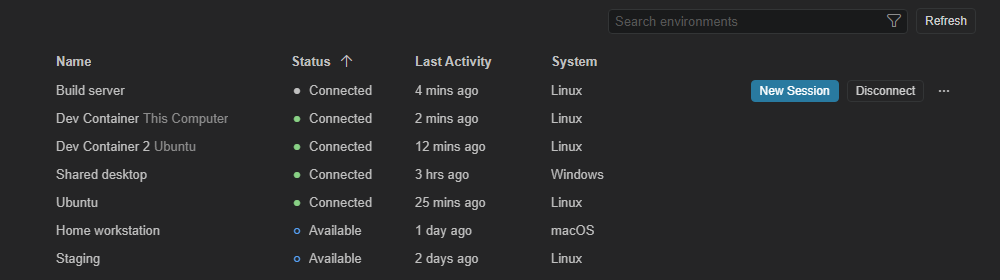
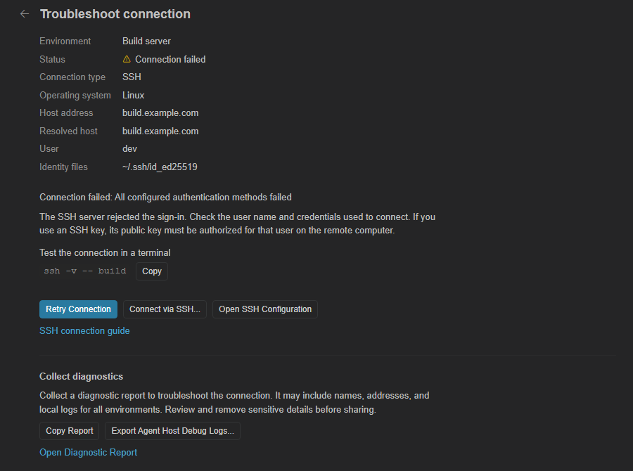
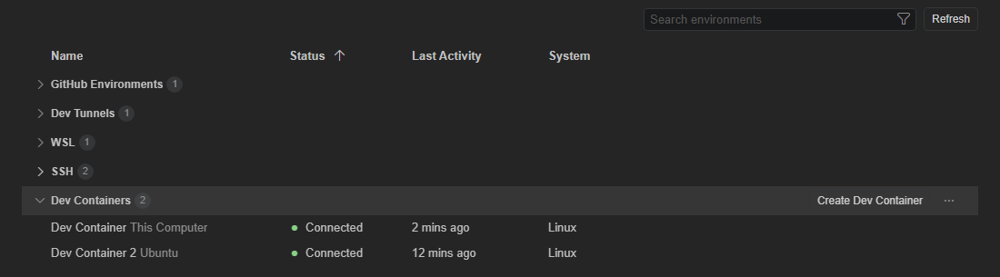
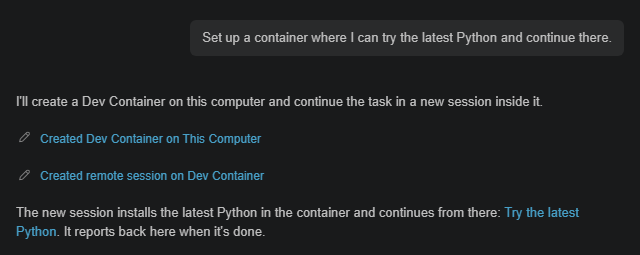
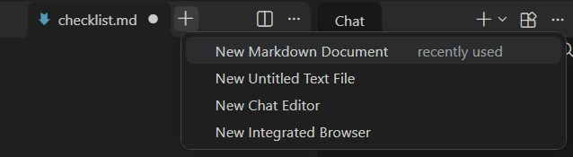
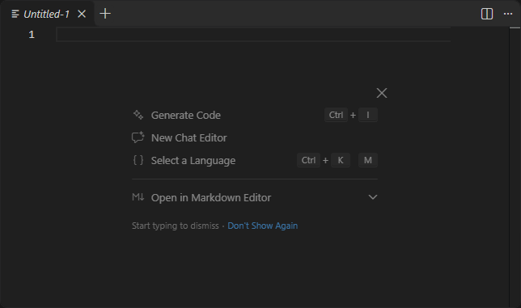
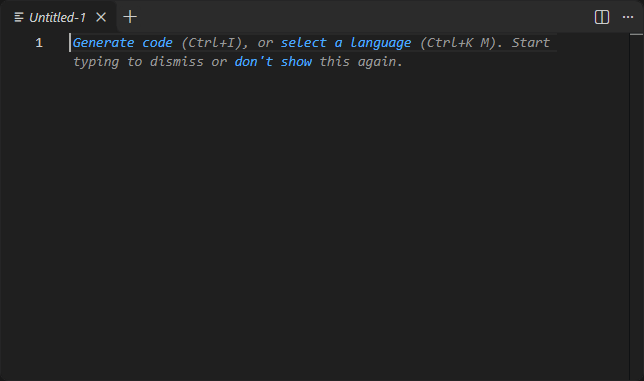

# Visual Studio Code 1.148

<!-- %IF IN_PRODUCT %
Follow us on [LinkedIn](https://www.linkedin.com/showcase/vs-code), [X](https://go.microsoft.com/fwlink/?LinkID=533687), [Bluesky](https://bsky.app/profile/vscode.dev), [Instagram](https://www.instagram.com/vscode) | [View online](https://code.visualstudio.com/updates)
%ENDIF % -->
<!-- %IF IN_WEB %

Release date: November 25, 2026 Stable

%ENDIF % -->
<!-- %IF IN_PRODUCT %
_Release date: November 25, 2026_
%ENDIF % -->

<!-- DOWNLOAD_LINKS_PLACEHOLDER -->

<!-- RELEASE_HIGHLIGHTS_START -->
## Release highlights

Keep agent work moving, even when you step away. This week, chat responses start faster and active agents can keep their hosts awake. Give a task its own Dev Container, and reclaim disk space from old worktrees without switching windows.

* [Keep agent work awake (Preview)](#keep-agent-work-awake-preview): Prevent idle sleep on supported hosts while agents work.

* [Worktree cleanup](#worktree-cleanup-in-editor-windows): Reclaim disk space from inactive agent worktrees in the Agents window or the editor.

* [Create Dev Containers (Experimental)](#create-dev-containers-for-agent-sessions-experimental): Give an agent an isolated Linux workspace, without writing a container configuration.

* [Agent chat performance](#improved-chat-performance): Spend less time waiting for Agent Host chat responses to begin.

<!-- Optional video: remove this block when no highlights video is available.
Before publishing, verify the media paths, add the actual duration to the summary,
and provide captions and a descriptive transcript for narrated content. -->
<!-- %IF HIGHLIGHTS_VIDEO %

  
Watch release highlights

  <video src="images/1_148/release-highlights.mp4" poster="images/1_148/release-highlights.webp" title="Video showing the highlights of VS Code 1.148." controls></video>

%ENDIF % -->
<!-- RELEASE_HIGHLIGHTS_END -->

<!-- %IF STABLE %

Already installed? Use <strong>Check for Updates</strong> in VS Code. For upcoming features, use the <a href="https://code.visualstudio.com/insiders">Insiders build</a>.

%ENDIF % -->

<!-- %IF IN_PRODUCT %
Happy Coding!

---
%ENDIF % -->

<!-- TOC

  <nav id="toc-nav">
    
In this update

    <ul>
      <li><a href="#release-highlights">Release highlights</a></li>
      <li><a href="#agents">Agents</a></li>
      <li><a href="#remote-agents">Remote agents</a></li>
      <li><a href="#mcp">MCP</a></li>
      <li><a href="#editor-experience">Editor Experience</a></li>
      <li><a href="#terminal">Terminal</a></li>
      <li><a href="#contributions-to-extensions">Contributions to extensions</a></li>
      <li><a href="#extension-authoring">Extension Authoring</a></li>
      <li><a href="#engineering">Engineering</a></li>
      <li><a href="#deprecated-features-and-settings">Deprecated features and settings</a></li>
      <li><a href="#notable-fixes">Notable fixes</a></li>
      <li><a href="#thank-you">Thank you</a></li>
    </ul>
  </nav>
  

Navigation End -->

## Agents

### Improved chat performance

This week we've made several improvements to the performance of chat in the Agent Host. On average you can expect to see responses begin 30% faster than in our previous Stable version.

We appreciate your feedback as we've transitioned our harness to the [Agent Host](https://code.visualstudio.com/docs/agents/concepts/agent-host), and the performance difference compared to the old harness was a recurring topic of discussion. With this release, we see chat start times within ~5% of the old harness, and we will continue to find ways to further improve in upcoming releases.

### Keep agent work awake (Preview)

**Setting**: `setting(sessions.keepAwakeWhileWorking)`

Avoid stalled unattended work when the machine running your agent would otherwise idle-sleep. A supported Agent Host can keep its machine awake during active turns, including after you close the window, and release the hold shortly after work ends.

Choose a mode:

* `whenPluggedIn` (default): Prevent idle sleep while the host is plugged in.
* `always`: Prevent idle sleep during agent work, including on battery.
* `never`: Allow idle sleep during agent work.

### Inbox navigation and organization (Experimental)

**Setting**: `setting(sessions.list.inboxAutoAdvance)`

[Inbox mode](https://code.visualstudio.com/docs/agents/run/sessions/organize-sessions#_triage-sessions-with-inbox-mode) groups Agents window sessions by what needs your attention. Enable `setting(sessions.list.inboxEnabled)` to use it.

You can choose where to continue after replying to an Inbox session:

* `auto` (default): Open the next Inbox conversation, or focus the Inbox heading when none remain. With a screen reader attached, stay in the current conversation instead.
* `on`: Always advance through the Inbox, including with a screen reader.
* `off`: Stay in the current conversation.
* `newSession`: Open **New Session** with its input focused, even when other Inbox conversations remain.

## Remote agents

### Redesigned Remote Environments editor

The Remote Environments editor in the Agents window is where you manage the machines that your agent sessions run on. Its redesigned table shows the status, last activity, and operating system of each environment, so you can see at a glance which ones are connected and in use.

**Connect** and **New Session** stay on each row, and other actions, such as configuring the agent run behavior or updating an outdated server, are in **More Actions**. Use **Filter** in the search box to sort the table, or to group environments by type or status.

### Troubleshoot remote connections

When a connection fails, it can be hard to tell whether the cause is your configuration, the network, or the remote machine. Select **Troubleshoot** in the notification of a failed connection, or **More Actions** > **Troubleshoot Connection...** on any environment, to open a page that explains what went wrong and offers actions to fix it, such as retrying, opening your SSH configuration, or restarting a WSL distribution. The page can also collect a diagnostic report for you to review and share.

Learn more about [troubleshooting remote sessions](https://code.visualstudio.com/docs/agents/run/remote-agent-sessions#_troubleshoot-remote-sessions).

### Worktree cleanup on remote hosts

Reclaim disk space on connected remote Agent Hosts with [worktree cleanup](https://code.visualstudio.com/docs/agents/run/sessions/manage-sessions#_clean-up-session-worktrees). The cleanup editor includes worktrees on hosts that support cleanup. Rows and confirmations identify the owning host, so identical paths on different machines remain distinct. Disconnected or unsupported hosts are unavailable for cleanup.

### Create Dev Containers for agent sessions (Experimental)

**Settings**: `setting(chat.agentHost.devContainer.environments.enabled)`, `setting(chat.agentHost.devContainer.handoff.enabled)`

Run agent sessions in an isolated Linux container without writing a Dev Container configuration first. These Dev Containers are Ubuntu containers with an Agent Host inside and keep their files in a Docker volume. You can create them on this computer, or on a connected SSH host, WSL distribution, or Dev Tunnel that has Docker.

In Remote Environments, select **Create Dev Container** in **More Actions** of a connected host. To create one on this computer, group the table by type (**Filter** > **Group By** > **Type**) and select **Create Dev Container** on the **Dev Containers** group. Then choose the Dev Container in the Environment picker to start a session in it.

When you also enable `setting(chat.agentHost.devContainer.handoff.enabled)`, an agent can create a Dev Container from an existing session, for example when you ask it to try something in an isolated environment. It creates the container on the host that the session runs on, and continues the task in a new session inside the container, which can report back when it's done.

### Sandbox profiles for remote environments (Experimental)

**Setting**: `setting(chat.agent.sandbox.profiles.enabled:true)`

When you use remote agent hosts, you might want different [sandbox](https://code.visualstudio.com/docs/agents/run/agent-sandboxing) rules for each host. For example, you might give a build server open network access but keep a shared machine locked down. Sandbox profiles let you save a set of agent sandbox settings under a name and assign one to each remote agent host.

Manage profiles with **Sandbox: Manage Sandbox Profiles**, and assign them to remotes in **Manage Remote Environments**. The assignment is stored on the remote, so every device that connects to it uses the same profile. Organization sandbox policies still apply, and the remote needs an up-to-date VS Code Server.

<video src="images/1_148/sandbox-profiles-2026112401.mp4" title="Video showing a GitHub Only sandbox profile being created, assigned to an Ubuntu remote in Remote Environments, and a new session on that remote running curl against github.com with the profile's sandbox policy." autoplay loop controls muted></video>

## MCP

### Support for fullscreen MCP Apps

MCP Apps now offer a "fullscreen" button, which moves the app into the editor area in the Editor window or the Secondary Side Bar in the Agents window.

## Editor Experience

### Set a default user agent for the integrated browser

**Setting**: `setting(workbench.browser.userAgent)`

You can now set the user agent the integrated browser uses. For example, set it in your workspace settings to test how your site responds to a particular user agent without changing it for your other projects.

### Sign in to sites that use HTTP Basic authentication

You can now sign in to sites that use HTTP Basic authentication in the integrated browser.

### Worktree cleanup in editor windows

Reclaim disk space from inactive agent worktrees without switching to the Agents window. Run **Chat: Open Worktree Cleanup** from the Command Palette or select **Open Worktree Cleanup** in the Chat view's menu.

Normal cleanup saves changes to branches and retains session history, but deletes ignored files in removed worktrees. Review your selection and confirm before proceeding.

Learn more about [worktree cleanup and its safety constraints](https://code.visualstudio.com/docs/agents/run/worktrees#_clean-up-session-worktrees).

### New tab button (Experimental)

**Setting**: `setting(workbench.editor.newTabButton)`

We are rolling out an experimental new-tab button in the editor tab bar via an experiment, or you can enable `setting(workbench.editor.newTabButton)` directly. Selecting **+** opens a menu to create an untitled text file, a Markdown document, a chat editor, or an integrated browser tab. The button remembers your last choice, so selecting **+** again creates the same kind of tab.

### Actions for new untitled files (Experimental)

**Setting**: `setting(workbench.editor.experimental.emptyEditorHintActions)`

We are rolling out a redesigned empty editor experience for new untitled files via an experiment, or you can enable `setting(workbench.editor.experimental.emptyEditorHintActions)` directly. A centered list of actions appears below line 1—generate code, start a chat editor, select a language, or reopen the file in another editor such as the Markdown editor—instead of clickable links inline on line 1. Moving the actions off line 1 causes fewer accidental clicks when you click into a new file to start typing. Start typing to dismiss the list. The list replaces the classic hint only when `setting(workbench.editor.empty.hint)` is set to `text`, which is the default.

| After | Before |
| --- | --- |
|  |  |

### Rust-based WebAssembly diff algorithm

**Setting**: `setting(diffEditor.diffAlgorithm)`

We are rolling out an experimental Rust-based diff algorithm compiled to WebAssembly (`@vscode/diff`) via an experiment. You can also try it directly by setting `setting(diffEditor.diffAlgorithm)` to `advanced-wasm`. In early rollout measurements, the WebAssembly backend computes diffs more than 2× faster at the median across all diffs, with noticeably fewer slow-tail timeouts. You may not notice the difference on a single small file, but it shows when reviewing multiple heavily modified files at once in the multi-file diff editor.

### Floating comment widget (Experimental)

**Settings**: `setting(comments.thread.experimental.style:floating)`, `setting(chat.experimental.agentsWindowEditorComments:true)`

A new floating comment widget can replace the inline comment widget that pushes code apart. Floating comments appear alongside your code, stay in the same order as the lines they refer to, and can be resized, expanded, and collapsed.

## Terminal

### Enter passwords for agent shell commands in chat

**Setting**: `setting(chat.agentHost.copilot.shellAuthentication.enabled)`

Previously, in [Copilot harness](https://code.visualstudio.com/docs/agents/run/agent-harnesses#_copilot) sessions, commands that needed a password, such as `sudo`, `ssh`, or `git`, failed because the agent runs commands without an interactive terminal by default.

When `sudo -A`, `ssh`, or `git` asks for a password, passphrase, or confirmation, the prompt now appears as a question in chat. Your answer goes only to that program and isn't sent to the model.

Prompts that nobody can answer, such as in Autopilot, are canceled. To turn off this behavior, set `setting(chat.agentHost.copilot.shellAuthentication.enabled)` to `false`.

## Contributions to extensions

## Extension Authoring

### Agent Host Protocol 1.1.0

We've released version 1.1.0 of the Agent Host Protocol, which is the protocol that powers our agent system and can be integrated with or hosted by your own tools. This version includes [many improvements](https://github.com/microsoft/agent-host-protocol/blob/main/CHANGELOG.md#110--2026-11-12), including:

* TCP port forwarding support and windowing mechanics for traffic control over networks
* The ability to move chats between sessions and per-chat harness selection
* Support for representing SEP-2640 Skills over MCP
* Support for partial reads and HTTPS interoperability

We also wrote [a blog post](https://github.blog/engineering/engineering-principles/building-the-agent-host-protocol-for-sessions-that-continue-across-devices/) about the background and engineering that went into the protocol and agent architecture.

## Engineering

### VS Code CLI is 40% Smaller

The Rust-based VS Code CLI is about 40% smaller, with slight variations per platform. The CLI can be downloaded as a standalone executable, and is also used to bootstrap Remote SSH connections, some WSL connections, and remote agent hosts from the Agents window. Users should see accordingly faster connection times and less resource usage.

## Deprecated features and settings

### New deprecations in this release

None

### Upcoming deprecations

* [The Local harness is deprecated](https://code.visualstudio.com/updates/v1_146#_copilot-harness-and-deprecation-of-the-local-harness) and will be removed in February 2027.

## Notable fixes

<!-- RELEASE_THANK_YOU_START -->
## Thank you

### Issue tracking

Contributions to our issue tracking:

* [@gjsjohnmurray (John Murray)](https://github.com/gjsjohnmurray)
* [@RedCMD (RedCMD)](https://github.com/RedCMD)
* [@IllusionMH (Andrii Dieiev)](https://github.com/IllusionMH)
* [@albertosantini (Alberto Santini)](https://github.com/albertosantini)

### Pull requests

Contributions to `vscode`:

* [@amv146 (Alex Vallone)](https://github.com/amv146): Fix configuration events when toggling tab focus mode [PR #345251](https://github.com/microsoft/vscode/pull/345251)
* [@ayushkrsingh946 (Ayush Kr Singh)](https://github.com/ayushkrsingh946): webview: skip load handlers when pending frame is unmounted (#344744) [PR #344773](https://github.com/microsoft/vscode/pull/344773)
* [@SimonSiefke (Simon Siefke)](https://github.com/SimonSiefke): fix: memory leak in menu hidden defaults [PR #348413](https://github.com/microsoft/vscode/pull/348413)

<!-- RELEASE_THANK_YOU_END -->
---

We really appreciate people trying our new features as soon as they are ready, so check back here often and learn what's new.

>If you'd like to read release notes for previous VS Code versions, go to [Updates](https://code.visualstudio.com/updates) on [code.visualstudio.com](https://code.visualstudio.com).

<a id="scroll-to-top" role="button" title="Scroll to top" aria-label="scroll to top" href="#"></a>
<link rel="stylesheet" type="text/css" href="css/inproduct_releasenotes.css"/>
