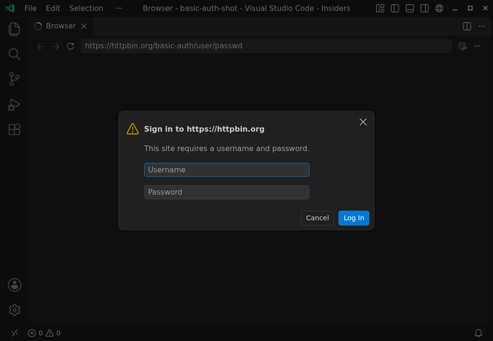

# Visual Studio Code 1.148

<!-- %IF IN_PRODUCT %
Follow us on [LinkedIn](https://www.linkedin.com/showcase/vs-code), [X](https://go.microsoft.com/fwlink/?LinkID=533687), [Bluesky](https://bsky.app/profile/vscode.dev), [Instagram](https://www.instagram.com/vscode) | [View online](https://code.visualstudio.com/updates)
%ENDIF % -->
<!-- %IF IN_WEB %

Release date: November 25, 2026 Stable

%ENDIF % -->
<!-- %IF IN_PRODUCT %
_Release date: November 25, 2026_
%ENDIF % -->

<!-- DOWNLOAD_LINKS_PLACEHOLDER -->

<!-- RELEASE_HIGHLIGHTS_START -->
## Release highlights

This release ... <TODO @ntrogh>

* [highlight](#bookmark): <highlight description, including availability or requirements when relevant>

<!-- Optional video: remove this block when no highlights video is available.
Before publishing, verify the media paths, add the actual duration to the summary,
and provide captions and a descriptive transcript for narrated content. -->
<!-- %IF HIGHLIGHTS_VIDEO %

  
Watch release highlights

  <video src="images/1_148/release-highlights.mp4" poster="images/1_148/release-highlights.webp" title="Video showing the highlights of VS Code 1.148." controls></video>

%ENDIF % -->
<!-- RELEASE_HIGHLIGHTS_END -->

<!-- %IF STABLE %

Already installed? Use <strong>Check for Updates</strong> in VS Code. For upcoming features, use the <a href="https://code.visualstudio.com/insiders">Insiders build</a>.

%ENDIF % -->

<!-- %IF IN_PRODUCT %
Happy Coding!

---
%ENDIF % -->

<!-- TOC

  <nav id="toc-nav">
    
In this update

    <ul>
      <li><a href="#release-highlights">Release highlights</a></li>
      <li><a href="#agents">Agents</a></li>
      <li><a href="#chat">Chat</a></li>
      <li><a href="#mcp">MCP</a></li>
      <li><a href="#accessibility">Accessibility</a></li>
      <li><a href="#editor-experience">Editor Experience</a></li>
      <li><a href="#code-editing">Code Editing</a></li>
      <li><a href="#notebooks">Notebooks</a></li>
      <li><a href="#source-control">Source Control</a></li>
      <li><a href="#debugging">Debugging</a></li>
      <li><a href="#tasks">Tasks</a></li>
      <li><a href="#terminal">Terminal</a></li>
      <li><a href="#authentication">Authentication</a></li>
      <li><a href="#languages">Languages</a></li>
      <li><a href="#remote-development">Remote Development</a></li>
      <li><a href="#contributions-to-extensions">Contributions to extensions</a></li>
      <li><a href="#extension-authoring">Extension Authoring</a></li>
      <li><a href="#proposed-apis">Proposed APIs</a></li>
      <li><a href="#engineering">Engineering</a></li>
      <li><a href="#deprecated-features-and-settings">Deprecated features and settings</a></li>
      <li><a href="#notable-fixes">Notable fixes</a></li>
      <li><a href="#thank-you">Thank you</a></li>
    </ul>
  </nav>
  

Navigation End -->

## Agents

### Inbox navigation and organization (Experimental)

**Setting**: `setting(sessions.list.inboxAutoAdvance)`

[Inbox mode](https://code.visualstudio.com/docs/agents/run/sessions/organize-sessions#_triage-sessions-with-inbox-mode) groups Agents window sessions by what needs your attention. Enable `setting(sessions.list.inboxEnabled)` to use it.

You can choose where to continue after replying to an Inbox session:

* `auto` (default): Open the next Inbox conversation, or focus the Inbox heading when none remain. With a screen reader attached, stay in the current conversation instead.
* `on`: Always advance through the Inbox, including with a screen reader.
* `off`: Stay in the current conversation.
* `newSession`: Open **New Session** with its input focused, even when other Inbox conversations remain.

### Keep agent work awake (Preview)

**Setting**: `setting(sessions.keepAwakeWhileWorking)`

Avoid stalled unattended work when the machine running your agent would otherwise idle-sleep. A supported Agent Host can keep its machine awake during active turns, including after you close the window, and release the hold shortly after work ends.

Choose a mode:

* `whenPluggedIn` (default): Prevent idle sleep while the host is plugged in.
* `always`: Prevent idle sleep during agent work, including on battery.
* `never`: Allow idle sleep during agent work.

## Chat

## MCP

## Accessibility

## Editor Experience

### Set a default user agent for the integrated browser

**Setting**: `setting(workbench.browser.userAgent)`

You can now set the user agent the integrated browser uses. For example, set it in your workspace settings to test how your site responds to a particular user agent without changing it for your other projects.

### Sign in to sites that use HTTP Basic authentication

You can now sign in to sites that use HTTP Basic authentication in the integrated browser.

### Worktree cleanup in editor windows

Reclaim disk space from inactive agent worktrees without switching to the Agents window. Run **Chat: Open Worktree Cleanup** from the Command Palette or select **Open Worktree Cleanup** in the Chat view's menu.

Normal cleanup saves changes to branches and retains session history, but deletes ignored files in removed worktrees. Review your selection and confirm before proceeding. Learn more about [worktree cleanup and its safety constraints](https://code.visualstudio.com/docs/agents/run/sessions/manage-sessions#_clean-up-session-worktrees).

## Code Editing

## Notebooks

## Source Control

## Debugging

## Tasks

## Terminal

### Enter passwords for agent shell commands in chat

**Setting**: `setting(chat.agentHost.copilot.shellAuthentication.enabled)`

Previously, in [Copilot harness](https://code.visualstudio.com/docs/agents/run/agent-harnesses#_copilot) sessions, commands that needed a password, such as `sudo`, `ssh`, or `git`, failed because the agent runs commands without an interactive terminal by default.

When `sudo -A`, `ssh`, or `git` asks for a password, passphrase, or confirmation, the prompt now appears as a question in chat. Your answer goes only to that program and isn't sent to the model.

Prompts that nobody can answer, such as in Autopilot, are canceled. To turn off this behavior, set `setting(chat.agentHost.copilot.shellAuthentication.enabled)` to `false`.

## Authentication

## Languages

## Remote Development

The [Remote Development extensions](https://marketplace.visualstudio.com/items?itemName=ms-vscode-remote.vscode-remote-extensionpack), allow you to use a [Dev Container](https://code.visualstudio.com/docs/devcontainers/containers), remote machine via SSH or [Remote Tunnels](https://code.visualstudio.com/docs/remote/tunnels), or the [Windows Subsystem for Linux](https://learn.microsoft.com/windows/wsl) (WSL) as a full-featured development environment.

Highlights include:

* TODO: @ntrogh

You can learn more about these features in the [Remote Development release notes](https://github.com/microsoft/vscode-docs/blob/main/remote-release-notes/v1_148.md).

### Worktree cleanup on remote hosts

Reclaim disk space on connected remote Agent Hosts with [worktree cleanup](https://code.visualstudio.com/docs/agents/run/sessions/manage-sessions#_clean-up-session-worktrees). The cleanup editor includes worktrees on hosts that support cleanup. Rows and confirmations identify the owning host, so identical paths on different machines remain distinct. Disconnected or unsupported hosts are unavailable for cleanup.

## Contributions to extensions

## Extension Authoring

## Proposed APIs

## Engineering

## Deprecated features and settings

### New deprecations in this release

### Upcoming deprecations

## Notable fixes

<!-- RELEASE_THANK_YOU_START -->
## Thank you

<!-- RELEASE_THANK_YOU_END -->
---

We really appreciate people trying our new features as soon as they are ready, so check back here often and learn what's new.

>If you'd like to read release notes for previous VS Code versions, go to [Updates](https://code.visualstudio.com/updates) on [code.visualstudio.com](https://code.visualstudio.com).

<a id="scroll-to-top" role="button" title="Scroll to top" aria-label="scroll to top" href="#"></a>
<link rel="stylesheet" type="text/css" href="css/inproduct_releasenotes.css"/>
