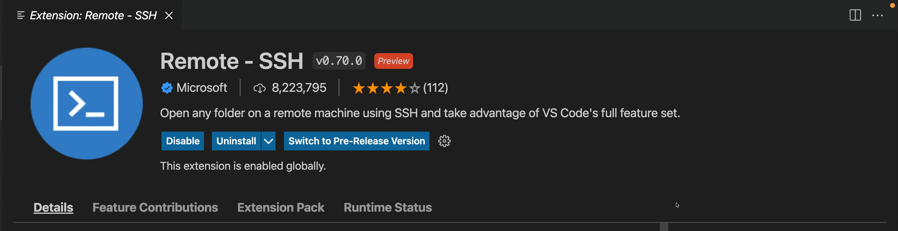
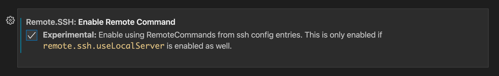

# January 2022 (version 1.64)

## Containers (version 0.217.x)

### Always run feature entrypoints

Container features can now run their own entrypoint, for example, to start a daemon process like `sshd`, or when you choose to not override your container's entrypoint (`"overrideCommand": false` in the devcontainer.json, which is the default for Docker Compose).

### Container definition documentation links

Container definitions now have an inline action to open documentation on the definition in the browser.

### Pre-release versions

The Dev Containers extension now supports the pre-release extension model, making it possible to switch between release and pre-release versions.

## SSH (version 0.74.x)

### Pre-release version

The Remote-SSH extension has adopted the pre-release extension model so anyone can switch between the stable release of the extension, released alongside each stable release of VS Code, and the pre-release version, which is released every day with the latest features and fixes.

### Enable RemoteCommand

You can now use RemoteCommands defined in your SSH configuration entries. To enable this, set `remote.SSH.useLocalServer` and `remote.SSH.enableRemoteCommand` to `true`. Only commands that leave the shell open work properly. If you test the same connection in your shell and the command runs on the remote before the connection immediately closes, that command won't work with the Remote-SSH extension.

## WSL (version 0.64.x)

The WSL extension now also supports Alpine distros running on ARM64.
